<div align="center">

<picture>
  <source media="(prefers-color-scheme: dark)" srcset="docs/img/hero-dark.png">
  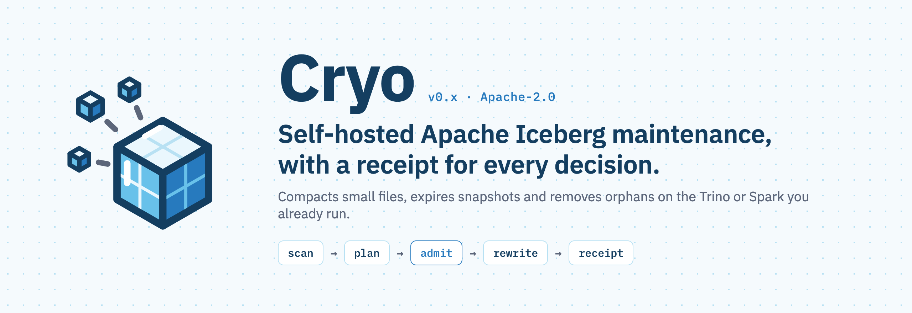
</picture>

[](https://github.com/tech-pw/cryo/actions/workflows/ci.yml) [](./LICENSE) [](./docs/VERSIONING.md)   [](https://tech-pw.github.io/cryo/)

**[Docs](https://tech-pw.github.io/cryo/)** · **[Quickstart](https://tech-pw.github.io/cryo/quickstart/)** · **[Architecture](./hld.md)** · **[What ships today](./docs/CAPABILITIES.md)** · **[Contributing](./CONTRIBUTING.md)**

</div>

---

## What is Cryo?

Apache Iceberg tables decay quietly. Every streaming write and every small batch leaves another
tiny Parquet file. Snapshots pile up. Failed jobs leave orphan files that nothing references but
everyone still pays to store. Queries get slower, and the S3 bill gets bigger.

<picture>
  <source media="(prefers-color-scheme: dark)" srcset="docs/img/table-decay-dark.png">
  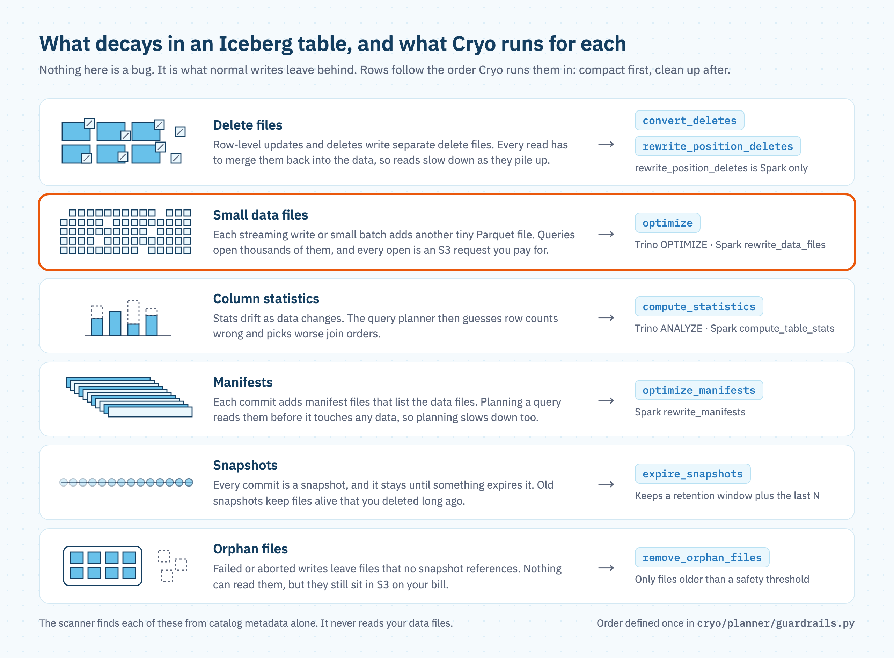
</picture>

Most teams fight this with an Airflow DAG that computes stats, a second DAG that shells out to
per-table dbt runs, and a set of macros holding the real logic. None of it shares state, none of
it has a UI, and running maintenance on one table right now means hand-editing a macro and hoping
the flags are right.

**Cryo is that whole pile, as one product you run yourself.** It scans every table in your lake,
grades it A to F, works out what maintenance would cost and save, and runs that maintenance on the
Trino or Spark you already have. It only starts work when those engines have room, and it writes
down everything it did.

> *Fresh snow lands as loose grains. Under steady pressure it packs into solid ice. Cryo is that
> pressure for your lake: applied on schedule, only when your engines have headroom, and logged
> every time.*

<p align="center">
  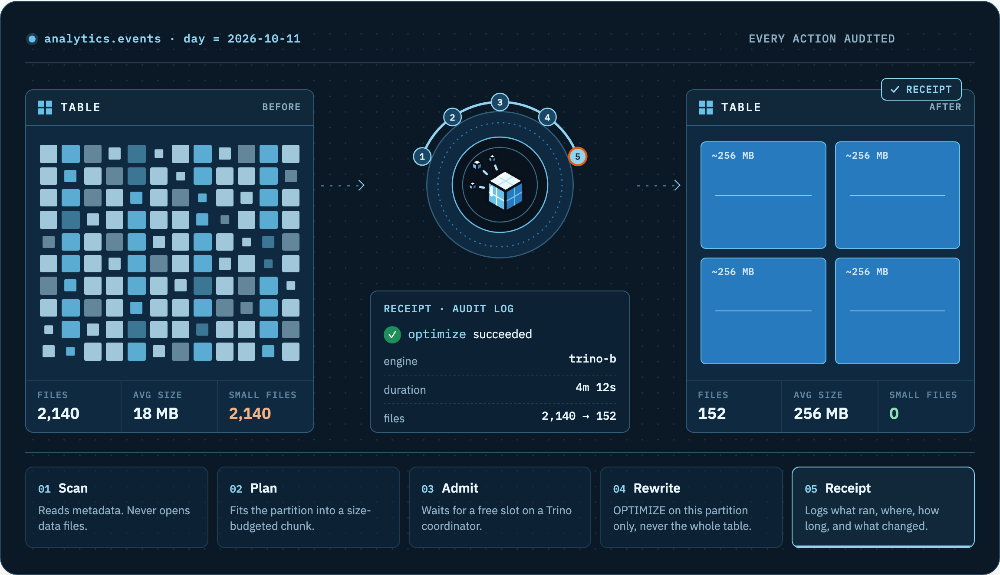
</p>

## Why Cryo

- **One scan, one source of truth.** The scanner reads catalog metadata, not your data files. It
  produces per-table and per-partition stats, an A–F health grade, and an S3 cost estimate. The
  planner, dashboards and alerts all read the same numbers.
- **Partition-aware, so Trino survives.** The planner works from stored scan data, never live
  `$files` reads. It budgets each chunk in GB and caps partitions per chunk, so it never sends the
  full-table `OPTIMIZE` that takes a cluster down.
- **Load-aware admission.** The governor reads live engine load (Trino `system.runtime.queries`)
  before it admits a job. Adding workers does not add parallel rewrites; engine headroom decides
  concurrency.
- **The planner contains no SQL.** It emits operations and partition predicates. Trino and Spark
  each have their own renderer, with golden tests, so neither dialect leaks into the other.
- **Compact first, clean up after.** Seven operations run in one fixed order, so a single run
  reclaims the space its own compaction freed.
- **Every action leaves a receipt.** Table, operation, engine, status, duration and actor go to the
  audit log, whether the run succeeded, failed or was deferred.
- **Your lake stays yours.** Apache 2.0, self-hosted on Kubernetes. Telemetry and data stay on
  your infrastructure.

## See it

<picture>
  <source media="(prefers-color-scheme: dark)" srcset="site/assets/img/screens/health-dark.png">
  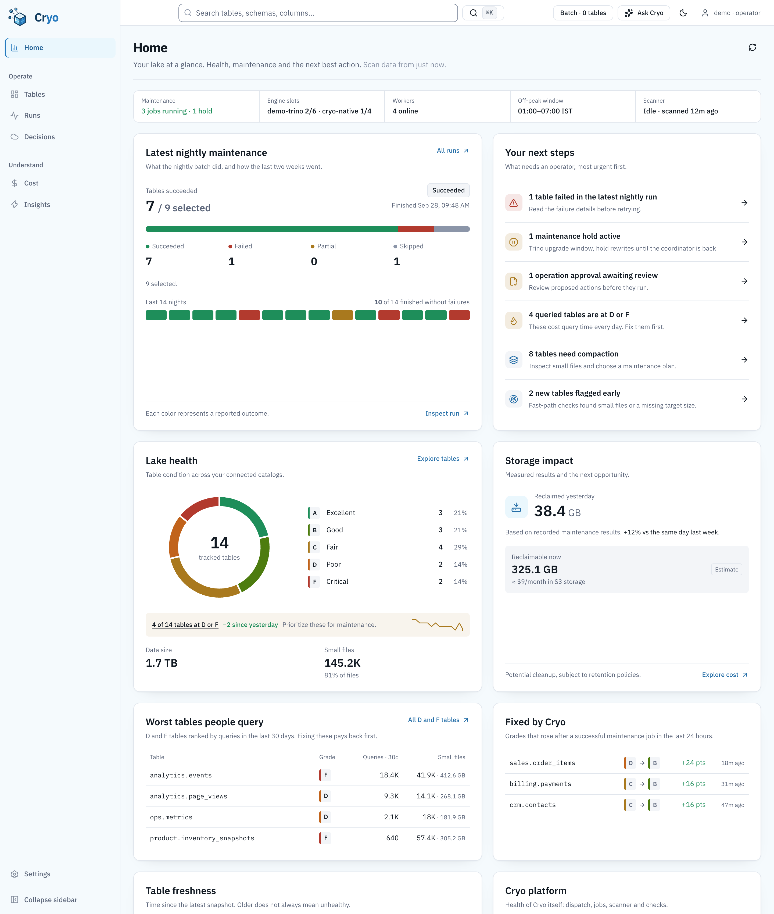
</picture>

<table>
  <tr>
    <td width="50%">
      <picture>
        <source media="(prefers-color-scheme: dark)" srcset="site/assets/img/screens/tables-dark.png">
        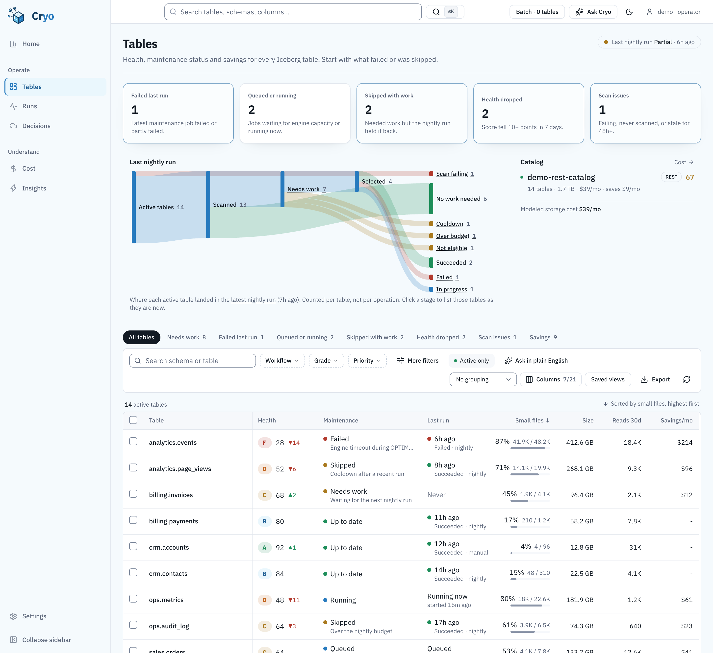
      </picture>
      <p align="center"><b>Explore the fleet.</b> Filter by grade, size or small-file share, then select every match and assign a preset.</p>
    </td>
    <td width="50%">
      <picture>
        <source media="(prefers-color-scheme: dark)" srcset="site/assets/img/screens/run-detail-dark.png">
        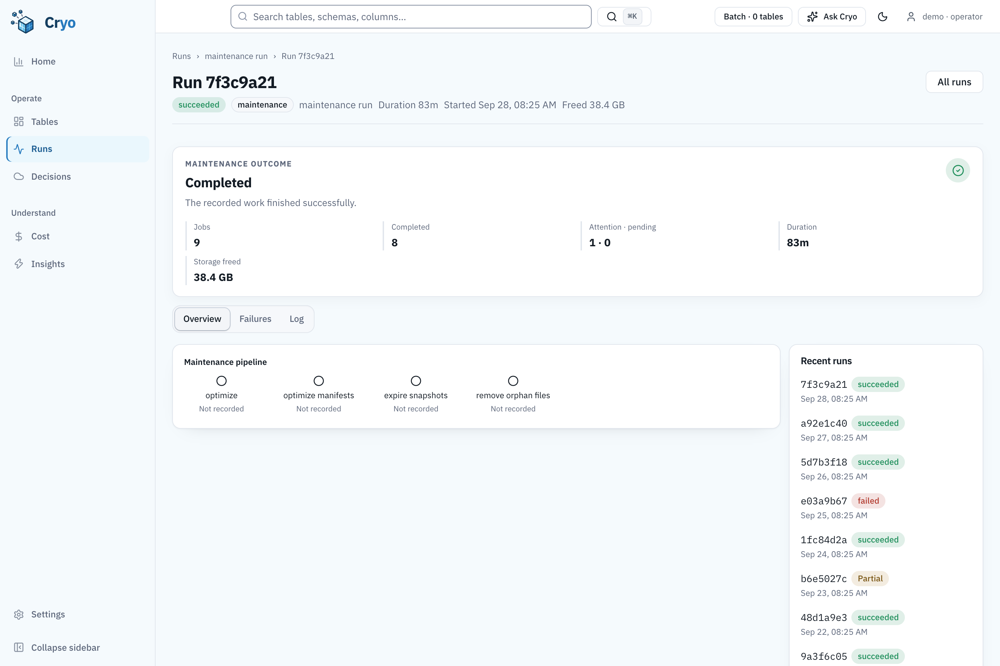
      </picture>
      <p align="center"><b>Debug a run.</b> Outcome, every job, storage freed, and when each table ran.</p>
    </td>
  </tr>
  <tr>
    <td width="50%">
      <picture>
        <source media="(prefers-color-scheme: dark)" srcset="site/assets/img/screens/table-detail-dark.png">
        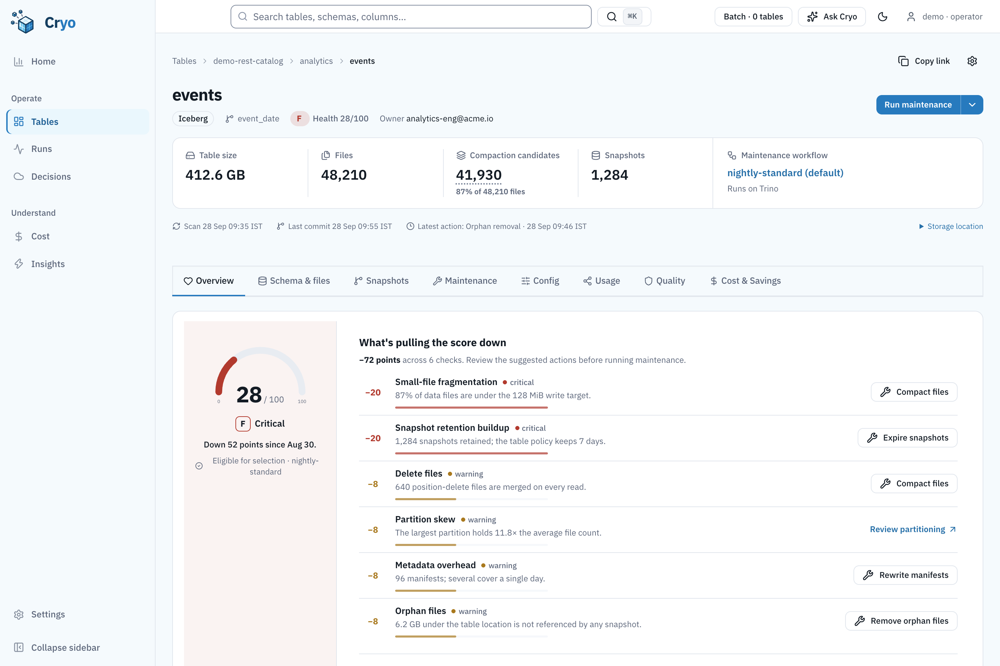
      </picture>
      <p align="center"><b>Read one table.</b> Why it got its grade, what maintenance would do, and what already ran.</p>
    </td>
    <td width="50%">
      <picture>
        <source media="(prefers-color-scheme: dark)" srcset="site/assets/img/screens/connections-dark.png">
        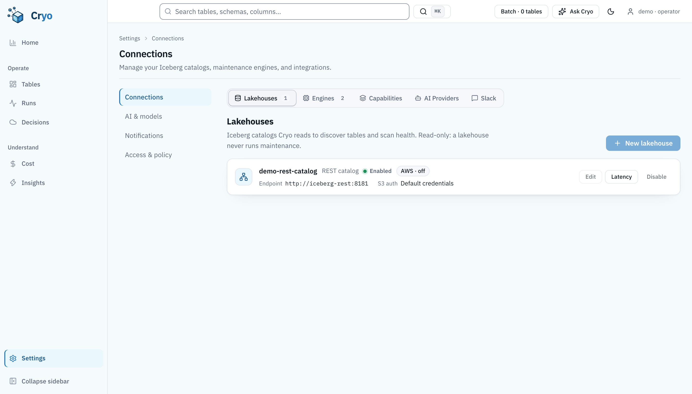
      </picture>
      <p align="center"><b>Connect once.</b> Catalogs you read from and engines you write through are set up separately.</p>
    </td>
  </tr>
</table>

<sub>Screenshots are the real web UI on synthetic demo data, captured with
<code>web/e2e/docs-capture</code>. No numbers in them come from a deployment.</sub>

## How it works

<picture>
  <source media="(prefers-color-scheme: dark)" srcset="docs/img/architecture-dark.png">
  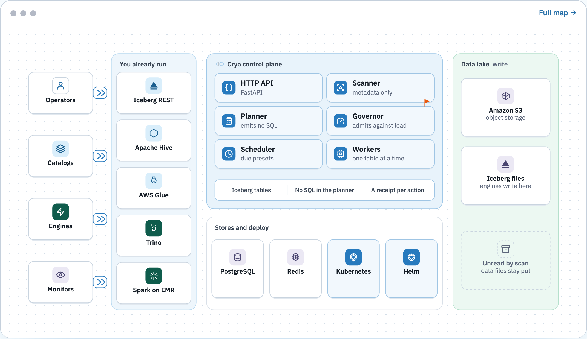
</picture>

A table is **discovered** from a source (a catalog Cryo reads) and **maintained** on a destination
(an engine Cryo writes through). The two never share a code path, a config or a database table.

1. **Scanner** reads catalog metadata into PostgreSQL: stats, grade, cost.
2. **Scheduler** finds the presets that are due and enqueues jobs.
3. **Governor** probes live engine load and admits a job only when there's room.
4. **Worker** asks the **planner** for a partition-aware plan, renders it for Trino or Spark,
   and executes it, one table at a time, under a per-table lock.
5. **Audit log** records the result. A failure on one table never fails the run.

### Scan: every table gets a grade

The scanner reads catalog metadata, never data files, and scores each table against 14 checks. The
grade isn't a black box: every point lost comes with its reason and the operation that wins it back.

<picture>
  <source media="(prefers-color-scheme: dark)" srcset="docs/img/health-grade-dark.png">
  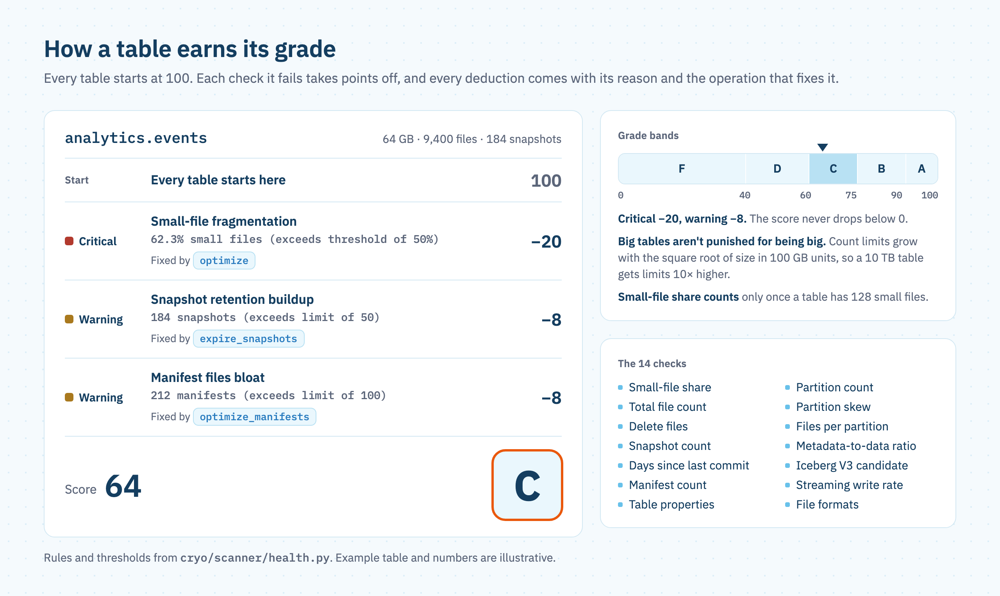
</picture>

### Plan: partition by partition, never the whole table

The planner ranks partitions by small-file count from the stored scan, drops the ones that aren't
worth rewriting, and packs the rest into chunks under a GB budget. One oversized partition runs on
its own. The plan holds partition predicates, not SQL; each engine renders its own dialect.

<picture>
  <source media="(prefers-color-scheme: dark)" srcset="docs/img/planner-chunks-dark.png">
  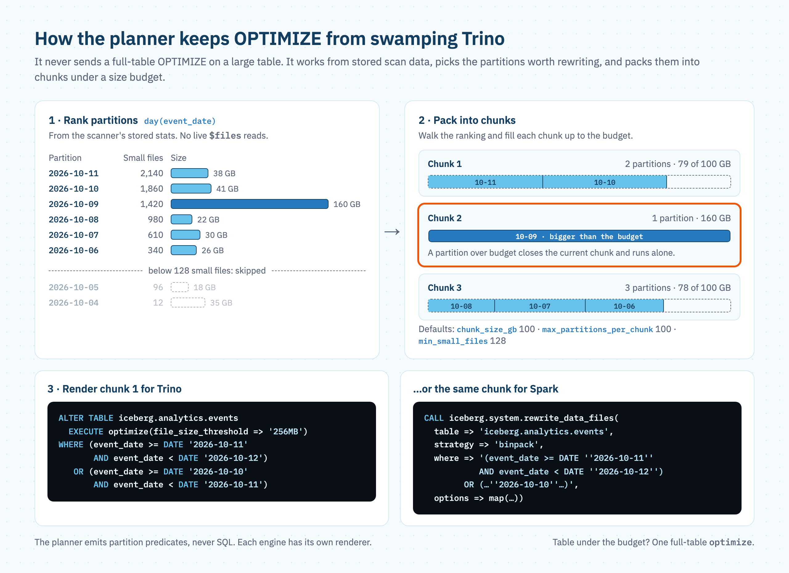
</picture>

### Admit: only when the engine has room

Workers don't grab work on their own. The governor checks each job, then counts the rewrites
already running on each Trino coordinator and admits work only into free slots. That's why adding
workers never adds parallel `OPTIMIZE`s.

<picture>
  <source media="(prefers-color-scheme: dark)" srcset="docs/img/governor-admission-dark.png">
  
</picture>

### Rewrite and record

<table>
  <tr>
    <td width="50%" valign="top">
      <b>Compact first, then clean up.</b> The order is defined once, in
      <code>cryo/planner/guardrails.py</code>.
      <code>convert_equality_deletes</code> is opt-in and currently blocked on every
      engine: it must replace equality deletes with position deletes without rewriting
      data files, and no Trino or Spark procedure does that.<br><br>
      <picture>
        <source media="(prefers-color-scheme: dark)" srcset="docs/img/operation-order-dark.png">
        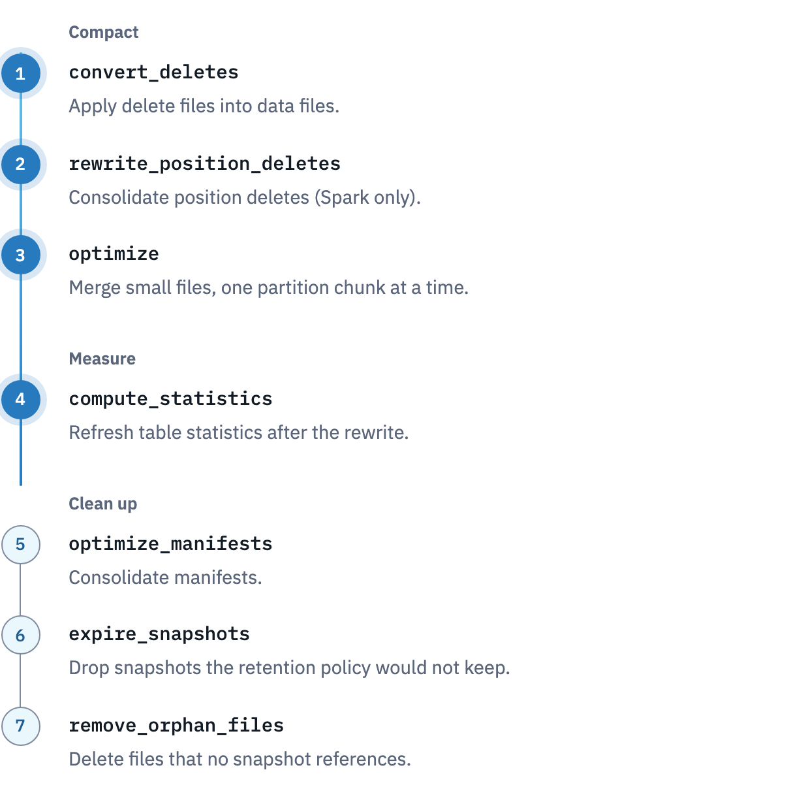
      </picture>
    </td>
    <td width="50%" valign="top">
      <b>Every decision is written down</b>, including the ones Cryo chose not to make.<br><br>
      <picture>
        <source media="(prefers-color-scheme: dark)" srcset="docs/img/receipts-dark.png">
        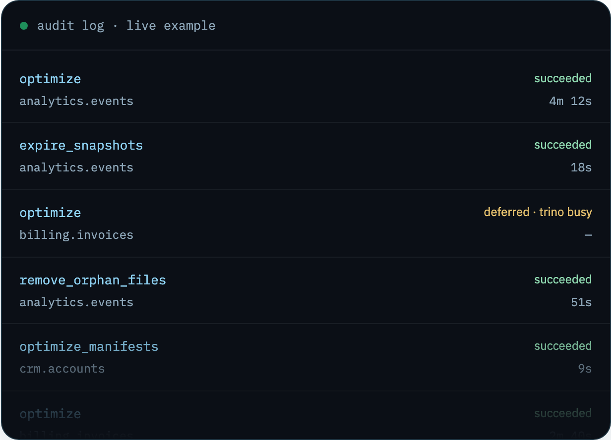
      </picture>
    </td>
  </tr>
</table>

Full component map and data flow: [`hld.md`](./hld.md). Schemas, interfaces and the planner
algorithm: [`lld.md`](./lld.md).

## Quick start

You need Docker, Python 3.12+, Node 22+ and curl.

```bash
git clone https://github.com/tech-pw/cryo.git
cd cryo
./start-local.sh start
```

Open **http://localhost:5173** and sign in with a role (`viewer`, `operator` or `admin`).
`./start-local.sh` runs the database migrations; `make up` on its own does not.

```bash
curl -s http://localhost:8000/healthz   # liveness only; does not touch Postgres
```

The UI starts empty. `make seed` writes five small Iceberg tables, but it doesn't register a
source, scan or enqueue maintenance, and it needs host PySpark. The
[illustrated quickstart](https://tech-pw.github.io/cryo/quickstart/) walks through the rest.

> [!WARNING]
> The chart default `CRYO_ENVIRONMENT=dev` leaves `POST /api/v1/auth/token` open, so anyone who can
> reach the API can issue themselves a role. In production, set `CRYO_ENVIRONMENT=prod`, keep the
> dev token off, and configure OIDC before the API is reachable. OIDC alone does not close the dev
> token. See [SECURITY.md](./SECURITY.md).

## Status

> [!NOTE]
> Cryo is **pre-1.0** (`v0.x` SemVer, see [`docs/VERSIONING.md`](./docs/VERSIONING.md)). The core
> maintenance path is real and tested: scanner, health grading, planner, governor, the Trino and
> Spark engines, presets and assignment, bulk runs, the audit log, the run console, and JWT/OIDC
> auth. The AI, FinOps, tiering and anomaly surfaces are partial and only fill in once query-log
> ingestion is on. [`docs/CAPABILITIES.md`](./docs/CAPABILITIES.md) lists exactly what each engine
> can do today.

| Engine | Maturity | What it does |
|---|---|---|
| **Trino** | GA | Iceberg maintenance through Trino SQL procedures |
| **Spark / EMR** | GA | The full surface through Iceberg Spark procedures |
| **Native (Go)** | Beta | Low-overhead compaction for simple table shapes, with SQL fallbacks |
| **Flink** | Experimental | Generates Flink job config; Cryo does not submit it |

Catalogs: Iceberg REST, Apache Polaris, Project Nessie, Hive Metastore and AWS Glue. Unity
Catalog and JDBC catalogs are rejected.

<details>
<summary><b>Who this isn't for (yet)</b></summary>

- **Multi-tenant SaaS operators.** Tenant isolation is opt-in
  (`Settings.enforce_tenant_isolation`), not the default. Run one instance per customer until
  that changes.
- **Flink-first streaming shops.** The Flink engine generates config only and does not submit
  jobs (see the `cryo/engines/flink/engine.py` docstring).
- **Teams that want a zero-config managed product.** You operate this: Kubernetes, Postgres,
  Redis and an Iceberg catalog.
- **Anyone who needs an unattended native compactor.** The native path (`engine-go/`,
  `CRYO_ENGINE_IMPL=go`) is beta. Use Trino or Spark unless native Go is explicitly configured.
- **Anyone expecting full AI / FinOps / tiering / anomaly dashboards on day one.** They need
  query-log ingestion (`Settings` → `telemetry_*`). Until then, expect empty charts, not broken
  ones.

</details>

## Features

<details>
<summary><b>Maintenance</b>: sources, engines, planner, governor, presets</summary>

- **Sources (read)** connect Iceberg catalogs (REST, Hive Metastore, Glue, Apache Polaris and
  Project Nessie) and discover tables through PyIceberg, configured separately from write engines.
- **Destinations (write)** submit maintenance to **Trino**, **Spark on EMR**, or the **native Go**
  compactor when it is enabled. Each SQL engine has its own renderer.
- **Planner** walks pre-computed scan data, GB-budgets chunks, caps partitions per chunk to avoid
  Trino `FilterNode` blowups, runs oversize partitions alone, bypasses chunking for small tables,
  and applies cooldowns, off-peak windows, adaptive budgets and deadlines.
- **Governor** is the global admission controller. It reads Trino `system.runtime.queries` to
  bound real concurrency, applies per-replica caps with round-robin, and tunes thresholds per
  destination with a contextual-bandit policy.
- **Presets** bind *operations + params + target engine + schedule + selection rules* into a named
  profile, such as `spark-large`: "tables over 100 GB → Spark/EMR, deep maintenance weekly".
- **Assignment** filters the fleet by schema, size, small-file ratio, grade or drift, selects every
  match across pages (as a filter, not a list of IDs), and assigns a preset in one action. Rule-based
  auto-matching handles the rest, with manual override.

</details>

<details>
<summary><b>Health and observability</b>: grades, dashboards, anomalies, cost</summary>

- **Scanner** runs chunked, resumable scans and produces per-table and per-partition stats, an
  A–F grade (WARN −8, CRIT −20), a `needs_compaction` priority and an S3 cost estimate.
- **Dashboards** cover datalake and per-table health, audit timelines, drift and cost alerts,
  scheduled email and Slack summaries, and a WebSocket live run console.
- **Anomaly detection** watches null rate, size, file count and small-file ratio for drift, with
  history for baselines.
- **AWS cost and inventory** (opt-in) pulls S3 size and object counts from CloudWatch and CUR or
  inventory feeds, so storage spend is quoted from real numbers.
- **Owner and consumer alerts**: tables carry an owner and subscribers, and SLA or data-quality
  breaches email (and optionally Slack) the people who would notice.

</details>

<details>
<summary><b>Operations and security</b>: leader election, locks, audit, auth</summary>

- **Scheduler, governor and workers** are separate, leader-elected Kubernetes deployments.
  Scaling workers does not scale parallel `OPTIMIZE`s.
- **Per-table locks** prevent double maintenance. **Failure isolation** keeps one bad table from
  failing a run; it shows up in the audit log and the failed-tables panel, with its
  `consecutive_scan_failures` streak and last error.
- **Audit log** records table, action, status, detail, engine, duration, file counts and actor.
- **Auth** is a signed JWT with the roles `evidence_collector`, `viewer`, `operator` and `admin`
  (`editor` is an alias of `operator`). Production uses OIDC; see the warning under
  [Quick start](#quick-start).

</details>

## How it compares

Cryo is a self-hosted control plane over engines you already own. It is not a managed platform,
and it does not bring its own compute.

| | Cryo | DIY (Airflow + dbt) | Apache Amoro | LakeOps | Managed clouds |
|---|---|---|---|---|---|
| Deployment | Self-hosted (Kubernetes) | Hand-rolled | Self-hosted | SaaS | Fully managed |
| Engines | Trino, Spark/EMR, native Go (beta) | Whatever you wired | Own optimizers (local, Kubernetes, Flink, Spark, external). Trino is query-only | Own Rust engine | Locked to platform |
| Load-aware admission | Yes, live engine load | If you built it | No (quota and optimizer groups) | Yes | N/A |
| A–F health grade + cost projection | Built in | Usually a script | Numeric score only; no A–F grade or cost projection | Partial | Varies |
| Data leaves your infra | No | No | No | Telemetry does | Yes |
| Cost | Free | Free, you own it all | Free | Paid | Usage-based |

<details>
<summary><b>Full comparison, including Granica Crunch, and the fine print</b></summary>

| | Cryo | DIY (Airflow + dbt) | Apache Amoro | LakeOps | Granica Crunch | Managed cloud (Databricks / S3 Tables / Snowflake) |
|---|---|---|---|---|---|---|
| Deployment | Self-hosted (Kubernetes) | Self-hosted, hand-rolled | Self-hosted | SaaS | SaaS, hybrid, or on-prem/air-gapped | Fully managed |
| Engines | Trino, Spark/EMR, and a beta native Go compactor | Whatever you wired up | Own optimizer processes (local, Kubernetes, Flink, Spark, external). Trino is query-only. Mixed-Iceberg is a format, not an engine | Own Rust engine + telemetry from Trino/Spark/Snowflake/DuckDB/Flink | Own engine; coexists with Trino/Spark/Airflow/dbt | Locked to the platform |
| Table formats | Iceberg | Whatever you wired up | Iceberg, Mixed-Iceberg | Iceberg, Delta | Iceberg, Delta, Hive | Varies by platform |
| Maintenance ops (compaction, snapshot expiry, orphan cleanup) | Yes | Only if you built it | Yes | Yes | Yes | Yes |
| Sorting / curve clustering | Sort + Z-order (Spark only; Hilbert capability-gated) | Only if you built it | Partial: honours table sort order; no Z-order | Yes | Sort, Z-order, Hilbert | Varies by platform |
| Parquet re-compression below ZSTD | No; reports measured codec/level gains instead | No | No | No | Yes, its core differentiator | No |
| Load-aware admission control | Yes, reads live engine load before admitting work | Only if you built it | No. Quota and optimizer groups, not live engine load | Yes | Not documented | N/A (fully managed) |
| Table health grading (A–F) + cost projection | Yes, built in | No, usually a one-off script | Numeric health score (small-file, equality-delete, position-delete). No A–F grade, no cost projection | Partial | Savings-focused, not a fleet health grade | Varies by platform |
| Data leaves your infra | No | No | No | Yes, telemetry goes to LakeOps | Depends on tier: hybrid sends metadata; on-prem sends nothing | Yes, data lives on the platform |
| UI for fleet-wide assignment | Yes | No | Limited | Yes | Yes | Yes |
| Cost | Free, self-hosted | Free, but you build and own everything | Free, self-hosted | Paid SaaS | Commercial, outcome-based pricing | Usage-based, platform lock-in |

Cryo sits where **LakeOps** does, as a dedicated control plane rather than a managed platform, but
keeps telemetry on your infrastructure and treats Trino as a first-class engine. Against **Apache
Amoro**, Cryo is lighter to operate (no optimizer fleet, no Mixed-Iceberg coupling) and maintains
through the Trino or Spark you already run. Amoro never maintains a table via Trino. Maintenance
runs on Amoro's own optimizer processes. Cryo's committed Helm defaults request 3.35 CPU cores and 6.00 GiB of
memory at idle across the always-on control plane; reproduce it with `make deployment-footprint`,
which reads `deploy/helm/cryo/values.yaml` live. No document here cites an Amoro figure, so none is
compared (see `scripts/deployment_footprint.py` to add one honestly). Against the managed clouds
(Databricks Predictive Optimization, AWS S3 Tables, Snowflake), Cryo is for teams who aren't
consolidating onto one vendor's compute.

**Granica Crunch** is the closest commercial product on operations, across more formats (Delta,
Hive) and catalogs (Unity, Polaris, BigLake). Crunch's differentiator is compression: it rewrites
Parquet smaller than ZSTD alone, which Cryo does not attempt. Cryo optimizes file *layout* and
submits SQL to your Trino or Spark. Choose Crunch if storage-byte reduction is the goal; choose
Cryo for a free, self-hosted control plane with fleet-wide grading and load-aware admission.

Two qualifications. Curve clustering runs on **Spark only**, because Trino's `OPTIMIZE` binpacks
and has no sort rewrite, and Hilbert needs Iceberg 1.12.0 on Spark 4.1, so it falls back to Z-order
elsewhere. On compression, Cryo reports what a measured codec or level change is worth on *your*
table: for a table already on ZSTD-3 with sensible row groups, the cheap residual is roughly
3–12%. Granica's published 20–50% rests on one public datapoint (TPC-DS `store_sales`, 418 GiB
across 301,949 files averaging ~1.45 MB) that changes file size, row-group size, sort order and
encoding together, so it can't be credited to a codec alone. Neither vendor publishes a
reproducible benchmark; Cryo's inputs are in [CryoBench](./docs/CRYOBENCH.md).

Amoro cells were checked against `apache/amoro` commit `6d3cd42` (2026-10-17). The latest
release then was v0.8.1-incubating (2025-09-11). `dynamic-allocation.*` is on `main` and the
latest docs, not part of that release.

- Engines: [Managing Optimizers](https://amoro.apache.org/docs/latest/managing-optimizers/) —
  containers `local`, `kubernetes`, `flink`, `spark`, `external`.
- Trino: [Trino](https://amoro.apache.org/docs/latest/trino/) — Iceberg connector and
  `amoro-mixed-trino` are query paths only.
- Sorting: [Self-optimizing](https://amoro.apache.org/docs/latest/self-optimizing/) mentions
  sorting; `IcebergRewriteExecutor.java` at `6d3cd42` honours table sort order. No Z-order
  implementation in the Java sources at that commit.
- Health score: `table_summary_health_score` in `TableSummaryMetrics.java`; `getHealthScore`,
  `getSmallFileScore`, `getEqualityDeleteScore`, and `getPositionalDeleteScore` in
  `AbstractOptimizingEvaluator.java` at `6d3cd42`.
- Admission: quota and optimizer groups in the self-optimizing and managing-optimizers docs.
  No admission against live query-engine load.

</details>

## Research foundations

Several features implement recent papers. Each has at least one test exercising the paper's core
contribution.

<details>
<summary><b>Eight papers and where they live in the code</b></summary>

| Paper | Feature | Where it lives |
|---|---|---|
| [arXiv:2504.04186](https://arxiv.org/abs/2504.04186): *AutoComp* (SIGMOD 2025, LinkedIn) | Compaction candidate ranking by small-file count, skew and benefit score | `cryo/scanner/compaction_candidates.py`, `cryo/planner/benefit_score.py` |
| [arXiv:2510.09567](https://arxiv.org/abs/2510.09567): *Proof-Carrying AI Agents* | Plan verifier: statically checks a plan against the live catalog before enqueue | `cryo/planner/verifier.py`, `POST /plans/verify` |
| [arXiv:2511.02674](https://arxiv.org/abs/2511.02674): *EasyTUS* | Embedding-based unionable-table search across the fleet | `cryo/ai/union_search.py`, `GET /tables/union-search` |
| [arXiv:2512.02795](https://arxiv.org/abs/2512.02795): *Observation Lakehouse* (SANER 2026) | Append-only archive of every actuation, for audit and replay | `cryo/observability/observation_lakehouse.py` |
| [arXiv:2604.20081](https://arxiv.org/abs/2604.20081): *Silent Data Loss* (inspired by) | Detector for orphan data files and missing committed files | `cryo/scanner/silent_data_loss.py`, `cryo/scheduler/health.py` |
| [arXiv:2605.30308](https://arxiv.org/abs/2605.30308): *Zero-Scan Data Quality* (FORMATS '26) | Per-column null rates, value bounds and drift from manifest metadata, with no data scans | `cryo/scanner/quality.py`, `cryo/scanner/puffin_writer.py` |
| [arXiv:2606.01185](https://arxiv.org/abs/2606.01185): *Skill Issues* (inspired by) | Versioned AI skillsets (prompt + tool registry) with outcome-based promotion | `cryo/ai/skillset.py` |
| [arXiv:2606.03464](https://arxiv.org/abs/2606.03464): *Variance-aware QPP* (CLOUD 2026) | Query performance prediction; the governor refuses jobs predicted to blow p95 | `cryo/governor/qpp.py`, `cryo/governor/governor.py` |

</details>

## Documentation

| Start here | What's in it |
|---|---|
| [Docs site](https://tech-pw.github.io/cryo/) | Quickstart, concepts, maintenance, engines, deployment, reference |
| [`docs/CAPABILITIES.md`](./docs/CAPABILITIES.md) | Generated catalog, engine and operation matrix: what ships today |
| [`plan.md`](./plan.md) · [`hld.md`](./hld.md) · [`lld.md`](./lld.md) | Vision and scope · components and data flow · schemas, interfaces and planner algorithm |
| [`AGENTS.md`](./AGENTS.md) | Guardrails for contributors and AI agents, including the parity checklist |
| [`docs/`](./docs/) | Execution plan, research and operational notes. Index: [`docs/README.md`](./docs/README.md) |
| [`docs/operator-guide.md`](./docs/operator-guide.md) · [`docs/api.md`](./docs/api.md) | Local operator notes · API and auth |
| [`docs/SUPPORT_POLICY.md`](./docs/SUPPORT_POLICY.md) · [`docs/VERSIONING.md`](./docs/VERSIONING.md) | Supported releases and triage · what pre-1.0 promises |
| [`CHANGELOG.md`](./CHANGELOG.md) · [`SECURITY.md`](./SECURITY.md) | Release notes · disclosure |

## Tech stack

Three trees: Python `cryo/`, Go `engine-go/` (the native compactor) and TypeScript `web/`.

- **Backend:** Python 3.12, FastAPI, SQLAlchemy 2.0 + Alembic (PostgreSQL + pgvector), PyIceberg,
  trino-python-client, boto3 (EMR Serverless), Redis, structlog.
- **Frontend:** React 19 + TypeScript (Vite), Radix UI, Tailwind CSS, Recharts, TanStack Table and
  Query. API types are generated from the backend's OpenAPI schema (`npm run gen:api`).
- **AI (optional):** pgvector embeddings and a pluggable provider (Anthropic, OpenAI, Azure OpenAI)
  that you configure on the Connections page. Core maintenance never calls a model.
- **Observability:** OpenTelemetry tracing, Prometheus metrics, Loki logs.
- **Deploy:** Docker images and a Helm chart (`api`, `web`, `scheduler`, `governor`, `worker`, and
  the `scanner` as a `CronJob`), with Postgres and Redis.

<details>
<summary><b>Local development commands and service URLs</b></summary>

```bash
# Full local stack (datalake + Cryo deps + observability)
make up                 # all three compose files
make up-cryo            # Cryo platform only (prod-shaped)
make up-datalake        # MinIO + catalogs + Trino (LOCAL/CI only)
make down               # stop the full local stack
make seed               # create demo Iceberg tables (needs host PySpark)

# Backend
make install            # python3.12 -m pip install -e ".[dev]"
make migrate            # alembic upgrade head
make scan               # run the scanner once against the local source
make api                # run FastAPI (uvicorn) locally
make worker             # run a worker
make governor           # run the governor
make scheduler          # run the scheduler

# Quality (run before finishing any change)
make lint               # ruff check + ruff format --check
make typecheck          # mypy
make test               # pytest (unit + parity); add -k for a subset

# Frontend
cd web && npm install && npm run dev      # Vite dev server
cd web && npm run build && npm run test
```

| Service | URL |
|---|---|
| Cryo Web | http://localhost:5173 |
| Cryo API | http://localhost:8000 |
| MinIO Console | http://localhost:9001 (minioadmin / minioadmin) |
| Iceberg REST catalog | http://localhost:8181 |
| Trino | http://localhost:8080 |
| Postgres | localhost:5432 (`cryo` / `cryo` / `cryo`) |
| Grafana | http://localhost:3000 (admin / admin) |

</details>

## Contributing

Read [`CONTRIBUTING.md`](./CONTRIBUTING.md) for setup and [`AGENTS.md`](./AGENTS.md) before opening a
PR. The non-negotiables: the parity checklist (§5), sources and destinations kept separate, separate
Trino and Spark SQL renderers with golden tests, and an Alembic migration for every schema change.

## License

[Apache License 2.0](./LICENSE). Copyright 2026 tech-pw. By contributing, you agree your
contributions are licensed under the same terms. See [CONTRIBUTING.md](./CONTRIBUTING.md) and
[docs/GOVERNANCE.md](./docs/GOVERNANCE.md).

<sub>Apache, Apache Iceberg, Iceberg and Apache Spark are either registered trademarks or
trademarks of The Apache Software Foundation in the United States and/or other countries. Trino and
other names may be trademarks of their respective owners. Cryo is not affiliated with or endorsed by
The Apache Software Foundation.</sub>
