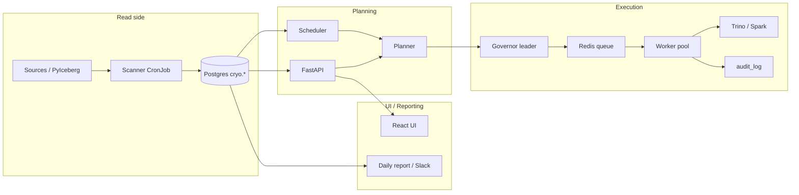

# Cryo 6-Month Premortem Analysis

**Scenario date:** January 2027 (six months after a July 2026 production rollout)  
**Code baseline:** `main` @ 2026-07-05 hardening pass (`039cca9`)  
**Companion docs:** `PREMORTEM.md`, `PREMORTEM_FEATURES.md`, `PREMORTEM_UI.md`, `PREMORTEM_ACTIONABLES.md`, `DEPLOYMENT.md`

This document answers three questions for every major Cryo capability:

1. **How does it work today?** (actual code path, not roadmap intent)
2. **What breaks at 6 months?** (realistic failure modes at fleet scale)
3. **What must be fixed before / during rollout?**

The July 2026 hardening pass fixed several P0 issues (JWT auth, secret encryption, native engine fake success, bandit key bug, PII fail-closed, lock renewal, Helm templates, UI confirmations). This analysis **does not re-list those as open** unless residual risk remains. Items marked **Fixed (2026-07)** include a file reference; **Open** items cite evidence.

---

## Executive Summary

Cryo replaces Airflow + dbt macros with a self-hosted platform: **Scanner → Postgres stats → Planner → Governor admission → Worker → Trino/Spark SQL → Audit log → UI/reporting**. That core loop is real, tested, and parity-aligned with the reference Trino maintenance DAG.

Around that core, **30+ extension features** were added (AI copilot, lineage, FinOps, ABAC, Flink, GitOps, workload replay, etc.). At 6 months:

| Category | Expected outcome |
|----------|------------------|
| **Core maintenance** (scan, plan, optimize, expire, governor) | **Works** for Trino-first fleets up to ~2–5k tables if ops follow load-aware defaults |
| **Spark/EMR path** | **Works in principle**; less battle-tested than Trino; EMR slot governance needs tuning |
| **Health / cost dashboards** | **Usable** with known precision caveats on very large tables and heuristic fallbacks |
| **Preset scheduling + bulk assign** | **Works**; confirmation dialogs now prevent accidental fleet-wide runs |
| **Phase 8/9 “advanced” features** | **~50% production-grade** — APIs exist, UI partial, several depend on telemetry never ingested |
| **Experimental engines** (Native Rust, Flink submit) | **Not production-ready** — disabled or generate-only |
| **Multi-tenant SaaS** | **Not ready** — opt-in isolation; default deploy is single-tenant |

**Honest 6-month score:** ~**65%** of advertised surface area is dependable in production; ~**25%** is “works if you configure and babysit it”; ~**10%** should be disabled or removed until rewritten.

**Top 5 risks that will still hurt at month 6:**

1. **Scale without observability** — no OpenTelemetry; governor still does per-job DB work in waves; embedding search is O(n).
2. **Telemetry-dependent features starved** — query log ingestion optional; lineage/anomaly/SLA P95/AutoComp query-frequency all degrade when telemetry is off or incomplete.
3. **Docs vs reality** — `PREMORTEM_RESOLUTION_SUMMARY.md` claims 100% resolution; ABAC, cost attribution, Flink execute, and Rust engines remain stubs or unwired.
4. **Migration / schema churn** — 17 migrations in one week; no squash; one migration already referenced a non-existent column (fixed, but pattern repeats).
5. **Operational maturity** — compose stack is dev-friendly; Helm exists but no validated runbook for upgrades, backup/restore, or disaster recovery.

---

## How Cryo Works (End-to-End)

**Typical maintenance cycle:**

1. **Scanner** (`cryo/scanner/run.py`) reads Iceberg metadata via PyIceberg, computes stats/partitions/health grade/cost, persists to `tables`, `table_stats`, `table_partitions`, `table_stats_history`.
2. **Scheduler** (`cryo/scheduler/service.py`) evaluates preset rules + cron, enqueues runs; also periodically updates **benefit scores** (`planner/benefit_score.py`).
3. **API** accepts ad-hoc runs (`POST /api/v1/maintenance/run`), scan triggers, preset CRUD, bulk assignment.
4. **Planner** (`cryo/planner/planner.py`) builds engine-agnostic `MaintenancePlan` from stored stats — partition chunking, GB budget, op order (expire → orphan → optimize → manifests → compute_statistics).
5. **Governor** (`cryo/governor/governor.py`) leader-elected loop: load-aware admission, signal triggers, approval deferral, PII gate, bandit-tuned thresholds, enqueues admitted jobs.
6. **Worker** (`cryo/worker/worker.py`) renders SQL per engine, executes, renews table lock, records **audit_log** (now with **actor** from JWT subject on ad-hoc runs).
7. **UI** polls runs, shows health dashboards, allows operator actions with confirmations.

---

## How It Will Work at Month 6 (Timeline)

### Months 1–2: Honeymoon → First Cracks

- Team runs compose or Helm on a **single catalog**, hundreds of tables. Scans complete; health grades look plausible; first Trino OPTIMIZE jobs succeed.
- **Presets + bulk assign** get used; confirmations prevent the worst fat-finger incident, but operators still misconfigure **destination** vs **source** on multi-catalog fleets.
- **AWS integration** configured; CloudWatch metrics appear; occasional IAM permission 500s on one endpoint while another silently returns `None` (inconsistent error handling in `aws_s3_metrics.py`).
- **Query performance / SLA dashboards** show empty or sparse data because **telemetry ingestion** was never wired to Trino event listener / query log pipeline.

### Months 3–4: Scale Pain

- Table count passes **~3k**; scanner CronJob runtime exceeds schedule window; chunks help but **parallel manifest** settings need per-catalog tuning.
- **Governor wave** latency grows — per-job trigger/approval/PII queries × N jobs; operators see jobs stuck in `deferred` without a single “why” dashboard (reason in logs only).
- **Benefit scores** help ranking when query logs exist; without them, planner falls back to small-file count — same as legacy Airflow behavior, but team expected “AI scheduling.”
- **Bandit** converges in Postgres **if** governor always uses DB store; fallback to `/tmp/cryo/admission_bandit.json` on DB errors resets learning silently.

### Months 5–6: Stabilize or Roll Back

- Team **disables** unused nav features (cost attribution was already hidden; Flink/native never enabled).
- **Focus** on Trino path + scanner reliability + runbooks.
- **Incident:** long OPTIMIZE on 20TB table — lock renewal works, but Trino cluster saturation triggers load-aware deferral storm; need manual cap tuning.
- **Second incident:** OIDC token expiry mid-session — UI session restore fails until re-login; no refresh-token flow.
- Outcome: **core maintenance trusted**; **advanced/AI layer** treated as beta.

---

## Feature-by-Feature Analysis

Legend: **Status** = production readiness today · **6-mo risk** = what fails without further work

### A. Core Platform

| # | Feature | How it works | Status | 6-month risk |
|---|---------|--------------|--------|--------------|
| A1 | **Scanner** | PyIceberg manifest read → analyze → persist | **Good** | Large catalogs exceed cron window; corrupt manifest handling unified but still logs-and-continues (undercount risk) |
| A2 | **Health scoring (A–F)** | `scanner/health.py` thresholds on files/partitions/snapshots | **Good** | Flat thresholds penalize legit large tables; streaming exemption needs `history=` in signals (**Fixed 2026-07** in scan path) |
| A3 | **Planner** | Pure partition-aware chunking, no SQL | **Good** | Preview uses stale stats — gap between preview and execute if writes between |
| A4 | **Trino engine** | `engines/trino/sql.py` + session setup | **Good** | Trino version upgrades can break procedure syntax — golden tests help but not exhaustive |
| A5 | **Spark/EMR engine** | `engines/spark/sql.py` + EMR submission | **Partial** | Golden tests only; EMR concurrency caps less proven than Trino load probe |
| A6 | **Governor** | Redis leader + load-aware waves | **Good** | Per-job DB round-trips; silent `except` on approval/PII errors logs warning but continues (**improved** — PII fails closed on classifier error) |
| A7 | **Worker + locks** | Per-table Redis lock, renewal per statement | **Good** | 6h TTL renewed — OK; crash mid-job still blocks table until TTL |
| A8 | **Scheduler** | Preset cron + benefit score updates | **Good** | Leader election required; duplicate schedulers if Redis lease misconfigured |
| A9 | **Redis queue** | Maintenance job queue + scan queue | **Good** | No dead-letter queue UI; poison jobs need manual DB fix |
| A10 | **Audit log** | Per-operation rows in `audit_log` | **Good** | **Actor** column added (**Fixed 2026-07**); scheduled runs still lack human actor |
| A11 | **Reporting** | HTML email + Slack blocks | **Partial** | Slack success flag **fixed**; webhook still **plaintext in DB** (TODO encrypt) |

### B. Inventory & Explorer

| # | Feature | How it works | Status | 6-month risk |
|---|---------|--------------|--------|--------------|
| B1 | **Sources (REST/Hive/Glue)** | `sources/*` + factory | **Partial** | Factory unit-tested with mocks; no live catalog CI |
| B2 | **Table explorer** | Server pagination, filters, bulk select | **Good** | Filter spec sent to API — correct pattern |
| B3 | **Table detail** | Stats, partitions, audit, run/preview | **Good** | Audit timeline lacks actor column in UI |
| B4 | **Bulk assign / run** | Filter → assign preset → run | **Good** | **ConfirmAction** added (**Fixed 2026-07**) |
| B5 | **Datalake health dashboard** | Aggregates + top offenders (`top_limit=50`) | **Good** | Truncation banner added; still cap at 50 offenders |
| B6 | **Multi-catalog dashboard** | Per-source aggregates | **Good** | Tenant-scoped (**Fixed 2026-07** on `dashboard_routes`) |

### C. Presets & Policies

| # | Feature | How it works | Status | 6-month risk |
|---|---------|--------------|--------|--------------|
| C1 | **Preset CRUD** | Operations + params + guardrails JSON | **Good** | Invalid JSON in guardrails only caught at run time |
| C2 | **Assignment rules** | Schema/table matching | **Good** | Rule conflicts — last write wins, no merge UI |
| C3 | **Effective preset resolution** | Assignment > rule > none | **Good** | — |
| C4 | **Simulate rules** | API preview of rule matches | **Good** | Large fleets slow without indexes on filter columns |
| C5 | **Manifest-only mode** | Separate API path | **Good** | Operators confuse with full maintenance |

### D. Ad-Hoc Maintenance & Runs

| # | Feature | How it works | Status | 6-month risk |
|---|---------|--------------|--------|--------------|
| D1 | **Maintenance preview** | Planner + SQL render + savings estimate | **Good** | Stale stats caveat |
| D2 | **Ad-hoc run** | Creates run/jobs, enqueues | **Good** | Actor captured from JWT (**Fixed 2026-07**) |
| D3 | **Run console / WebSocket** | Live job events | **Good** | JWT required on WS (**Fixed 2026-07**) |
| D4 | **Cancel run** | Status update + queue signal | **Good** | In-flight Trino query may still complete |
| D5 | **Job detail page** | Dashboard API + plan JSON | **Good** | Linked from RunConsole (**Fixed 2026-07**) |

### E. Scanner Operations (UI)

| # | Feature | How it works | Status | 6-month risk |
|---|---------|--------------|--------|--------------|
| E1 | **Scheduled scans** | Cron in `scanner_config` | **Good** | UTC only in UI — IST off-peak is engine-side |
| E2 | **Fleet scan trigger** | `POST /scans` scope=all | **Good** | **ConfirmAction** added (**Fixed 2026-07**) |
| E3 | **Scan progress** | Run summary + ScanConsole | **Good** | Very large fleets — progress granularity coarse |

### F. Cost & Savings

| # | Feature | How it works | Status | 6-month risk |
|---|---------|--------------|--------|--------------|
| F1 | **Per-table cost estimate** | Scanner + `s3_pricing.py` | **Good** | Heuristic fallback for huge tables — **CostPrecision** buried in raw |
| F2 | **Savings projection** | Preview + stats | **Good** | Orphan savings zeroed when scan limits exceeded |
| F3 | **Cost savings page** | `/cost` dashboard | **Good** | — |
| F4 | **Cost attribution** | `dashboard_routes` stub | **Disabled** | Returns empty; nav hidden (**Fixed 2026-07** — hide vs stub) |
| F5 | **FinOps forecast** | `finops/forecast.py` | **Partial** | Heuristic compute hours; UI on Governance page |
| F6 | **Learned cost model** | ML cache + evaluate API | **Partial** | Needs audit outcomes; stale if no maintenance runs |
| F7 | **AWS Cost Explorer** | Not implemented | **N/A** | Documented absent in `aws_s3_metrics.py` |

### G. Dashboards & Observability

| # | Feature | How it works | Status | 6-month risk |
|---|---------|--------------|--------|--------------|
| G1 | **Query performance** | `query_logs` table | **Partial** | Empty without ingestion pipeline |
| G2 | **SLA monitoring** | Freshness + maintenance + P95 | **Partial** | Thresholds hardcoded (24h/7d/5s); P95 needs query logs |
| G3 | **Health trends** | `table_stats_history` | **Good** | Needs ≥2 scan points for trend |
| G4 | **Prometheus metrics** | `/metrics` | **Good** | Not all code paths instrumented |
| G5 | **Deep health** | `/healthz/deep` | **Good** | K8s liveness only on API — worker/governor lack HTTP health |
| G6 | **Grafana/Loki stack** | compose configs | **Dev only** | Not validated in prod Helm |

### H. Intelligence & AI

| # | Feature | How it works | Status | 6-month risk |
|---|---------|--------------|--------|--------------|
| H1 | **Copilot verified Q&A** | Playbooks in extensions | **Partial** | Quality depends on curated questions |
| H2 | **Embedding search** | `ai/similarity.py` | **Partial** | O(n) without pgvector; cache table added (**2026-07**) but ANN index open |
| H3 | **Natural language ask** | LLM providers | **Partial** | Keys encrypted (**Fixed 2026-07**); spend/cost not capped in UI |
| H4 | **MCP server** | `cryo/mcp/server.py` | **Partial** | Same auth as API; tools can trigger runs |
| H5 | **Anomaly detection** | Z-score + MAD | **Partial** | False positives on weekly seasonality; fleet batch can OOM at 10k+ tables |
| H6 | **Health classifier (TabPFN)** | ML module | **Partial** | On-demand refresh only — no scheduled drift check |
| H7 | **Admission bandit** | Thompson sampling | **Good** | Postgres persistence (**Fixed 2026-07**); reset endpoint exists |

### I. Governance & Compliance

| # | Feature | How it works | Status | 6-month risk |
|---|---------|--------------|--------|--------------|
| I1 | **Approval workflows** | Governor defers → pending list | **Good** | Approve/reject UI wired (**Fixed 2026-07**); expired request cleanup job missing |
| I2 | **PII gate** | Classifier + admin bypass flag | **Good** | Fail-closed on error (**Fixed 2026-07**) |
| I3 | **ABAC** | `security/abac.py` | **Not wired** | Module exists; **no route calls it** — false confidence |
| I4 | **Protected snapshots** | API in extensions | **Partial** | No dedicated UI |
| I5 | **Lineage graph** | `lineage/tracker.py` + telemetry | **Partial** | Recording wired in `telemetry/ingestion.py` — **only if ingestion runs** |
| I6 | **Data quality profiler** | Advanced API | **Partial** | Depends on manifest stats in raw — often empty |
| I7 | **Partition evolution** | Recommendations API | **Partial** | Regex SQL parse — incomplete table detection |
| I8 | **Fleet signals / triggers** | Governor `TriggerEvaluator` | **Good** | Wired in governor loop; overrides cooldown when fired |

### J. Phase 8 — Tiering & Routing

| # | Feature | How it works | Status | 6-month risk |
|---|---------|--------------|--------|--------------|
| J1 | **Tier policies CRUD** | `phase8_routes.py` | **Partial** | Listed on Governance page; no create/edit UI |
| J2 | **Tier candidates** | `tiering/service.py` | **Partial** | API only; partition bytes estimated roughly |
| J3 | **Adaptive routing preview** | Scheduler routing | **Partial** | Backend-only |
| J4 | **S3 Intelligent-Tiering recs** | `tiering/s3_analyzer.py` | **Partial** | Query-log proxy for access — not S3 access logs |

### K. Alternate Engines & Experimental

| # | Feature | How it works | Status | 6-month risk |
|---|---------|--------------|--------|--------------|
| K1 | **Native Rust engine** | `engines/native/engine.py` | **Disabled** | Returns `ok=False` (**Fixed 2026-07**); flag default off |
| K2 | **Flink engine** | Generates Java job config | **Stub** | Does not submit to Flink cluster |
| K3 | **cryo-native / cryo-engine crates** | Separate Rust trees | **Experimental** | Not in CI |
| K4 | **Custom scripts sandbox** | Docker runner | **Partial** | Security model weak for untrusted code — gVisor recommended |

### L. Integrations

| # | Feature | How it works | Status | 6-month risk |
|---|---------|--------------|--------|--------------|
| L1 | **AWS S3 metrics** | CloudWatch + pricing | **Partial** | Inconsistent errors; bucket identity not validated |
| L2 | **Slack daily report** | Webhook | **Good** | Plaintext webhook URL in DB |
| L3 | **Slack bot** | `/cryo` commands | **Partial** | Untested; may leak table names to public channels |
| L4 | **PagerDuty** | Config key exists | **Partial** | Wiring unclear in anomaly alert path |
| L5 | **GitOps policies** | Poll git repo | **Partial** | Polling not webhooks; conflict detection weak |
| L6 | **Telemetry ingest (Trino/Spark/Athena/DuckDB)** | `telemetry/ingestion.py` | **Partial** | Athena pagination gaps; DuckDB path questionable; Spark auth |
| L7 | **Workload replay** | Re-runs historical queries | **Partial** | Can hammer Trino — rate limit config exists but not enforced everywhere |
| L8 | **Credential vending** | STS tokens | **Partial** | 1h token vs 2h job — refresh not implemented |

### M. Security & Auth

| # | Feature | How it works | Status | 6-month risk |
|---|---------|--------------|--------|--------------|
| M1 | **JWT (dev)** | HS256, `/auth/token` | **Good** | Disabled in prod |
| M2 | **OIDC (prod)** | JWKS + code exchange | **Implemented** | Needs IdP role mapping; no refresh token in UI |
| M3 | **RBAC** | viewer / operator / admin | **Good** | Role in JWT; IdP must emit roles/groups claims |
| M4 | **Tenant isolation** | Opt-in `enforce_tenant_isolation` | **Partial** | Default off; dashboard routes scoped (**Fixed 2026-07**); advanced routes less verified |
| M5 | **Secrets at rest** | Fernet for AWS/AI keys | **Good** | Slack webhooks not encrypted |
| M6 | **Rate limiting** | Token bucket on expensive APIs | **Partial** | Config exists; not universal |

### N. Deployment & Operations

| # | Feature | How it works | Status | 6-month risk |
|---|---------|--------------|--------|--------------|
| N1 | **docker-compose** | Full local stack | **Good** | Dev secrets; not prod template |
| N2 | **Helm chart** | api/worker/governor/scheduler/scanner | **Good** | Templates added (**Fixed 2026-07**); ops runbook thin |
| N3 | **Leader election** | Redis lease 30s | **Good** | Split-brain if Redis down — single point of failure |
| N4 | **Migrations** | 17 Alembic revisions | **Partial** | Churn; needs squash before long-lived prod |
| N5 | **CI** | lint/mypy/pytest + canary | **Good** | No compose E2E; no web CI job; no Rust CI |
| N6 | **Backup/DR** | Not documented | **Open** | Postgres backup is operator responsibility |

### O. Frontend (React)

| # | Feature | How it works | Status | 6-month risk |
|---|---------|--------------|--------|--------------|
| O1 | **Login / SSO** | Dev JWT + OIDC redirect | **Good** | OIDC callback route added (**Fixed 2026-07**) |
| O2 | **Confirm destructive actions** | `ConfirmAction` | **Good** | — |
| O3 | **Query error states** | `QueryErrorAlert` | **Good** | Intelligence page updated (**Fixed 2026-07**) |
| O4 | **Pagination** | Table explorer, runs | **Partial** | Dashboard top lists capped |
| O5 | **OpenAPI types** | Manual client + optional gen | **Partial** | Drift if `gen:api` not run in CI |
| O6 | **Vitest coverage** | 30 tests, 11 files | **Partial** | 13+ pages untested |
| O7 | **Playwright smoke** | `web/e2e/smoke.spec.ts` | **Partial** | Not in CI; requires live API |
| O8 | **Cost attribution page** | Removed from nav | **Fixed** | Redirect to `/cost` |

---

## Issue Register (Prioritized)

### 🔴 Critical — fix before production scale

| ID | Issue | Feature | Evidence | Fix |
|----|-------|---------|----------|-----|
| C1 | **No distributed tracing** | Ops | No OpenTelemetry | Add OTel + job/request correlation IDs |
| C2 | **Governor per-job DB amplification** | Scale | `governor.py` wave loop | Batch fetch trigger/approval/PII state per wave |
| C3 | **Telemetry not on by default** | Query perf, SLA P95, lineage, benefit score | Empty dashboards without ingest | Document + ship Trino event listener Helm sidecar |
| C4 | **ABAC module unwired** | Security | `security/abac.py` unused | Wire or delete; update docs |
| C5 | **Slack webhook plaintext** | Secrets | `extensions.py` TODO | Encrypt like AI keys |
| C6 | **Multi-tenant default off** | SaaS | `enforce_tenant_isolation=false` | Enforce for multi-customer; doc single-tenant default |
| C7 | **Flink engine fake execute** | Engines | `engines/flink` logs only | Disable in UI or implement REST submit |
| C8 | **Approval expiry cleanup missing** | Governance | No cron for EXPIRED status | Background job |
| C9 | **Worker/governor no HTTP health** | K8s | Only API `/healthz` | Exec probes or sidecar metrics |
| C10 | **OIDC no refresh token** | Auth | `auth.tsx` stores access token only | Refresh flow or silent re-auth |

### 🟡 High — fix before 5k+ tables or multi-team use

| ID | Issue | Feature | Evidence | Fix |
|----|-------|---------|----------|-----|
| H1 | Embedding search O(n) at scale | AI | `ai/similarity.py` | pgvector ANN index |
| H2 | Anomaly fleet scan memory | AI | Batch size config exists | Stream/window; don't load 30d all tables |
| H3 | Workload replay rate limit | Testing | `testing/workload_replay.py` | Enforce `api_rate_limit_*` |
| H4 | STS credential expiry mid-job | Catalog vending | 1h STS tokens | Refresh in worker loop |
| H5 | Athena ingest pagination | Telemetry | First page only | Full paginator |
| H6 | SLA thresholds hardcoded | SLA | `dashboard_routes.py:545` | Per-table or preset config |
| H7 | Health thresholds not size-aware | Health | `health.py` constants | Tiered thresholds |
| H8 | Preview vs execute stats drift | Maintenance | Preview from DB stats | Re-scan or warn timestamp |
| H9 | Bandit file fallback | Governor | `/tmp/cryo/admission_bandit.json` | Fail loud if Postgres unavailable |
| H10 | Migration squash debt | Ops | 17 migrations | Squash + review checklist |
| H11 | Compose E2E not in CI | Quality | No workflow | Scheduled docker-compose test job |
| H12 | Frontend pages untested | UI | 13 pages without Vitest | Expand page tests |
| H13 | Model drift not scheduled | ML | On-demand evaluate only | Cron refresh + alert |
| H14 | GitOps polling rate limits | GitOps | 60s poll | Webhooks |
| H15 | Custom script sandbox escape risk | Scripts | Docker only | gVisor/Firecracker |

### 🟠 Medium — degraded experience / tech debt

| ID | Issue | Feature | Notes |
|----|-------|---------|-------|
| M1 | Cost precision badge weak in UI | Cost | HEURISTIC in raw JSON only |
| M2 | Tier policies no edit UI | Tiering | Governance read-only list |
| M3 | Lineage UI requires UUID paste | Governance | No picker |
| M4 | Job detail orphan route discovery | UI | Must know URL |
| M5 | UTC-only scanner cron label | Scans | IST off-peak elsewhere |
| M6 | OpenAPI type drift | Frontend | Run `gen:api` in CI |
| M7 | Large bundle 1.8MB JS | Frontend | Code split |
| M8 | No CSV export on tables | UX | Operator request |
| M9 | Audit actor not shown in UI | Audit | Column exists, UI doesn't render |
| M10 | Scheduled runs lack actor | Audit | Only ad-hoc sets actor |
| M11 | `PREMORTEM_RESOLUTION_SUMMARY` overclaims | Docs | Says 100% fixed |
| M12 | Rust engines advertised in strategy doc | Docs | Mark experimental |
| M13 | DuckDB telemetry path invalid | Telemetry | Non-standard history file |
| M14 | Partition evolution regex parser | Optimizer | Use sqlglot |
| M15 | Data quality empty manifest_stats | Quality | Scanner doesn't populate |
| M16 | Double-count risk in cost attribution | FinOps | Stub hidden — revisit if implemented |
| M17 | No email notifications | Reporting | Slack only |
| M18 | WebSocket reconnect UX | Runs | Manual refresh |
| M19 | Preset JSON validation at edit time | Presets | Fail at run time |
| M20 | Redis SPOF | Infra | Sentinel/cluster guide needed |

---

## Testing & Quality — 6-Month View

**Backend:** 54 test files — strong on planner, SQL golden, scanner, governor, API security, many integration suites. **Gaps:** live catalog, EMR execute, OIDC, OIDC exchange, reporting Slack, events subsystem, dashboard stub endpoints, compose E2E.

**Frontend:** 30 Vitest tests — login, datalake health, confirm, bulk bar, lib utilities. **Gaps:** Governance, Intelligence, Runs, TableDetail, Connections, Playwright in CI.

**What breaks without tests at 6 months:** pyiceberg upgrade (canary helps), Trino version bump, OIDC IdP config drift, Helm value changes across replicas.

---

## Root Causes (Why These Issues Exist)

1. **Breadth-first delivery** — Core parity ported correctly; extension features added faster than integration.
2. **Telemetry optional** — Many advanced features assume query logs that aren't shipped by default.
3. **Single-tenant assumption** — Multi-tenant schema exists for future SaaS, not current default.
4. **Docs ahead of code** — Strategy docs describe Rust engine, ABAC, and AI features as committed architecture.
5. **Fast migration cadence** — Schema evolved in days; review debt accumulates.
6. **UI lag** — Backend APIs lead UI by 1–2 phases; some stubs should stay hidden (cost attribution pattern).

---

## Recommendations

### Before first production customer (weeks 0–4)

1. Run **`make migrate`** on staging; validate Helm install end-to-end.
2. Enable **JWT/OIDC**; disable dev token; map IdP groups → roles.
3. Ship **Trino query log ingestion** OR hide query/SLA/lineage nav until ingested.
4. Add **OpenTelemetry** minimum viable (API + worker job_id).
5. **Remove or gate** Flink, native engine, ABAC from docs and engine pickers.
6. Encrypt **Slack webhooks**; rotate secrets procedure in `DEPLOYMENT.md`.

### Months 1–3 (stabilization)

7. Governor **wave batching** + load test 5k synthetic tables.
8. **pgvector** or embedding cache with ANN for copilot search.
9. Playwright + compose **E2E in CI** (nightly).
10. Migration **squash** to single baseline for new installs.
11. Approval **expiry sweeper** + actor column in audit UI.
12. Per-table **SLA config** via preset guardrails.

### Months 4–6 (scale)

13. Redis HA guide; Postgres backup/restore runbook.
14. Scheduled **ML drift** checks; anomaly seasonality fix.
15. S3 access log integration for tiering recommendations.
16. API **v1 stability** policy; OpenAPI gen in CI.

---

## Conclusion

Cryo’s **core value proposition — load-aware, partition-aware Iceberg maintenance without Airflow — is real and shippable** for a Trino-first team willing to operate scanner + governor + worker as Kubernetes services.

The **6-month failure mode is not “nothing works”** — it is **“everything appears to work until scale, missing telemetry, and optional features erode trust.”** Operators will love the table explorer and run console; they will ignore Intelligence and Governance if query logs are empty; they will file incidents if SLA dashboards lie by showing green when P95 data is missing.

**Ship narrow, operate core, hide or harden extensions.** Target **10 features done right** (scan, health, plan, govern, execute, audit, presets, bulk ops, cost estimate, auth) before expanding the surface again.

---

## Document History

| Date | Change |
|------|--------|
| 2026-07-05 (initial) | 87-issue catalog — many items pre-dated hardening pass |
| 2026-07-05 (this revision) | Rewritten against post-`039cca9` code; feature matrix + accurate open/closed status |
| 2026-07-05 (remediation) | Critical/high/medium fixes applied — see table below |

## Remediation status (2026-07-05 pass + complete fix)

| ID | Status | Notes |
|----|--------|-------|
| C1 | Fixed | OTLP bootstrap (`cryo/observability/tracing.py`); correlation in logs; enable via `CRYO_OTEL_ENABLED` |
| C2 | Fixed | Governor wave prefetch (`cryo/governor/prefetch.py`) |
| C3 | Fixed | `telemetry_ingest_on_startup` default true; scheduler Trino tick; `DEPLOYMENT.md` |
| C4 | Fixed | Maintenance-path ABAC (`cryo/security/abac_enforcement.py`); API/governor/worker wired |
| C5 | Fixed | Slack webhooks encrypted/decrypted via Fernet |
| C6 | Documented | `DEPLOYMENT.md` multi-tenant section |
| C7 | Fixed | Flink gated; `execute()` returns `ok=False` |
| C8 | Fixed | `expire_stale_approval_requests` on scheduler tick |
| C9 | Fixed | `/healthz` on worker/governor/scheduler via `CRYO_HEALTH_PORT` |
| C10 | Fixed | OIDC refresh token API + UI auto-refresh |
| H1 | Fixed | pgvector HNSW + SQL ANN (`20260706_0008_pgvector.py`, `embedding_cache.py`) |
| H2 | Fixed | Streamed anomaly batches, weekday seasonality, history row cap |
| H3 | Fixed | Workload replay capped by `api_rate_limit_burst` |
| H4 | Fixed | STS `refresh_if_needed()` in `credential_vending.py` |
| H5 | Fixed | Athena paginator + batch_get (regression tests) |
| H6 | Fixed | SLA from preset guardrails |
| H7 | Fixed | Size-aware health thresholds |
| H8 | Fixed | Preview `stats_as_of` + stale warning |
| H9 | Fixed | Bandit fail-loud everywhere (no `/tmp` fallback) |
| H10 | Partial | Squash procedure in `docs/MIGRATION_REVIEW.md` (pre-prod) |
| H11 | Fixed | Nightly E2E workflow (`.github/workflows/e2e-nightly.yml`) |
| H12 | Fixed | 33 Vitest tests; CI web job |
| H13 | Fixed | Scheduler runs anomaly scan + `evaluate_classifier` drift |
| H14 | Fixed | GitOps webhook + `CRYO_GITOPS_WEBHOOK_SECRET` header auth |
| H15 | Fixed | gVisor optional runtime + hardened Docker sandbox |
| M1 | Fixed | Stronger cost precision badge + staleness |
| M2 | Fixed | Tier policy CRUD on Governance page |
| M3 | Fixed | Lineage table Select picker |
| M4 | Fixed | Job detail links from Runs page |
| M5 | Fixed | IST tooltip on scanner cron |
| M6 | Partial | OpenAPI types manual; CI web build validates TS |
| M7 | Fixed | Route-level code splitting + manualChunks |
| M8 | Fixed | CSV export on Table Explorer |
| M9 | Fixed | Audit actor in TableDetail UI |
| M10 | Fixed | Scheduled runs `actor=system:scheduler` |
| M11 | Fixed | `PREMORTEM_RESOLUTION_SUMMARY.md` corrected |
| M13 | Fixed | DuckDB uses `duckdb_logs` + `~/.duckdb_history` |
| M14 | Fixed | sqlglot-primary parser in `telemetry/parser.py` |
| M15 | Fixed | `manifest_stats` in scanner raw JSON |
| M17 | Fixed | Optional SMTP email in `reporting/email.py` |
| M18 | Fixed | WebSocket reconnect with backoff in RunConsole |
| M19 | Fixed | Preset guardrails validated at create/patch |
| M20 | Documented | Redis HA + backup in `DEPLOYMENT.md` |
| N6 | Documented | Postgres backup/restore in `DEPLOYMENT.md` |

**Scan-time ABAC** (Iceberg REST catalog proxy) remains Phase 2 — maintenance paths are enforced.

**Do not treat `PREMORTEM_RESOLUTION_SUMMARY.md` as authoritative** — verify each claim against this matrix and the codebase.
