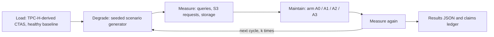

# Cryo benchmark research and design

**Date:** 2026-10-06
**Status:** Design only. No harness, no code, no compose change, no commit.
**Question:** What benchmark can Cryo publish that is honest, rerunnable, and allowed under Cryo's own claim rules?

Evidence grades: **R** re-read in this pass · **C** code in this repo · **U** not re-fetched; not a number Cryo may quote.

This doc does not authorize a public claim. A number enters marketing only after a run writes it into the claims ledger in §5.

## 1. TL;DR

- The sentence "Reduce costs by up to 50% and accelerate queries up to 10x" is Ryft's, word for word, on the platform overview (**R**, [docs.ryft.io/platform](https://docs.ryft.io/platform), accessed 2026-10-06). The same page also says "Accelerate queries by up to 10x" and "Cut infrastructure costs by up to 50%". Copying it would be both me-too and unbacked. No method, dataset, or result file is on that page.
- e6data's homepage, same day, says "10x performance for a fraction of the cost" and, separately, "up to 50% lower compute cost" (**R**, [e6data.com](https://www.e6data.com/)). That is the same pattern, not the same sentence. Do not collapse the two into one slogan.
- Published "10x / 50%" lines in this market do not come with a rerunnable method. Cryo's edge is the brand promise already in [docs/brand/CRYO_BRAND_GUIDE.md](brand/CRYO_BRAND_GUIDE.md) §11: results you can verify, with a source and a date next to every number.
- Speedup ranges that were in the draft (LST-Bench 1.5–3.2x; AWS S3 Tables 1.1–3.2x per query and 2.26x overall on 3 TB TPC-DS) were **not** re-read from the papers or the AWS post in this pass (**U**). They are not claims. The techniques those sources are known for — degradation over time, and a mechanism-first before/after — are still the right shape. The numbers wait until someone opens the primary source.
- Databricks' Predictive Optimization page, last updated 2026-09-11, does **not** say maintenance costs "<5% of ingestion cost" (**R**, [docs](https://docs.databricks.com/aws/en/optimizations/predictive-optimization)). It says the work runs on serverless jobs compute and is billed on that SKU. Drop the "<5%" line. The useful idea is still to subtract maintenance cost, using Cryo's own `net_savings` arithmetic, not a vendor's unpublished ratio.
- Storage percentages are a function of churn rate and horizon. Both have to be in the same sentence as the percentage. A modelled dollar is not money ([brand guide §11](brand/CRYO_BRAND_GUIDE.md)).

## 2. Techniques that boost a product

Each row is a technique, who used it, why it works, and what Cryo should copy. Where the exemplar's number was not re-read, the number is omitted on purpose.

### 2.1 Open, reproducible benchmark

ClickBench publishes the queries, the load, and the hardware notes, and anyone can add a row. The credibility is the rerun, not the leaderboard position. Cryo applies this by shipping CryoBench-Maint as a laptop profile (smoke, then standard) with pinned image digests, a seed, and raw JSON. A cloud reference run is optional and labeled as such. Local MinIO is not S3; §6 says so in the output, not in a footnote nobody reads.

### 2.2 Mechanism-first before/after

AWS S3 Tables' public story is a file-layout mechanism (small files versus a target size), not a product adjective. Cryo applies this with a file-size sweep: same table, same queries, only the file-size distribution changes, reported as absolute elapsed time next to the ratio. Do not quote an AWS multiplier until the post is re-read and dated (**U**).

### 2.3 Degradation over time

LST-Bench (PACMMOD 2024, DOI [10.1145/3639314](https://doi.org/10.1145/3639314), already cited in [docs/cryo-10-of-10-plan.md](cryo-10-of-10-plan.md)) is the right shape: ingest, read, update, maintain, repeat, and plot the slope. A single before/after hides the fact that an unmaintained table gets worse. Cryo applies this by running each scenario for `k` cycles and reporting the degradation rate per arm. Specific LST-Bench speedups were not re-read (**U**).

### 2.4 ROI net of maintenance cost

Gross bytes freed flatter the vendor. Cryo already has the subtraction in [cryo/finops/net_savings.py](../cryo/finops/net_savings.py) (**C**):

```
net = storage_saved - rewrite_cost - ongoing_maintenance - platform_fee
```

The module says it is arithmetic over caller-supplied inputs, not a benchmark. The harness must call the same function so the benchmark and the product cannot drift. Platform fee is zero for self-hosted Cryo and must still appear as a line, so a reader can see it was considered.

### 2.5 Named customer case studies

A named study beats a synthetic fleet, and it is also the easiest place to leak a table name. Cryo applies this only through the production track in §7, and only as k-anonymous aggregates. No named customer until that customer agrees in writing. This doc does not name one.

### 2.6 Run-it-on-your-own-data

Cryo's projected-savings report is the honest version of a vendor calculator: the operator's scan, the operator's prices, labeled as a projection. The benchmark does not replace that report. It is the method the report can point at.

### 2.7 Publish limits and losses

A benchmark that only shows the win is an ad. Cryo applies this by publishing every query, including regressions, the A0 control, and a Limitations section that states what the profile cannot measure (snapshot expiry and orphan deletion inside a one-day floor; MinIO latency versus S3).

### 2.8 The DeWitt embrace

The DeWitt clause is a contract term that forbids a customer from publishing a benchmark of a database. The useful inversion is to invite others to publish CryoBench-Maint results, including results where Cryo loses to A2. Cryo applies this by making the harness public-shaped (seed, digest, raw JSON) even if the first runs stay internal. Whether the repo and the results are public is an open question in §9.

## 3. Traits of successful benchmarks, and the product traits Cryo has to prove

Jim Gray's handbook criteria are relevance, portability, scalability, and simplicity. Karl Huppler's TPCTC 2009 list adds repeatability, fairness, verifiability, and economy. Those two lists are the filter for §6. A profile that only the author can rerun fails verifiability. A profile that needs a cluster fails economy for the laptop claim.

Pitfalls, stated as rules rather than as quotations from papers that were not re-read in this pass:

- Raasveldt, Holanda, Gubner, and Mühleisen, "Fair Benchmarking Considered Difficult", DBTest 2018: cold and warm runs mixed, one query standing in for a suite, and a tuned system compared with an untuned one. Cryo keeps A3 (defaults) separate from A3-tuned, and reports cold and warm apart.
- Gernot Heiser's benchmarking-crimes list: missing variance, a ratio without the absolute, and a benchmark that does not match the claimed workload. Cryo reports median and IQR, absolute times next to ratios, and maps each scenario to one maintenance operation.
- Brendan Gregg's performance work: a warm cache presented as a cold-cache win, and a local disk presented as a network store. Cryo discards one warm-up, splits cold and warm, and refuses to treat MinIO latency as S3 latency.

Product traits the benchmark is allowed to speak to, and the arm that speaks to each:

| Trait | What would count | What would not |
|---|---|---|
| Outcome | A3 median faster than A0 on the scenario that matches the operation, with the absolute time | A ratio against R* (the ceiling is not a product) |
| Overhead | Maintenance CPU and bytes rewritten, subtracted via `net_savings` | Bytes freed with the rewrite cost omitted |
| Safety | Row count and `checksum()` match across arms | A green optimize with no checksum |
| Zero-tuning automation | A3 uses default settings | A3-tuned presented as A3 |
| Fleet scale | S7, foreground p95/p99 while maintenance runs | A single quiet table |
| Verifiability | Seed, digest, image digests, raw JSON | A chart with no input file |

## 4. Competitor claim landscape

Internal only. Dated 2026-10-06. Do not turn these numbers against the vendor ([brand guide §11](brand/CRYO_BRAND_GUIDE.md)). "Reproducible" means a third party can rerun the method from what the vendor published.

| Vendor | What was on the page | Method published | Reproducible |
|---|---|---|---|
| Ryft | "Reduce costs by up to 50% and accelerate queries up to 10x." (**R**) | No | No |
| e6data | "10x performance for a fraction of the cost"; "up to 50% lower compute cost." (**R**) | No | No |
| Qlik / Upsolver | Not re-fetched (**U**) | Unknown | Unknown |
| LakeOps | Not re-fetched (**U**) | Unknown | Unknown |
| AWS S3 Tables | Mechanism-first comparisons exist in AWS posts; the draft's 1.1–3.2x and 2.26x figures were not re-read (**U**) | Partial, when the post includes the setup | Not from this doc |
| Databricks Predictive Optimization | Automatic `OPTIMIZE`, `VACUUM`, `ANALYZE` on Unity Catalog managed tables; serverless jobs SKU. No "<5%" sentence on the page updated 2026-09-11 (**R**) | Product docs, not a benchmark | No |
| Academic (LST-Bench) | Degradation-over-time benchmark. DOI above. Speedups not re-read (**U**) | Paper | Yes, if the artifact is used as published |

## 5. Claim rules and claims ledger

### 5.1 Rules

Cryo may print an "up to X" figure only when all three hold:

1. At least 10% of (table, query) cases in that scenario reach X. This 10% is **Cryo's floor**, chosen because it is a concrete reading of "significant proportion". The ASA advice page was not retrieved in this pass (the URLs tried returned 404), so 10% is not quoted here as an ASA sentence.
2. The scenario's degradation is no worse than production p90, from the calibration in §6. If calibration is the synthetic fleet, the sentence must say synthetic.
3. The median appears in the same sentence as the maximum.

That bar is stricter than a slogan, and it matches the FTC's published view more closely than a median-only disclaimer would. The FTC press release of 2012-06-29 says many consumers believe an "up to" claim promises the maximum, and that advertisers should be able to substantiate that consumers are likely to achieve the maximum under normal circumstances (**R**, [press release](https://www.ftc.gov/news-events/news/press-releases/2012/06/ftc-report-many-consumers-believe-claims-promise-maximum-results); study by Hastak and Murphy, June 2012, [report page](https://www.ftc.gov/reports/effects-bristol-windows-advertisement-savings-claim-consumer-take-away-beliefs)). The study used a windows ad claiming "up to 47%" energy savings. It does not say people read "up to" as the typical result. It says they expect the maximum. Pairing the median with the ceiling is how Cryo avoids that reading.

ASCI, Chapter I, accessed 2026-10-06 (**R**, [the ASCI Code](https://www.ascionline.in/the-asci-code/)):

- Claims of objectively ascertainable fact must be capable of substantiation (I.1).
- Where a claim is expressly based on independent research, the source and date should be indicated in the advertisement (I.2).
- An advertisement must not mislead by implication, omission, ambiguity, or exaggeration (I.4).
- A claim such as "up to five years guarantee" is not acceptable if the consumer is likely to be misled about how widely the benefit applies (I.4(c)).

The page's Chapter I block is signed 2025-07-10. Cryo's "source and date next to every number" rule is the brand guide applying I.2 to every number, not only to independent-research claims.

TPC: results that use TPC-H queries via Trino's `tpch` connector are not TPC-H results. Label them "derived from TPC-H". The TPC fair-use PDF path tried in this pass returned 404, and TPC-Pricing v2.9.0 was downloaded but not text-extracted, so the exact required sentence is **U**. The label is still mandatory as Cryo's rule. Do not compare a derived number to a published TPC-H result.

Dollar figures appear only as measured quantities times a dated price-list row, and the sentence says so. No modelled saving presented as money.

### 5.2 Ledger

`claims.json` is an output of a run, not of this doc. Schema:

```json
{
  "schema": "cryobench.claims/v1",
  "generated_at": "ISO-8601",
  "price_list_publication": "ISO-8601",
  "claims": [
    {
      "id": "string",
      "text": "sentence a human could publish",
      "metric": "median_speedup",
      "value": null,
      "median": null,
      "pct_cases_reaching_max": null,
      "scenario": "S1",
      "arm": "A3",
      "baseline": "A2",
      "degradation_vs_production_p90": "not_calibrated",
      "allowed": false,
      "blocked_reason": "no run yet"
    }
  ]
}
```

Until a run fills `value`, every claim stays `allowed: false`. This doc creates no allowed claim.

### 5.3 Price table (list prices, not a bill)

From the AWS AmazonS3 offer file, `publicationDate` 2026-09-28T23:04:16Z, read 2026-10-06 (**R**). First 50 TB/month. Request rates are the same in both regions in that file.

| Component | us-east-1 | ap-south-1 (Mumbai) |
|---|---|---|
| S3 Standard storage | $0.023 / GB-month | $0.025 / GB-month |
| PUT, COPY, POST, LIST | $0.005 / 1,000 | $0.005 / 1,000 |
| GET and other | $0.0004 / 1,000 | $0.0004 / 1,000 |

The GET line in the offer description is "$0.004 per 10,000", which is the same rate. LIST is priced as a Tier1 request in that file, not as a GET.

EC2 $/vCPU-hour was **not** extracted. The us-east-1 EC2 offer, `publicationDate` 2026-10-06T17:24:54Z, is a 481,529,705-byte file. No compute dollar goes in this doc. The harness fills it from that offer for one named instance type (Linux, shared tenancy, on-demand), divided by that instance's vCPU count, and records the instance type and the offer publication date in the results JSON.

Public claims use one region, stated in the sentence. us-east-1 is the reference. ap-south-1 is the PW region. Which one is the public default is open (§9).

## 6. CryoBench-Maint v1



### 6.1 Arms

| Arm | What it is | Fairness note |
|---|---|---|
| A0 | No maintenance | Control. The degradation curve. |
| A1 | Naive nightly script: full-table optimize, expire snapshots at 7 days, remove orphans at 7 days, Trino documented defaults | Easy to beat. Not the headline baseline. |
| A2 | Expert DIY: hand-tuned SQL, same retention policy as Cryo | The fair baseline. Needs a named reviewer (§9). |
| A3 | Cryo defaults, via `POST /api/v1/maintenance/run` | The product claim. |
| A3-tuned | Cryo with non-default settings | Reported in a separate table. Never merged into A3. |
| R* | Fresh CTAS rewrite | Ceiling, not a competitor. |

### 6.2 Data and queries

Load with Trino's built-in `tpch` connector, CTAS into Iceberg. Deterministic, no download. Scale factors: SF1 smoke, SF10 standard.

Queries: the 22 TPC-H-derived queries, plus five lakehouse queries: point lookup, last-day aggregate, 30-day trend, full scan, and a join. Label the TPC-H set "derived from TPC-H". Publish the SQL in the harness repo when the harness exists. This doc does not paste it.

### 6.3 Scenarios

| Id | Degradation | Operation it exercises |
|---|---|---|
| S1 | Streaming small files | optimize / compaction |
| S2 | CDC position and equality deletes, via Trino MERGE plus the existing `seed-native-fixtures commit-equality-delete` | convert_deletes, rewrite_position_deletes, optimize |
| S3 | Commit storm / metadata bloat | optimize_manifests |
| S4 | Overwrite churn | storage; reclaimable until the soak profile |
| S5 | Orphan files | remove_orphan_files; age floor in §6.7 |
| S6 | Stale statistics | compute_statistics |
| S7 | Mixed fleet plus a foreground query stream | governor: foreground p95/p99 during maintenance |
| Sweep | File-size distribution only | mechanism plot, not an arm |

Operation order, when an arm runs more than one, is the product order in `cryo/planner/guardrails.py::CORRECT_ORDER`: convert_deletes, rewrite_position_deletes, optimize, compute_statistics, optimize_manifests, expire_snapshots, remove_orphan_files. The harness does not invent a second order.

### 6.4 Calibration

Set the "typical" and "heavy" degradation levels at p50 and p90 of real tables, from `cryo.table_stats` and `cryo.table_cost`. Aggregates only. At least 10 tables per bucket, matching the cohort floor in [docs/PRIVACY_PRESERVING_BENCHMARKS.md](PRIVACY_PRESERVING_BENCHMARKS.md). No table name in the calibration file.

Fallback, if production aggregates are not approved: the CryoBench fleet fixture in [cryo/benchmarks/fleet.py](../cryo/benchmarks/fleet.py) (**C**: 12,938 tables, seed `20260804`, declared outlier of 397,000 partitions). Label every number from that fixture `synthetic`. [docs/CRYOBENCH.md](CRYOBENCH.md) already says the fixture is not production evidence.

### 6.5 Metrics

- Trino client `cursor.stats`: elapsed time, CPU time, physical input bytes, splits. Confirm the key names against the pinned `trino` Python client when the harness is written. Do not guess spellings in the results schema.
- Planning time: `system.runtime.queries.planning_time_ms` exists on current Trino master (**R**, `QuerySystemTable.java` in `trinodb/trino`, column list includes `queued_time_ms`, `analysis_time_ms`, `planning_time_ms`). The Trino 483 docs page for the system connector describes the table but does not list columns. The table holds currently and recently running queries, so the harness must read the row while the query is in flight. A query after the fact is a miss, not a zero.
- Object-store requests: the MinIO docs on `master`, read 2026-10-06, document **v2** scrape paths, not a v3 file (the v3 path returned 404). Per-bucket counters on `GET /minio/v2/metrics/bucket` include `minio_bucket_requests_total`, plus 4xx, 5xx, canceled, inflight, and `minio_bucket_requests_ttfb_seconds_distribution` (**R**, [list.md](https://raw.githubusercontent.com/minio/minio/master/docs/metrics/prometheus/list.md)). Those names are totals. An API-name label (GET, PUT, LIST) was not in that table. The harness must confirm a breakdown on the pinned image, or count from the audit log. Do not invent a v3 metric name.
- Storage: `mc du` plus Iceberg `$files`, `$manifests`, `$snapshots`.
- Bytes rewritten: Cryo audit log, not a guess from file counts.
- Scanner A–F grade before and after.
- Correctness: row count and `checksum()` equal across arms. A mismatch fails the run.
- Foreground p95 and p99 during S7 maintenance.

### 6.6 Statistics

Discard one warm-up. Then n ≥ 5 (n ≥ 3 for smoke). Cold and warm reported separately. Median and IQR. Per-query speedup. Suite geometric mean. Bootstrap 95% CI. Every query, absolute value next to the ratio. Degradation rate per arm, LST-Bench style. Predicted results written down before the first non-smoke run (pre-registration), stored next to the results JSON so a reader can see what moved.

### 6.7 Time-compression constraint

Cryo will not expire snapshots or delete orphans younger than one day.

- `_validate_positive_number` in [cryo/planner/guardrails.py](../cryo/planner/guardrails.py) rejects `retention_days` and `orphan_retention_days` below 1 (**C**).
- `_orphan_params` in [cryo/planner/planner.py](../cryo/planner/planner.py) sets `orphan_min_age_hours` to `days * 24` (**C**).

Trino adds its own floor. On the Trino 483 docs, `iceberg.expire-snapshots.min-retention` and `iceberg.remove-orphan-files.min-retention` both default to `7d` (**R**, [Iceberg connector](https://trino.io/docs/current/connector/iceberg.html)).

So:

- Smoke and standard measure compaction, deletes, manifests, and stats. Storage is reported as reclaimable, not reclaimed.
- Real reclaimed storage needs a soak of at least 48 hours. Seven days is the recommended soak, because that is the Trino default floor unless the bench catalog overrides it.
- A bench-only catalog may set both min-retention properties to `1d`. That is a catalog file for the harness, not a product change. The results JSON records the override.

### 6.8 Profiles

Sized for the machine this design was written on: M4 Pro, 12 cores, 24 GB. These are budgets, not measured runtimes. The first smoke run replaces the "about" figures.

| Profile | Scale | Budget | What it may claim |
|---|---|---|---|
| Smoke | SF1 | about 15 minutes | Harness works. No marketing number. |
| Standard | SF10 | about 2 hours; Docker capped at 8 CPU and 12–16 GB | Query and request-count comparisons. Storage as reclaimable. |
| Soak | SF10 or smaller | 2–7 days | Reclaimed storage, with the horizon stated. |
| Cloud reference | named EC2 type, real S3 | separate budget | The only profile whose latency may be quoted as S3 latency. |

Local MinIO answers in well under a millisecond. Local elapsed times understate the small-file penalty. Request counts transfer to S3. Latencies do not. The report says this in the Limitations section, not only here.

### 6.9 Integrity

- Pin image digests. Today [docker-compose.dev-datalake.yml](../docker-compose.dev-datalake.yml) uses `minio/minio:latest`, `minio/mc:latest`, and `tabulario/iceberg-rest:latest` (**C**). A bench overlay pins digests. The inventory file is updated when that overlay lands, not in this doc.
- Randomize arm order.
- Pause Cryo's scanner and scheduler during measurement windows.
- Keep A3 and A3-tuned in separate tables.
- Publish raw timings. A summary without the raw file is not a result.

### 6.10 Outputs

Results JSON, schema `cryobench.maint/v1`:

- commit SHA
- image digests
- hardware (CPU, RAM, Docker caps)
- seed
- dataset digest
- price-list publication dates and region
- raw timings, cold and warm
- calibration source (`production_aggregate` or `synthetic_fleet`)

Generated report: degradation sawtooth, before/after with absolute values, file-size sweep, cost breakdown (measured quantity × dated price, maintenance subtracted), interference CDF for S7.

`claims.json` as in §5.2.

A Limitations section in every report: MinIO versus S3, reclaimable versus reclaimed, TPC-H derived, synthetic calibration if used, n, and which queries regressed.

### 6.11 Pre-registered hypotheses

Written before the first standard run, so the ledger can say whether the run matched them. These are predictions, not results.

- H1: On S1 at the heavy (p90) file-size mix, A3 median elapsed time is lower than A0, and the request count drops. Magnitude is not predicted here.
- H2: A3 does not beat A2 by a large margin on S1, because A2 is the same retention policy with hand-tuned SQL. A small or zero gap is a successful fairness check, not a failed product.
- H3: A1 on a large table without a partition filter is slower or more expensive than A3, because that is the failure the planner exists to prevent. If A1 wins, the report says so.
- H4: S7 foreground p95 under A3 is no worse than under A1 at the same admitted concurrency. This is the governor claim. It is not a query-speed claim.
- H5: Net savings on smoke and standard are "reclaimable", not dollars removed from a bill. A dollar line appears only on soak, and only as quantity × dated list price.

## 7. Production case-study track

Compare tables Cryo maintains with tables it does not yet maintain, as a difference-in-differences, not as a before/after on the same table alone. Sources: `QueryLog` (and `table_query_activity` when the source writes that and no `query_logs` rows), the audit log's `actual_bytes_freed`, and S3 bills the operator already has.

Export only k-anonymous aggregates, per [docs/PRIVACY_PRESERVING_BENCHMARKS.md](PRIVACY_PRESERVING_BENCHMARKS.md): at least 10 distinct tables and 20 outcomes per cohort, rounded medians, no table or tenant identifiers. That doc says this is k-anonymity, not differential privacy. A case study that names a customer is out of scope until that customer agrees. This track does not feed the claims ledger until the cohort floors are met.

## 8. Implementation outline

Follow-up. Not this change.

- Harness package under a new path, decided when the design is approved. It calls the planner and `POST /api/v1/maintenance/run`. It does not emit SQL of its own for A3.
- Make targets: `bench-smoke`, `bench-standard`, `bench-soak`, `bench-report`.
- A bench compose overlay that pins digests and sets the two Trino min-retention properties to `1d` for the bench catalog only.
- Update [docs/LOCAL_DEV_ONLY_INVENTORY.md](LOCAL_DEV_ONLY_INVENTORY.md) in the same change as the overlay.
- Cost lines go through [cryo/finops/net_savings.py](../cryo/finops/net_savings.py).

Not in that follow-up either, unless a later plan says so: product guardrail changes, a public leaderboard, and any claim text.

## 9. Open questions

- Can we export aggregate percentiles from the production Cryo database for calibration, with the cohort floors in §6.4?
- Is there budget for a cloud reference run before any public latency number?
- Which region is the public price: us-east-1 or ap-south-1?
- Will the harness and the results JSON be public? Who outside the team reviews A2?
- ASA "up to" advice page: the URLs tried on 2026-10-06 returned 404. Fetch the current CAP/ASA page before quoting "significant proportion" as their words.
- TPC fair-use sentence: extract it from the current policy PDF before the first public derived result.
- EC2 $/vCPU-hour: extract from the 2026-10-06 offer for one named instance before any compute dollar.
- MinIO API-level request breakdown: confirm on the pinned image. The v2 bucket metric list does not name an `api` label.

## 10. Sources

Accessed 2026-10-06 unless noted.

- Ryft platform overview, **R**: https://docs.ryft.io/platform
- e6data homepage, **R**: https://www.e6data.com/
- FTC press release, 2012-06-29, **R**: https://www.ftc.gov/news-events/news/press-releases/2012/06/ftc-report-many-consumers-believe-claims-promise-maximum-results
- FTC study page, Hastak and Murphy, June 2012, **R**: https://www.ftc.gov/reports/effects-bristol-windows-advertisement-savings-claim-consumer-take-away-beliefs
- ASCI Code, Chapter I, page signature 2025-07-10, **R**: https://www.ascionline.in/the-asci-code/
- AWS S3 offer, publicationDate 2026-09-28T23:04:16Z, us-east-1 and ap-south-1 index.json, **R**
- AWS EC2 offer, publicationDate 2026-10-06T17:24:54Z, us-east-1, file size only, **R** for existence, **U** for any rate
- Trino 483 system connector, **R**: https://trino.io/docs/current/connector/system.html
- Trino `QuerySystemTable.java` on `trinodb/trino` master, **R**: https://raw.githubusercontent.com/trinodb/trino/master/core/trino-main/src/main/java/io/trino/connector/system/QuerySystemTable.java
- Trino 483 Iceberg connector, min-retention defaults `7d`, **R**: https://trino.io/docs/current/connector/iceberg.html
- MinIO Prometheus metric list on `master`, v2 paths, **R**: https://raw.githubusercontent.com/minio/minio/master/docs/metrics/prometheus/list.md
- Databricks Predictive Optimization, page updated 2026-09-11, **R**: https://docs.databricks.com/aws/en/optimizations/predictive-optimization
- LST-Bench DOI, not re-read, **U** for numbers: https://doi.org/10.1145/3639314
- Cryo brand guide §11, **C**: [docs/brand/CRYO_BRAND_GUIDE.md](brand/CRYO_BRAND_GUIDE.md)
- Cryo guardrails and orphan age, **C**: [cryo/planner/guardrails.py](../cryo/planner/guardrails.py), [cryo/planner/planner.py](../cryo/planner/planner.py)
- Cryo net savings, **C**: [cryo/finops/net_savings.py](../cryo/finops/net_savings.py)
- CryoBench fleet fixture, **C**: [cryo/benchmarks/fleet.py](../cryo/benchmarks/fleet.py), [docs/CRYOBENCH.md](CRYOBENCH.md)
- Privacy floor, **C**: [docs/PRIVACY_PRESERVING_BENCHMARKS.md](PRIVACY_PRESERVING_BENCHMARKS.md)
