# Maintenance batch: proposal and implementation plan

**Status:** proposed. Gates below are dependencies, not completion claims.
**Dates:** first draft 2026-09-28/29; technical review 2026-09-29; research and polish 2026-09-29
(code re-verified the same day, including uncommitted changes).
**Name in the product:** **Maintenance batch.** Controls read "Add to batch", "Review batch" and
"Run maintenance". "Cart" describes the interaction pattern only; never "queue" (Cryo already has
a job queue).

---

## TL;DR

- **The idea:** operators collect tables while they investigate, review **one** exact plan, and
  submit it once. It is Terraform's plan/apply for lake maintenance: what you reviewed is what
  runs, or the submit is refused.
- **Most of the machinery exists.** The assistant's action gateway already prepares a plan, binds
  it with a digest, expires it, enforces idempotency and dispatches through the shared run
  service. The run service already accepts an operation subset and a one-off `scheduled_at`. The
  governor already recovers jobs committed but not enqueued. **Build the batch on these; do not
  write a second execution authority.**
- **Ship the workflow first; claim savings last.** Today an ad-hoc run launches one Spark driver
  per table. Shared Spark sessions exist only in the nightly coordinator. A "cheaper" claim waits
  for a measured comparison on the shared path (MC-4).
- **Fix one real bug first.** `plan_lanes()` can return more lanes than `max_lanes` (reproduced,
  §2.2). It also affects the nightly path wherever `max_lanes` is below the number of occupied
  size tiers.
- **V1 scope:** Table detail and Tables bulk selection add to a session-scoped draft. A review
  drawer shows scope, blockers, resources and one Run button. Status appears in Run detail.
  There are no new destinations and no AI dependency.

---

## 1. The problem and the promise

Today an operator who finds five tables that need work while browsing has two poor options:
run each one separately (five decisions, five previews, five runs), or build a filter that
happens to match exactly those five. Neither leaves one place to see what will run, what is
blocked and what it will cost.

**Promise:** *collect the tables that need attention, understand exactly what will happen, run
them with a clear budget, and get a traceable result.*

Two benefits, with different bars:

| Benefit | Needs | When we may say it |
|---|---|---|
| **Workflow:** fewer repeated selections and previews; one review of scope, blockers and outcome | Reliable preview and submission (MC-1…MC-3) | At V1 release |
| **Execution:** compatible Spark work shares a session and its startup overhead | A shared dispatch path, proven and measured (MC-4, MC-5) | Only after a measured comparison of equivalent work |

**Act now** stays for urgent single-table work. Adding a table to a batch does not enqueue work,
change its preset assignment or reserve capacity.

---

## 2. What the code does today (verified 2026-09-29)

Recheck before implementing; the maintenance and assistant code is moving.

### 2.1 Facts that shape the design

| Area | Observed | Consequence |
|---|---|---|
| Bulk selection | `TableExplorerSection.tsx` sends explicit IDs for row selection and a **filter spec** for "all matching" (AGENTS.md rule) | The batch keeps both modes. It never substitutes the visible page's IDs for a filter |
| Run submission | `POST /maintenance/run` → `cryo/maintenance/run_service.py::start_maintenance_run` creates one job per table and enqueues each onto the worker/governor path. `MaintenanceRunRequest` takes `table_ids` or `selection`, `destination_id`, `preset_id`, `mode`, **`operations` (subset)** and **`scheduled_at`** | A batch submission can use the existing service directly. "Compact only" and "run later" need no new execution code |
| Spark on the ad-hoc path | The worker dispatches each Spark job as its own `spark-submit` driver (`cryo/engines/spark/k8s.py`) | Today a 5-table batch means 5 drivers. No session sharing, so no execution saving yet |
| Shared sessions | Only the nightly coordinator packs tables into lanes: `BatchMaintenance.run` → `plan_lanes` → one Spark pod per lane (`cryo/maintenance/coordinator.py`) | Shared execution means routing a reviewed batch through lane planning (§8), not through per-table jobs |
| Explicit tables in the coordinator | `BatchMaintenance.run(table_ids=…)` exists, but `_select` passes `require_eligible=not table_ids` and removes the per-table GB·h cap when IDs are given | Reusing it as-is **bypasses cooldown and eligibility**. MC-4 must restore those checks for batch submissions (§8) |
| Preview | `/maintenance/preview` takes client-supplied `PreviewTable` stats and partitions | It is a sketch, not an authorization. The batch needs a server-resolved plan |
| Prepared plans | `cryo/ai/actions/gateway.py`: `prepare` stores a proposal with `plan_hash`, `target_digest`, expiry and preview; `authorize` rechecks role, write switches, tier, ABAC, freshness and digest (409 when changed), uses an idempotency key, then calls `run_service.start_maintenance_run` | This is the prepared-plan contract the batch needs. Extract it from `cryo/ai/` into a maintenance service both callers share (§7) |
| Dispatch recovery | The governor's `reconcile_queued_jobs` (`cryo/queue/reconcile.py`) re-enqueues DB-queued jobs missing from Redis every wave (bounded) | "Committed but not enqueued" already recovers on the per-table path. An outbox is only needed for a new dispatch path (MC-4) |
| Table status | `GET /tables/{id}/maintenance-status` returns eligibility, blockers (cooldown, backoff, stale stats…) and next nightly time | Review shows per-table readiness from this, not from new logic |
| Manifest-only | `/maintenance/manifest-rewrite` goes through the same run path in manifest-only mode | A manifest-only batch is a recipe choice, not a separate feature |

### 2.2 Lane planning: a bug to fix first

A local call of the pure functions in `cryo/maintenance/lanes.py`, repeated 2026-09-29:

| Rewrite GB per table | `max_lanes` | `lane_count()` | `len(plan_lanes())` |
|---|---:|---:|---:|
| 1, 10 | 4 (default) | 1 | **2** |
| 1, 10, 250 | 1 | 1 | **3** |
| 1, 10, 250, 900 | 2 | 2 | **3** |
| 0.1 × 5 | 4 | 1 | 1 |

**Why it happens:** every occupied size tier (there are at most four) gets at least one lane, and
the trimming loop stops once each tier has one, even above `max_lanes`.

**Consequences:**
- `lane_count()` is not the pod count.
- `plan_lanes()` can break the configured cap.
- An installation running a high `max_lanes` never hits it. A small batch cap or a small
  install will.

The last row is the encouraging one: five small tables share one lane.

**Rule (MC-0):**
- `max_lanes` is a hard upper bound on the returned plan.
- Keep tier separation when it fits. When it can't, pack tiers into the largest lane shape
  needed (a tested fallback) or return a typed capacity conflict. **Never launch more pods than
  the cap.**
- Preview and dispatch check the same invariant.
- Ship this as its own fix, with tests for the four cases above, empty input, every tier and the
  tier boundaries.

---

## 3. Prior art, and what we take from it

| Pattern | Where | What we take |
|---|---|---|
| **Saved plan, refused when stale** | Terraform: a plan file is bound to the state it read, and apply fails with "Saved plan is stale" if state changed; HCP Terraform discards unconfirmed saved plans | The prepared plan binds its inputs with a digest. Submit returns a conflict and a fresh preview when anything material changed. The TTL is only a second fence |
| **Idempotency keys bound to parameters** | Stripe: reusing a key with different parameters is an error; keys are kept at least 24 h | The key is scoped to principal and tenant and bound to the plan digest. The same key with a different plan returns a conflict. Retries after a timeout reuse the key and return the same run |
| **Pending, then submit once** | GitHub "Start a review": comments stay pending and private until you submit them together | The draft is private and has no side effects until **Run maintenance** |
| **"Select all N that match"** | Gmail, and NN/g's bulk-action guidance: make cross-page scope explicit ("Select all 3,200 matching") | "Add all 312 matching to batch", resolved on the server and frozen at add time |
| **Choose items → operation → details → confirm** | Jira bulk change | The review drawer is that wizard collapsed into one screen: scope, recipe, readiness, confirm |
| **Shared resource pools across tables** | Apache Amoro optimizer groups: tables in one group share optimizer resources, with quota-based or balanced scheduling | Compatible tables share a lane; the lane is the pool. Per-table fairness still comes from the governor and per-table locks |
| **Catalog-level defaults** | AWS Glue catalog-level optimizers; table settings take precedence | A batch recipe never overrides a table's own settings silently. Review shows the effective value and its source |
| **Transactional outbox** | microservices.io, AWS Prescriptive Guidance | Needed only if MC-4 adds a new dispatch path. The per-table path already treats the DB as the outbox (governor reconcile) |

---

## 4. V1 decisions

| Decision | V1 behaviour |
|---|---|
| Where it lives | A **Batch · N** chip in the top bar opens the right-hand panel. The full review page is `/runs/batch` (inside Runs; no eighth destination, per the UI runbook) |
| One right panel | **Decided (owner, 2026-09-29).** The Ask Cryo drawer and the batch drawer share **one** right-panel slot with two tabs, **Batch** and **Ask Cryo**. Never two stacked drawers. Spec in §15.1 |
| Entry points | Table detail (header action), Tables row menu and bulk bar ("Add selected" / "Add all N matching"). Later: Decisions → Recommendations, and Ask Cryo (§10) |
| Draft lifetime | One draft per browser tab, installation and principal/tenant, in versioned `sessionStorage`. Survives navigation and reload; cleared on logout or identity change. No cross-session promise |
| Draft contents | Stable table references, selection receipts, labels, exclusions and the chosen recipe. No credentials, table data, SQL or authorization decisions |
| Recipe | One destination, preset, mode and **operation subset** per submission, reviewed explicitly. Presets suggest; choosing one never reassigns tables |
| Recipe shortcuts | "Compact", "Compact and clean up" and "Metadata only", each mapping to a preset plus an operation subset in canonical order. The UI shows the resulting operations as chips |
| Compatibility | One compatible group per submission: same source/catalog binding and effective destination. Other entries stay in the draft, flagged. No silent split into several runs |
| When it runs | **Run now.** "Run in the next off-peak window" (`scheduled_at`) is V1.1, after dispatch-time revalidation exists (§7.4) |
| Size limit | 100 unique tables by default, configurable, enforced on the server. It bounds interactive planning; it is not admission capacity |
| Membership | "All matching" is resolved on the server and frozen when added. Later filter changes do not change the draft |
| Review lifetime | A prepared plan lives 10 minutes by default. Any scope or recipe change invalidates it immediately; the server rechecks everything at submit |
| Exclusions | Deleted, inactive, inaccessible, incompatible or ineligible entries are never dropped silently. Each has a reason, without leaking unauthorized metadata |
| AI | None required. Ask Cryo may add to the same draft later; it cannot bypass review |

---

## 5. Operator experience

### 5.1 Collect without breaking the investigation

1. On a table: **Add to batch**. In Tables: **Add selected to batch**, or **Add all 312 matching
   to batch** (the count always shown).
2. The server resolves and deduplicates by table UUID. A toast reads "3 added · 1 already in
   batch", with **Review batch**. The top-bar chip updates (a brief highlight; no animation under
   reduced motion).
3. The page, filters and scroll position stay. Repeated clicks never add duplicates.
4. Names are shown as `catalog › schema › table`, so equal names in different catalogs are
   distinct.

### 5.2 Review: decision first, detail on demand

```text
Maintenance batch · 14 tables                        [Clear]  [Open full review]
Recipe   Compact and clean up ▾   on  spark-prod ▾   (preset: nightly-default)
         optimize → optimize_manifests → expire_snapshots        ← canonical order
Ready 11 · Blocked 2 · Nothing to do 1                           [Show blocked]
Resources  3 Spark lanes · 12 vCPU · 48 GiB peak   (shared lanes: MC-4 only;
           until then "11 separate Spark jobs")
Expected   Rewrite ≈ 84 GB (from scans 2–26 h old) · Reclaim: Not estimated
───────────────────────────────────────────────────────────────────────────
[Run maintenance on 11 tables]      Enters normal admission; may wait for capacity.
```

| Question | Answer shown |
|---|---|
| What am I running? | Exact table count, catalog, destination, preset, mode and operation chips in execution order |
| Can this run? | Ready / Blocked / Nothing to do counts with reasons and fixes: cooldown until, scan backoff, stale stats (link to scan), hold active (link to Runs → Holds), already running, unsupported by engine |
| What will it use? | The **actual** planned execution: "11 separate Spark jobs" today, lanes and pods only on the shared path. Requested CPU and memory. Runtime only with a defensible basis |
| What might improve? | Rewrite bytes from stored evidence (with its age), and reclaim estimates only where supported. Otherwise **Not estimated**, never 0 |
| What happens next? | **Run maintenance on N tables**, with the note that work goes through normal admission |

The full review (`/runs/batch`) reuses the shared DataTable: table, grade and freshness, planned
operations, rewrite bytes, readiness. Expanding a row shows predicates, retention, warnings and
the rendered SQL per engine. The **primary button names the count that will run**; the app never
reinterprets "run all" as "run the ready ones" without saying so. When nothing needs work, say so
and offer to remove those entries; never create an empty run.

**What changed since you reviewed.** If the submit returns a conflict, show a diff before asking
again: "+2 blocked (cooldown started), recipe unchanged, 1 table deactivated". This is
Terraform's stale-plan rule, made readable.

### 5.3 After submit

- On acceptance, remove **only the accepted entries of that draft revision**. Entries added
  while the submit was in flight stay. Link to Run detail.
- Show **Queued** or **Waiting for capacity** accurately. Accepted is not completed; completed is
  not proof of reclaimed bytes.
- Run detail stays the only monitor. The drawer shows a one-line status and a link.
- Failed or deferred tables do not re-enter the draft by themselves. **Retry failed** prepares a
  new plan for the eligible failed and deferred tables against current state.
- If Act now or the nightly run touches a table that is in the draft, the next review shows that
  run and re-evaluates eligibility. Never run it twice silently.

### 5.4 Interaction and accessibility

Use the UI runbook's motion catalogue: drawer M3, value change M6, skeleton M12. No animated
savings counters. Keyboard-complete with focus trap and return. Count changes are announced
politely. On narrow screens the drawer is a full-height sheet. ⌘K gains "Review batch".

---

## 6. Selection and draft contracts

Keep the draft light. Membership, eligibility and authorization are the server's.

- **Explicit selection:** the actual selected references, through the existing selection model.
- **All matching:** the full filter spec plus source/view scope, never the current page's IDs and
  never a browser download of every page.
- **Resolve:** a bounded API returns a principal-scoped **selection receipt**: frozen membership,
  unique count, display rows and expiry. A receipt proves membership, not permission.
- **Cap:** detect overflow with bounded queries. If the union would exceed the cap, reject that
  addition ("This selection would exceed the 100-table batch limit; narrow it"). Never take the
  first 100 or half a filter.
- **Union and exclusions:** the server unions receipts and explicit references, deduplicates,
  applies explicit exclusions, then enforces the cap. Removing a table excludes it even if a
  stored filter also matched it; re-adding it clears the exclusion.
- **Stable scope:** later filter edits don't touch earlier additions. An expired receipt needs an
  explicit re-resolve, with membership changes shown; it never expands by itself at submit.
- **Count:** the resolved unique count, not the sum of overlapping filters. Show "Resolving…"
  until it is known.
- **Storage:** only the versioned draft envelope lives in `sessionStorage`, validated on restore
  and wrapped in try/catch. Receipts and plans are scoped to installation, tenant and principal
  on the server.

---

## 7. Prepared plan and submission

### 7.1 One contract, shared with the assistant

```mermaid
flowchart LR
    A[Table detail / Tables] --> B[Draft in sessionStorage]
    B --> C[Resolve selection → receipt]
    C --> D[Prepare plan → plan_id + digest]
    D --> E[Operator reviews]
    E --> F[Submit plan_id + digest + idempotency key]
    F --> G[run_service → per-table jobs]
    G --> H[Governor admission, locks, workers]
    H --> I[Run detail, receipts]
```



**Extract, don't duplicate.** Move the proposal machinery in `cryo/ai/actions/gateway.py`
(prepare, digest, expiry, authorize, idempotency, reconcile) into a maintenance-level service,
for example `cryo/maintenance/prepared_plan.py`, that has no `cryo/ai` imports. The assistant
gateway becomes a caller of it, and so does the batch UI. There is one execution authority and
one set of tests.

| Operation | Input | Result |
|---|---|---|
| Resolve selection | Filter spec or IDs; existing receipts and exclusions | Receipt: frozen membership, unique count, expiry, display rows. No engine work |
| Prepare | Receipts/references, draft revision, destination, preset, mode, operation subset | `plan_id`, digest, expiry, eligible membership, per-table disposition and reason, effective recipe and routing, planned execution, estimates with their basis |
| Submit | `plan_id`, expected digest, idempotency key | The run and accepted membership, or a typed conflict (409) with a fresh preview and a diff |
| Read submission | `plan_id` or scoped idempotency key | Accepted / reconciling / rejected / terminal, with run links |

Route names follow existing API conventions. Any persisted schema is additive, lives in `cryo`,
has an Alembic migration, and its frontend types are generated from OpenAPI.

### 7.2 What preparation does

- Resolves tables, stored scan and partition stats, preset parameters, supported operations,
  routing and bindings **on the server**.
- Uses the existing pure planner and per-engine renderers.
  - No SQL in the planner and no partition logic in React.
  - No live `$files`, manifest or object-store listing on the request path.
  - Missing or old evidence becomes a warning or blocker linking to a scan. Opening the drawer
    never starts a scan.
- Reads per-table readiness from the `maintenance-status` logic (cooldown, backoff, holds, stale
  stats, running job).
- Digests the membership, recipe revisions, effective destination, each table's scan/snapshot
  version, operation summary and resource-plan version. The TTL is only a second fence. Secrets
  never enter the plan.
- Handles adaptive routing: if the batch yields several incompatible groups, V1 reviews one.
  Sharing a lane needs the same catalog binding, auth context, destination config and recipe;
  matching catalog names are not enough.

### 7.3 Submit and runtime checks

At submit, recheck identity, per-table authorization, enabled connections, engine capability,
write switches (`maintenance_writes_enabled`), ABAC, recipe revisions, evidence freshness and
exact membership. Any material change returns a conflict and the diff (§5.2). Scope never
widens, operations never change and the engine is never swapped.

Accepted work then goes through normal admission. Governor admission, cooldowns, off-peak rules,
deadlines, budgets, per-table locks, live engine load, per-replica caps and worker backpressure
all still apply. A preview never takes a lock. A table that becomes busy or ineligible after
submit is deferred or skipped with a recorded reason, never forced through to match the estimate.

Keep the canonical order from `cryo/planner/guardrails.py::CORRECT_ORDER`:

```text
convert_deletes → rewrite_position_deletes → optimize → compute_statistics
  → optimize_manifests → expire_snapshots → remove_orphan_files
```

Existing retention, snapshot-ref, shared-location and destructive-operation guards apply. There
is no "force all".

Audit prepare, submit and each action with the principal, origin (`batch`), plan digest, table,
operation, effective destination, run/job IDs and outcome.

### 7.4 Retries and reliability

1. **Idempotency:** the key is scoped to tenant and principal and bound to the digest (the Stripe
   rule). A retry after a timeout reuses the key and gets the same run; the same key with a
   different digest gets a 409.
2. **Atomic acceptance:** the submission record, run and jobs commit in one transaction. The
   governor's `reconcile_queued_jobs` already re-enqueues committed jobs that never reached Redis,
   so the per-table path needs **no new outbox**. Add a test that proves it for a batch: kill the
   enqueue after commit, then run a governor wave, and the jobs are enqueued exactly once.
3. **Uncertain response:** the UI marks the submitted entries **Checking submission** and polls
   with the same key. It never mints a new key and never offers a blind retry.
4. **Scheduled runs (V1.1):** `scheduled_at` runs are enqueued later by the scheduler tick,
   which does not revalidate. Before offering "run off-peak", add dispatch-time revalidation
   (eligibility, write switches, holds, membership), so a stale plan is deferred with a reason,
   not run.

---

## 8. Shared Spark execution (MC-4): one concrete design

Goal: a reviewed batch of compatible Spark work runs in lanes, as the nightly run does, without
inheriting the nightly run's own choices.

**Proposed path:**

1. Submit writes the run, the per-table jobs (status `batched`, not enqueued) and a durable
   **lane request** row in one transaction. This is the outbox for this path.
2. The leader-elected scheduler picks up the lane request and launches a **one-off Kubernetes Job
   from the maintenance CronJob's template**: the same image and service account, with args
   `--run-id <id> --table-ids …` and the reviewed recipe. The API process never launches pods.
3. The coordinator runs with those table IDs, **the reviewed recipe instead of its fleet
   defaults**, and **eligibility enforced**. Today `require_eligible=not table_ids` turns
   eligibility off for explicit IDs, so add a parameter such as
   `require_eligible=True, source="batch"` and keep the nightly behaviour unchanged.
4. Lanes respect `max_lanes` (§2.2), per-table locks and the run deadline. Each table's result
   updates its own job and audit row. A lane failure reconciles each table's committed state
   before any retry; completed tables are not replayed.
5. The same jobs are never also enqueued on the worker path. The job status (`batched`) makes
   the two paths mutually exclusive, and a test proves it.

If MC-4 slips, V1 ships as **batch organization and review with per-table execution**, and the
review says "11 separate Spark jobs", not lanes.

---

## 9. What "batching saves cost" must mean

Keep these quantities separate:

| Quantity | Basis |
|---|---|
| Planned rewrite bytes | Planner output from stored evidence; partial or unknown coverage shown |
| Planned lanes / pods | The validated execution plan. Not `lane_count()`, and not the table count |
| Requested CPU and memory | Per-lane requests and peak concurrent totals |
| Estimated resource-hours | Only from comparable completed work, with a range, sample size and model version; otherwise **Not estimated** |
| Estimated execution cost | Resource-hours × configured rates, with omitted parts disclosed. No rates configured means no $ figure |
| Expected maintenance benefit | Reclaim or performance evidence, never summed with execution cost. Bytes eligible for expiry are not bytes deleted |
| Measured result | Actual pods, runtime, resources and post-maintenance effect. Measured consumption, allocated cost and invoiced savings are kept apart |

```text
requested_vCPU_hours = Σ (lane.cpu_milli / 1000) × estimated_lane_hours
requested_GiB_hours  = Σ (lane.mem_mib  / 1024) × estimated_lane_hours
```

Pod startup and teardown count when they hold requested resources. Queue wait is time to
completion, not pod runtime.

**A fair comparison:** the same eligible tables and operations, run (a) as separate per-table
jobs and (b) as the shared lane plan. Use the same engine, rates and sizing, from **equivalent
starting states**: running (b) on tables that (a) just compacted is invalid. Fewer pods alone is
not success, because a larger pod held longer can cost more, and serializing can delay an urgent
table. Show **No estimated saving** when that is the result. Lower requested resource-hours
reduce the bill only if capacity is actually released.

---

## 10. Brainstorm: ideas beyond V1

Ranked by value divided by risk. **Now** fits V1 without new risk; **Next** needs V1 in
production; **Later** needs evidence or an owner decision.

| When | Idea | Why | Depends on |
|---|---|---|---|
| Now | Recipe shortcuts ("Compact", "Compact and clean up", "Metadata only") | The operation subset already exists in `run_service`; removes preset hunting | — |
| Now | "What changed since you reviewed" diff on 409 | Turns a frustrating refusal into a readable decision | §7.1 digest inputs |
| Now | Readiness from `maintenance-status` (cooldown until, backoff until, hold, already running) | Answers "why can't this run?" without new logic | Existing endpoint |
| Now | ⌘K "Review batch", and `b` to add the current table on table detail | Operator speed | Shell |
| Next | Add from Decisions: "Add approved recommendations to batch" | Recommendations become runnable in one review | Decisions page |
| Next | Add from a saved view: "Add all Grade F in `bronze` (37)" | The most common real batch | Tables views (filter spec) |
| Next | Notify me when done: toast plus optional Slack message with the outcome summary | Operators don't watch Run detail | Existing Slack connection |
| Next | Outcome card in the drawer after completion: per table files in → out, bytes or "not reported" | Closes the loop where it started | Receipts |
| Next | Export the reviewed plan (JSON, plus SQL per engine) for change review | Teams with change management need an artefact | Prepared plan |
| Next | Run off-peak (`scheduled_at`) | Avoid daytime load | §7.4 revalidation |
| Later | Shared Spark lanes with a measured saving shown in review | The execution benefit | MC-4, MC-5 |
| Later | Ask Cryo adds tables to the draft ("add the 5 worst in this schema") | Natural-language collection, same review | AI plan; owner decision on assistant writes |
| Later | Several compatible groups reviewed and submitted as one parent with child runs | Mixed catalogs | V1 in production |
| Later | Cost-aware suggestion: "split out the 900 GB table; it needs its own lane" | Better packing | Calibrated runtime model |
| Later | Saved or shared drafts | Team hand-offs | Real demand, ownership and conflict rules |

**Rejected, with the reason:**
- **Auto-run on add:** it defeats the review.
- **Per-table recipes inside one submission:** the review becomes unreadable; use separate
  batches.
- **Automatic cross-engine grouping:** it hides which engine runs what.
- **Recurring batches:** that is a preset's job, and presets already schedule.

---

## 11. Phases and gates

| Phase | Deliverable | Gate |
|---|---|---|
| **MC-0** Establish execution truth | Fix the `plan_lanes` cap (§2.2) with tests; document the ad-hoc vs lane dispatch trace; define compatibility; extract the prepared-plan service from the gateway (no behaviour change for the assistant) | Lane plans respect `max_lanes` in every §2.2 case; assistant tests unchanged and green |
| **MC-1** Collect | Draft store, top-bar chip, shared right panel, entry points, selection receipts, dedupe, exclusions, cap | Reload and navigation keep intent; filters resolve across pages; identity change clears the draft; overflow is explicit |
| **MC-2** Review | Prepare contract, one compatible group, readiness, evidence age, resource summary, 409 diff | The reviewed membership and recipe are bound to a plan; unsupported estimates are absent; no live scan on the request path |
| **MC-3** Submit | Idempotent submit through the shared service; status and reconciliation; entries removed on acceptance | Timeouts, crashes and retries cannot create a second accepted run; enqueue loss recovers via the governor (tested); only accepted entries leave the draft |
| **MC-4** Shared Spark | §8 path: lane request, one-off Job, reviewed recipe, eligibility enforced, per-table results | Preview and dispatch agree on lanes; per-table failure isolation; no job runs on both paths |
| **MC-5** Validate and release | Usability pass, accessibility, engine coverage, §9 comparison, docs, staged rollout | Every case in §12 passes; any published claim matches measurement |

MC-1 and MC-2 can build behind a flag while MC-0 lands. MC-3 comes before any submit is exposed.
MC-4 comes before any saving is claimed.

---

## 12. Acceptance cases

- [ ] The same table added from several pages and overlapping filters gives one draft entry and
  one accepted job.
- [ ] "All matching" includes off-page members, keeps the full filter scope, and never exceeds
  the cap by truncation or overlap errors.
- [ ] Remove, then re-add, a member of overlapping selections: re-resolving an expired receipt
  never resurrects an exclusion or adds new matches silently.
- [ ] Reload, logout, change of principal/tenant/installation, or malformed old draft data: the
  draft is correctly kept or safely reset, with no cross-user disclosure.
- [ ] Mixed bindings, adaptive destinations, unsupported operations, disabled connections or a
  changed preset produce an explicit group choice or an actionable blocker.
- [ ] A table deleted, deactivated or with access revoked between add, review and submit: no
  unauthorized execution, substitution or metadata leak.
- [ ] Stale stats, a changed snapshot, an empty plan or a changed recipe give the documented
  warning or 409 with a diff; no invented estimate and no live scan.
- [ ] Lane cases: all §2.2 rows, empty input, every tier and cap boundaries. Preview and launch
  both enforce the cap.
- [ ] Double-click submit, response lost after commit, API restart, or Redis unavailable at
  enqueue: one accepted run, jobs enqueued by the next governor wave, stable status lookup.
- [ ] Tables added or removed during an in-flight submit: acceptance clears only that revision's
  accepted entries.
- [ ] Act now, the nightly run and a batch targeting the same table: locks and admission prevent
  overlap and record the deferral.
- [ ] Shared lane fails after one table commits: that table stays recorded as done; only
  unresolved eligible tables are retry candidates.
- [ ] Spark, Trino, native (shown disabled when off fleet-wide) and Flink capabilities are shown
  accurately; no Spark lane estimate appears for another engine.
- [ ] The Batch and Ask Cryo tabs share one panel; opening one never stacks a second drawer.
- [ ] Keyboard only, screen reader, 320 px width, reduced motion and a 100-table draft: all work.

Test selection, preparation, submission and dispatch with backend contract and integration
tests. Test draft transitions with focused frontend tests, plus one end-to-end collect → review
→ submit → Run detail flow. Existing planner and parity tests stay green, and any renderer change
needs per-engine golden tests.

---

## 13. Measurement and rollout

Start with a small operator group and 5–20-table batches: metadata-only, same-tier small tables,
mixed tiers, and one large outlier. Benchmark §9's comparison in an isolated environment, and
record versions, cold or warm start, failures and repetitions.

| Outcome | Measure |
|---|---|
| Easier operation | Time and clicks from finding several tables to an accepted, correctly scoped run; feedback on blockers and review |
| Reliable submission | Duplicate accepted runs (target 0 per key), unresolved submissions, recovery time, reviewed-vs-accepted mismatches |
| Lower execution overhead (MC-4+) | Driver or session launches, startup time, requested vCPU-h and GiB-h, attributed cost for comparable work |
| Useful maintenance | Tables completed, bytes rewritten or reclaimed as reported, before/after health |
| Acceptable load | Prepare latency and query count, queue wait, completion time, engine-load impact vs Act now |

Use two separate switches: **batch UI** and **shared Spark dispatch**. Turning the UI off stops
new submissions; accepted work continues normally. A rollback never strands a lane request or
bypasses locks.

Before release, document the Helm/config defaults and limits, draft storage and expiry, engine
support, estimate assumptions and uncertain-submission handling. Update the API docs, `lld.md`
contracts and `todo.md` as work lands. The feature stays self-hosted and independent of AI
providers, proprietary telemetry and organization-specific names or prices.

---

## 14. Out of scope for V1

- Automatic execution on add.
- Per-table recipes within one submission.
- Automatic cross-engine grouping.
- Cross-device or team draft sync.
- Recurring batches.
- A new scheduler or SQL runner.
- Unrelated writes (snapshot rollback, table deletion, policy reassignment).
- Any fixed savings or competitor-superiority claim without a measured comparison.

## 15. Questions for the owner

1. **Shared right panel: decided 2026-09-29 (owner): merge.** Batch and Ask Cryo are two tabs
   of one right-side panel (§4, §15.1 below). The full review page `/runs/batch` stays for large
   batches.
2. **Eligibility for explicit batches.** Should an operator be able to override a cooldown for
   one table in a batch, with a note and an audit record? Recommendation: not in V1; show the
   cooldown end instead.
3. **Cap.** Is 100 tables right for this fleet's interactive planning? Measure prepare latency at
   100 before release.
4. **MC-4 priority.** Build shared lanes right after V1, or only after V1 shows real batch sizes?
   Recommendation: after, because most batches may be too small to benefit.

### 15.1 The shared right panel (decided)

One shell-level panel hosts both tools. It replaces the Ask Cryo drawer's own sheet; it doesn't
sit beside it.

```text
┌──────────────────────────── Right panel ─┐
│ [Ask Cryo]  [Batch · 14]        ⤢   ✕    │  ← tablist; expand; close
├──────────────────────────────────────────┤
│  (active tab's content; the other tab     │
│   keeps its state while hidden)           │
└──────────────────────────────────────────┘
```

- **Components** (`web/src/components/shell/`):
  - `RightPanel` owns the one `ui/sheet.tsx` instance, the tablist, width and expand state.
  - `AskCryoDrawer`'s body becomes `AskCryoPanel`, and the batch drawer is `BatchPanel`. Neither
    renders its own sheet.
  - The existing `AssistantProvider` stays. A small `RightPanelProvider` exposes
    `open(tab, payload?)`, `close()` and `activeTab`. `ShellContext.openAssistant(...)` calls
    `open("ask", …)`.
- **Entry points:**
  - The top-bar **Ask Cryo** button and ⌘/Ctrl+I open the Ask tab and focus the composer.
  - The top-bar **Batch · N** chip opens the Batch tab. It shows only when N > 0, or for a few
    seconds after the draft is emptied, with Undo.
  - ⌘K offers "Ask Cryo: …" and "Review batch". ⌘B stays the sidebar toggle.
- **URL:**
  - `?panel=ask|batch` records the open tab.
  - The existing `?ask=<conversationId>` deep link still works and implies `panel=ask`.
  - Closing the panel removes `panel` (and `ask`) without adding a history entry, so the
    browser's Back button isn't filled with panel toggles.
- **State:**
  - Switching tabs never cancels anything. An Ask Cryo answer keeps streaming, and the batch
    draft and any in-flight submit are untouched.
  - Closing the panel doesn't stop a stream either; only **Stop** does (AI plan §5.3).
  - Width and expanded state are shared and persisted in `localStorage` (try/catch).
- **Hand-off (later):** when Ask Cryo proposes adding tables, a "Add 5 tables to batch" action
  adds them through the same selection contract (§6) and switches to the Batch tab with a toast.
  It never submits.
- **Narrow screens:** a full-height sheet with the same tablist.
- **Accessibility:** `role="tablist"`/`tab`/`tabpanel`; arrow keys move between tabs; Esc
  closes; focus goes into the active panel and returns to the opener. Tab switches use M2 and
  panel open uses M3 (UI runbook §10), with reduced motion respected.
- **Tests:**
  - Opening Ask then Batch leaves exactly one dialog in the DOM.
  - `?ask=` restores the Ask tab.
  - A stream continues across a tab switch and a close/reopen.
  - ⌘I focuses the composer.
  - The chip count matches the draft's unique count.
  - Axe finds no issues on both tabs.

---

## Sources

**Code read on 2026-09-29:**
- `cryo/maintenance/lanes.py` (reproduced §2.2), `cryo/maintenance/run_service.py`,
  `cryo/maintenance/coordinator.py` (`run`, `_select`), `cryo/maintenance/run.py`;
- `cryo/queue/reconcile.py`, `cryo/ai/actions/gateway.py`, `cryo/ai/actions/catalog.py`,
  `cryo/engines/spark/k8s.py`, `cryo/api/schemas.py` (`MaintenanceRunRequest`),
  `cryo/planner/guardrails.py`;
- `web/src/pages/catalog/TableExplorerSection.tsx`.

**External:**
- Terraform saved plans and stale-plan behaviour:
  [HCP Terraform run modes](https://terraform.io/cloud-docs/run/modes-and-options) ·
  [HashiCorp Discuss](https://discuss.hashicorp.com/t/question-on-error-saved-plan-is-stale/52912)
- [Stripe idempotent requests](https://stripe.com/docs/idempotency)
- [GitHub: reviewing proposed changes](https://docs.github.com/articles/reviewing-proposed-changes-in-a-pull-request)
- [Gmail "select all conversations that match this search"](https://support.google.com/mail/thread/28952695/how-to-select-all-in-gmail?hl=en)
- [NN/g: Bulk actions, 3 design guidelines](https://www.nngroup.com/videos/bulk-actions-design-guidelines/)
- [Jira: editing multiple issues at the same time](https://confluence.atlassian.com/jirasoftwareserver/editing-multiple-issues-at-the-same-time-939938937.html)
- [Apache Amoro: managing optimizers](https://amoro.apache.org/docs/latest/managing-optimizers/)
- [AWS Glue catalog-level optimizers](https://docs.aws.amazon.com/glue/latest/dg/catalog-level-optimizers.html)
- Transactional outbox: [microservices.io](https://microservices.io/patterns/data/transactional-outbox.html) ·
  [AWS Prescriptive Guidance](https://docs.aws.amazon.com/prescriptive-guidance/latest/cloud-design-patterns/transactional-outbox.html)
- [Running Spark on Kubernetes](https://spark.apache.org/docs/latest/running-on-kubernetes.html)
