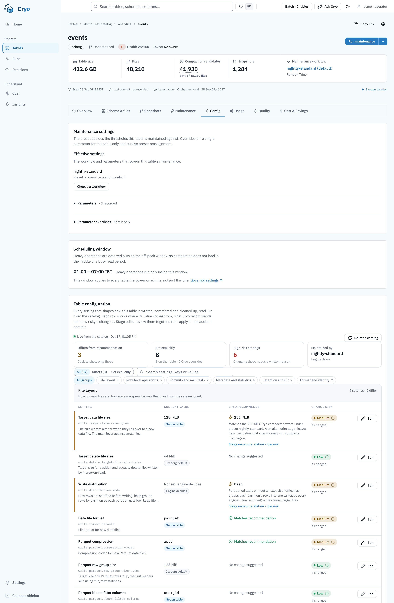
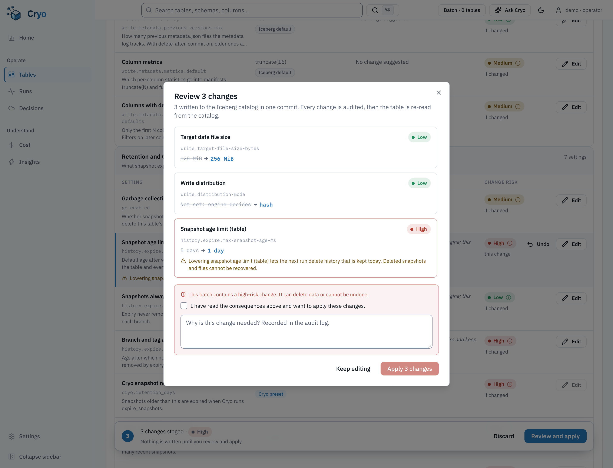

# Table configuration inventory (2026-10-17)

Branch `feat/table-config-inventory`. Replaces the "Iceberg table properties" block on the table
detail **Config** tab.

## Problem

- The old block listed only the property recommendations the scanner happened to produce. It never
  showed what a table is actually configured with, where a value comes from, or what a change risks.
- Three of the keys it tracked were not real Iceberg properties, so they never matched anything:
  - `write.sort-order` is not a property. Sort order lives in table metadata.
  - `write.merge-mode` and its siblings are spelled `write.merge.mode`, `write.update.mode` and
    `write.delete.mode`.
  - Result: `has_sort_order` was always false, and the merge-mode recommendation could never apply.
- The legacy apply path let a `format-version` "property" through. Iceberg reserves that key, and
  writing it as a property does not upgrade the table.
- `gc.enabled=false` was only shown as a banner. The planner still scheduled `expire_snapshots` and
  `remove_orphan_files`. GC off means the files may be shared with another table, which is why
  Iceberg's own actions refuse it. Not every engine path checked.

## What the Config tab shows now



Every row has:

- The setting's name and key, plus a one-line summary.
- The **current value**, formatted by type (MiB/GiB, days/hours, Enabled/Disabled, `v2`), with a
  **source badge**: Set on table, Iceberg default, Engine decides, Table metadata, Cryo preset, Table
  override, or Cryo default.
- **Cryo's recommendation** and the reason for it. It shows "Matches recommendation" when the table
  already agrees, or a contextual note when the right value depends on the owner's intent (GC,
  retention, row-level mode). One click stages the recommendation, showing its risk.
- **Change risk** (Low / Medium / High). This is direction-aware: it is the worst outcome of any
  direction the setting can move in. The ⓘ popover breaks it down:
  - what the setting does, and when it takes effect
  - whether it is reversible
  - the risk of each direction (lower, raise, turn on or off, reset), with what would happen
  - per-engine notes (Trino, Spark, Flink, Native, Cryo)
  - a link to the official docs
- **Edit** opens a typed editor:
  - enum → dropdown
  - bool → toggle
  - bytes → number plus MiB/GiB
  - duration → number plus hours/days
  - columns → searchable multi-select
  - text → textarea
  - Read-only settings show a lock with the reason instead.

Also on the page:

- Summary tiles: settings that differ from the recommendation (click to filter), settings set
  explicitly, high-risk settings, and the governing preset with its engine.
- Filters (All / Differs / Set explicitly), search, and group chips.
- A **Table metadata** card: format version, partition spec, sort order, identifier fields,
  branches and tags (refs with no max-ref-age are flagged as kept forever), snapshot and metadata-log
  counts, schema versions, statistics files, UUID, and the table and metadata locations.
- A collapsible **All table properties** list with search, covering every raw property, including
  ones outside the catalogue.
- When the live catalog read fails, a banner explains that values come from the last scan. Editing
  pauses until a live read succeeds, so nothing is written blind.

### Editing flow

1. **Stage.** Edits are staged, not written. A sticky bar counts staged changes and shows the
   batch's overall risk. Risk comes from a debounced `POST …/config/preview` against the live
   table.
2. **Review.** The dialog lists every change as old → new, with its risk, warnings and any block.
   A high-risk batch needs a checked acknowledgement plus a reason of at least 8 characters. The
   reason is recorded in the audit log.
3. **Apply.** Property changes are written in **one catalog transaction** (format upgrade, then
   set, then remove). Cryo overrides are saved to the table's `param_overrides`. Every change gets
   its own `table_config_change` audit row. The table is then re-read from the catalog, and the
   page re-renders from that read.



## Catalogue (34 settings, `cryo/table_config/settings.py`)

The catalogue is the single source of truth for keys, defaults, bounds, editors, consequences and
engine notes. Defaults are Iceberg's library defaults
([configuration](https://iceberg.apache.org/docs/latest/configuration/)); a test checks every
default against that list.

| Group | Settings |
| --- | --- |
| File layout | `write.target-file-size-bytes`, `write.delete.target-file-size-bytes`, `write.distribution-mode`, `write.format.default`, `write.parquet.compression-codec`, `write.parquet.row-group-size-bytes`, bloom-filter columns (virtual: one row for every `write.parquet.bloom-filter-enabled.column.*`), `write.object-storage.enabled`, `write.data.path` (read-only) |
| Row-level operations | `write.delete.mode`, `write.update.mode`, `write.merge.mode`, `write.delete.granularity`, `write.upsert.enabled` |
| Commits and manifests | `commit.retry.num-retries`, `commit.retry.min-wait-ms`, `commit.retry.max-wait-ms`, `commit.retry.total-timeout-ms`, `commit.manifest-merge.enabled`, `commit.manifest.target-size-bytes`, `commit.manifest.min-count-to-merge` |
| Metadata and statistics | `write.metadata.delete-after-commit.enabled`, `write.metadata.previous-versions-max`, `write.metadata.metrics.default`, `write.metadata.metrics.max-inferred-column-defaults` |
| Retention and GC | `gc.enabled`, `history.expire.max-snapshot-age-ms`, `history.expire.min-snapshots-to-keep`, `history.expire.max-ref-age-ms`, `cryo.retention_days`, `cryo.retain_last`, `cryo.orphan_retention_days` |
| Format and identity | `format-version`, `comment` |

The three `cryo.*` rows are Cryo preset parameters rather than Iceberg properties. Editing one
writes a per-table override. They are admin-only because lowering them deletes data. Format upgrades
are admin-only because they are one-way.

### Semantics the catalogue encodes

- **`gc.enabled`:** Java `Boolean.parseBoolean`. Only a case-insensitive `true` keeps GC on, so
  `"no"` or `"0"` means off.
- **`history.expire.*`** apply only to expiry run *outside* Cryo. Cryo always passes explicit
  retention to every engine, and the row's note says so.
- **Orphan age:** below 3 days is High, because files from in-progress writes may be deleted. On
  Trino, retention below 7 days warns, because Trino enforces a 7-day minimum for expire and orphan
  removal. The defaults are 3 days for Spark and 72 hours for native.
- **Target file size:**
  - Cryo's Spark and native compactions write it after every optimize, so a smaller value is reset
    on the next run. The warning appears only when the governing engine does this.
  - Trino honours the table property only from 482. Earlier versions use the catalog's
    `iceberg.target-max-file-size`.
- **Merge-on-read and upsert:** merge-on-read is blocked on v1 tables. Upsert is blocked without
  identifier fields.
- **Format version:**
  - Downgrades are blocked.
  - Upgrading to v3 is blocked, because PyIceberg (the write path) upgrades only to v2. The block
    message gives the Spark and Trino DDL to run instead.
  - Any upgrade is High.

## Write path (Source catalog)

Property writes go through the **Source** catalog with PyIceberg (`Transaction.set_properties`,
`remove_properties`, `upgrade_table_version`). This follows the precedent of the existing
`POST /tables/{id}/properties/apply`.

- These are metadata-only commits that change no data. No engine is involved, so this does not
  couple catalog access to an engine.
- The catalog read is bounded at 20 s (`run_bounded`) and cached for 30 s. Apply always does a fresh
  read and rejects a change whose `expected_value` no longer matches ("Changed since you loaded the
  page"), so two operators cannot overwrite each other blind.
- A failed catalog commit writes a FAILED audit row for each change and returns 502.

## API

```http
GET  /api/v1/tables/{table_id}/config?refresh=false   # viewer; falls back to the scan if the catalog read fails
POST /api/v1/tables/{table_id}/config/preview         # viewer; 503 if the catalog cannot be read
POST /api/v1/tables/{table_id}/config/apply           # operator; admin for min_role=admin settings
```

`apply` takes `{changes: [{key, value|null, expected_value, check_expected}], confirm, reason}`. A
`null` value unsets the property, or removes the Cryo override. Responses:

- **400:** a blocked change, nothing to change, or a high-risk batch without `confirm` and a reason
  of at least 8 characters.
- **403:** an admin-only setting changed without the admin role.
- **503:** the catalog could not be read.
- **502:** the catalog commit failed.

## Behaviour changes to call out

- **Planner GC gate (new safety behaviour).** `cryo/planner/execution.py::gate_gc_disabled` drops
  `expire_snapshots` and `remove_orphan_files` when the scan shows `gc.enabled` is false. It uses
  Java boolean semantics on `raw.iceberg_properties`, and falls back to `raw.gc_enabled`. The plan
  records a note that says why. Compaction and manifest rewrite still run.
- **Scanner key fixes (Go and Python).** The scanner now uses the real mode keys. Sort order is read
  from table metadata (`tbl.SortOrder().IsUnsorted()` in Go, `table.sort_order()` in PyIceberg)
  instead of the non-existent `write.sort-order` property. Parity tests were updated for both.
- **More tracked properties.** The scanner keeps the 15 extra keys the catalogue needs, so the scan
  fallback has real values.
- **Legacy property apply.** `format-version` in a property payload now always returns 400 and
  points to the Config tab. The legacy recommender no longer offers the v3 upgrade as "apply". The
  Files and Health tabs keep the legacy `PropertyRecommendations` panel, with its keys fixed.
- **Effective params hardening.** `get_effective_params` treats non-object JSON in
  `param_overrides` or preset `params` as empty instead of returning 500. `get_table_with_stats`
  loads only the stats and cost columns it needs.

## Verification

- `tests/test_table_config.py` has 34 tests. They cover:
  - catalogue integrity, and defaults against Iceberg
  - value sources and recommendations
  - direction-aware risk and normalization
  - the GC gate's Java boolean semantics
  - the endpoints: live read, scan fallback, preview, single-transaction apply with audits, stale
    `expected_value`, high-risk confirm, admin-only overrides, failed-commit audit, viewer 403
- The scanner, scanner-parity (Go binary), property, preset and orphan-gate suites pass.
- Frontend:
  - `tableConfig.test.ts` covers formatting, units, staging and error text.
  - `TableConfigInventory.test.tsx` covers rendering, the popover, the filter, locks and role gates,
    the stage → preview → apply flow, the high-risk acknowledgement and reason, scan fallback, the
    metadata card and raw properties.
  - `npm run quality` passes: 801 tests.
- Screenshots come from `e2e/docs-capture` (shots `table-config` and `table-config-review`). The
  fixture `demo-table-config.json` was produced by the real backend: a seeded SQLite database, a
  patched live read, then the GET and preview endpoints. The screenshots therefore show the real
  catalogue text.

## Known limits

- The v3 upgrade has to be done in Spark or Trino. PyIceberg 0.11 upgrades only to v2.
- Sort order and partition spec are shown, not edited. Changing them is a layout decision with its
  own rewrite cost; it goes through the Smart Layout flow.
- `write.data.path` is read-only. Moving data outside the table location breaks orphan cleanup's
  location check.
