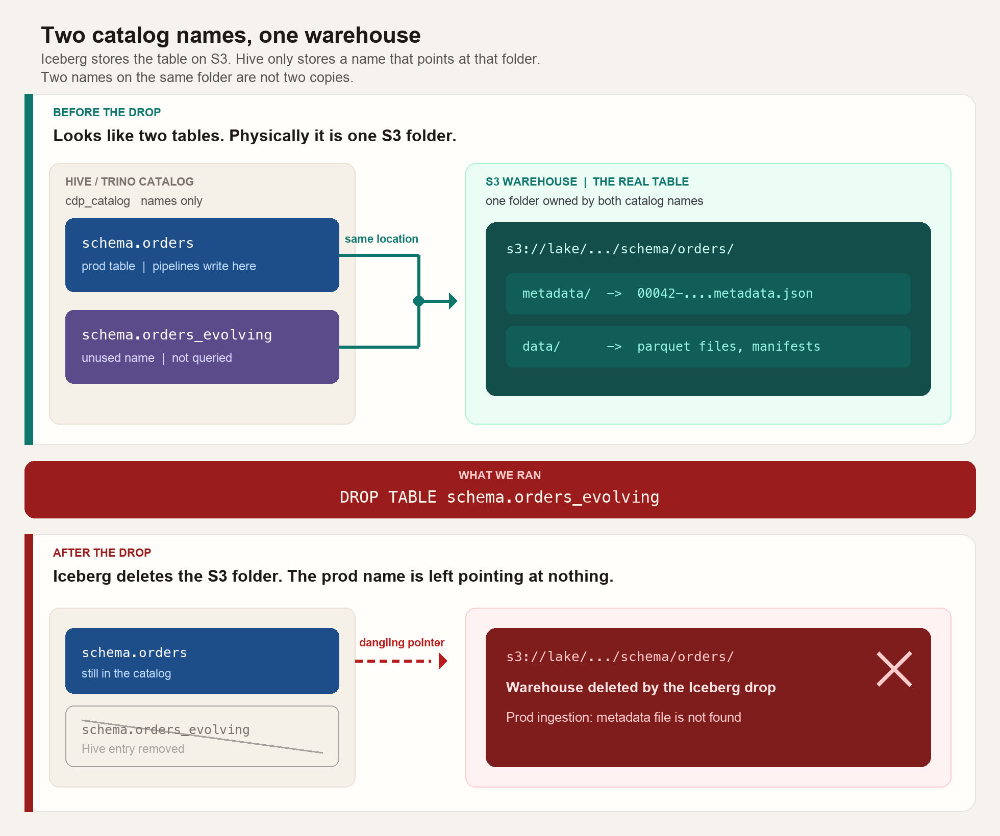

# RCA: Production Iceberg tables broken after dropping `_evolving` tables in `cdp_catalog`

**Catalog:** Trino `cdp` (Hive Metastore / `cdp_catalog`)
**When:** 14 Aug 2026 (Slack report ~16:51 IST)
**Symptom:** Prod ingestion failing with Iceberg **metadata file not found**
**Thread:** [Slack incident thread](https://pw-ipa8341.slack.com/archives/C05S6UNSJ1J/p1786706494920639)
**Status:** Resolved — tables restored

*Fill before publishing: severity, duration, number of tables, pipeline names, business impact.*

---

## Incident summary

We dropped unused `_evolving` tables in `cdp_catalog`. That drop also deleted the **production** Iceberg warehouses.

**Prod tables and `_evolving` tables pointed at the same S3 path.** They looked like two different tables in the catalog (different names), but they were two labels on the **same** folder of metadata and data. Any action on an `_evolving` table — especially `DROP TABLE` — therefore hit the matching prod table as well.

Ingestion then failed because the prod catalog entry still existed, but the metadata file it pointed at on S3 was already gone.

---

## Why two tables on one S3 path is dangerous

An Iceberg table is not “the name in Trino.” It is a **warehouse directory on S3** plus a **catalog pointer** to the current `metadata.json` in that directory.

If two catalog names share one location, they are not two copies. They are **one physical table with two names**.



*Read top to bottom: both catalog names point at the same S3 folder, so `DROP TABLE` on `_evolving` deletes the prod warehouse too.*

That shared path creates these risks:

1. **Drop is not scoped to one name.** Iceberg `DROP TABLE` removes the Hive entry **and** deletes the S3 prefix (`metadata/` and data files). The other name is left pointing at files that no longer exist. That is what happened in this incident.

2. **Orphan-file removal can delete another table’s live data.** This is the most dangerous maintenance op on a shared path, and it can run while both catalog names still exist.

   Iceberg `remove_orphan_files` lists objects under **this table’s** S3 location and deletes anything not referenced by **this table’s** metadata (current snapshot plus whatever snapshot history it still retains). It has no idea that a second Hive name is using the same folder.

   That is lethal when the two names have drifted even a little — two `metadata.json` files, two snapshot lists, two ideas of which parquet files are “live”:

   - Prod keeps writing. New data files land in the shared folder. Prod’s `metadata.json` lists them.
   - `_evolving` is stale or unqueryable. Its metadata does not list those files.
   - Orphan cleanup on `_evolving` treats prod’s new files as garbage and deletes them.
   - Prod queries then fail with missing data files / missing manifests, even though nobody dropped prod.

   The same pass can also delete the other table’s `metadata.json`, manifests, and delete-files, because those are just objects in the folder that this table’s metadata does not reference.

3. **The location prefix can be too wide, so unrelated tables get hit too.** Orphan removal and drop both walk the table `location` as if this table owned every object under it. If that location is a parent folder — a schema prefix, a warehouse prefix, or another table’s directory by mistake — cleanup will delete files that belong to **other** tables stored underneath, not only the intended twin. Shared exact paths are one failure mode; nested / overlapping prefixes are the same bug with a larger blast radius.

4. **Schema drift with shared files.** One name can be evolved or left unqueryable (`_evolving`) while the other is still prod. The broken name is not a sandbox; it is an alias of prod storage. Maintenance you would never run on prod is still running against prod’s files.

5. **“This table is unused” is the wrong check.** Query traffic on `_evolving` can be zero while prod is live on the **same path**. Unused **name** ≠ unused **data**. Zero queries also means nobody will notice orphan cleanup on that name until prod breaks.

6. **Recovery is hard.** After a purge, the remaining catalog row is a dangling pointer (`metadata file is not found`). Restore needs S3 versioning / backup plus a repaired `metadata_location`, not only a `CREATE TABLE`. Partial orphan deletes are worse to reconstruct: some files remain, some do not, and the two metadata logs no longer agree.

**Rule:** one warehouse path → one catalog table. A second name on the same path is an alias, not a copy. Never run `DROP` or `remove_orphan_files` on a table until its S3 `location` is unique and not a prefix of another table.

---

## What we were trying to do

`cdp_catalog` had many tables with suffix `_evolving`. They were not queryable.

The team confirmed they were not used, so we dropped them as catalog cleanup. That confirmation was about **names and query usage**, not about **whether the S3 location was unique**.

---

## What happened

1. `_evolving` tables were dropped in Trino / Hive (`cdp_catalog`).
2. Iceberg treated each drop as “this table owns this warehouse,” and **deleted the S3 path**.
3. Prod ingestion started failing: **metadata file is not found**.
4. Prod table S3 paths were missing.
5. Hive entries for the `_evolving` tables showed they used the **same** `location` as the prod tables.

So we did not drop a spare copy. We dropped an alias and Iceberg deleted the shared warehouse.

```
Before drop
  Hive:  schema.orders            ──┐
  Hive:  schema.orders_evolving   ──┴──►  s3://…/schema/orders/   (metadata + data)

After DROP TABLE orders_evolving
  Hive:  schema.orders            ──────►  s3://…/schema/orders/   (path gone)
  Hive:  schema.orders_evolving            (entry removed)

  Prod writers still look up schema.orders → metadata_location → file missing
```

---

## How this works technically

### 1. Catalog name and S3 location are separate

`cdp_catalog` is a Hive Metastore-backed Iceberg catalog. For each table Hive stores roughly:

| Piece | Role |
|---|---|
| `schema.table` | Name engines use (`cdp.schema.orders`) |
| `location` | Warehouse prefix on S3 |
| `metadata_location` | Current `….metadata.json` under that prefix |

Iceberg reads Hive → opens `metadata_location` → follows manifests → reads data files. If that JSON is missing, every read and every commit fails with **metadata file not found**, even though the Hive **name** is still there.

Nothing in Hive requires two names to have two prefixes. A second table can be created or registered with `LOCATION` / `register_table` pointing at an existing warehouse. That is how `_evolving` and prod ended up as two HMS rows on one prefix.

### 2. `_evolving` was a second pointer, not a second copy

An independent table would live under its own prefix, e.g. `…/orders_evolving/`. These did not. Hive showed the evolving table’s location equal to the prod table’s location.

They were unqueryable (schema/metadata mismatch, leftover evolution, etc.), which made them look like junk. Physically they were still the prod warehouse.

### 3. Iceberg `DROP TABLE` deletes the warehouse

`DROP TABLE` on Iceberg is not “remove the name only.”

Typical Trino / Spark Iceberg drop:

1. Deletes the Hive row for `_evolving`.
2. Deletes objects under that table’s S3 `location` (metadata and data), because Iceberg assumes exclusive ownership of that prefix.

Hive `DROP` on a registered Iceberg table can do the same when purge is enabled (`external.table.purge` / connector delete-on-drop).

The **safe** way to remove a duplicate **name** without touching data is unregister / drop **without** purge (engine-specific). That was not what ran. We issued a real Iceberg drop, so S3 was purged.

### 4. Why prod pipelines failed (not the evolving tables)

Writers (Spark / Flink / Trino jobs) target the **prod** name. On each commit they:

1. Read the prod Hive row.
2. Load current `metadata_location`.
3. Commit a new `metadata.json` and update Hive.

After the drop, step 2 failed: the JSON (and often the whole prefix) was gone. Hence **metadata file is not found** on prod ingestion, reported in [this Slack thread](https://pw-ipa8341.slack.com/archives/C05S6UNSJ1J/p1786706494920639).

Prod Hive rows were still present. Only storage was gone. That is why “the table exists in the catalog” and “S3 path does not exist” were both true.

---

## Why the unused check did not protect us

We checked: *does anyone query `_evolving`?*
We did not check: *does any other catalog table share this `location`?*

Zero queries on `_evolving` is expected for a leftover alias. The live table was the prod name on the same prefix.

---

## Impact

- Prod ingestion for tables whose `_evolving` twins were dropped failed with missing Iceberg metadata.
- Those Iceberg tables were unreadable until restore (queries, dbt, dashboards depending on them).
- Blast radius = every prod table that shared a warehouse with a dropped `_evolving` table, not the evolving names themselves.

---

## Recovery

All affected tables were restored by the team’s collective effort (S3 / metadata recovery and catalog repair so prod `metadata_location` pointers were valid again).

---

## Root cause

**Direct:** `DROP TABLE` on `_evolving` Iceberg tables deleted the shared S3 warehouse used by the corresponding prod tables.

**Underlying:** Two Hive/Iceberg catalog entries (`<table>` and `<table>_evolving`) pointed at the same S3 location. Catalog names were treated as isolated; storage was not.

---

## Corrective and preventive actions

**Corrective**

- All affected tables were restored by the team’s collective effort.

**Preventive**

- [x] **Cryo Anomalies page** (`/anomalies`) listing tables that share an S3 path (exact or nested prefix).
- [x] **Slack notification** at 10:00 IST when any tables share an S3 path (skipped when the harvest is clean). See [`docs/shared-s3-anomalies.md`](../shared-s3-anomalies.md).

**Operating rules going forward**

- Before dropping any Iceberg table — or running `remove_orphan_files` — confirm `location` is unique in the metastore and is not a parent prefix of another table.
- To remove a duplicate **name** only, unregister / drop without purge — never `DROP TABLE` until uniqueness is proven.
- Treat `_evolving`, `_backup`, `_tmp`, and similar suffixes as **high-risk aliases** until location uniqueness is checked, even if they are unqueryable.

---

## Lessons learned

1. In Iceberg + Hive, **the S3 location is the table**. The catalog name is only a pointer.
2. Unqueryable leftover names can still be wired to prod storage.
3. Usage checks on the name being dropped are not enough; **location uniqueness** is the gate.
4. This should be detected automatically (Cryo + Slack), not only during incident review.
