# Cryo brand and image guide

For the Cryo website, LinkedIn posts, blog illustrations and blog diagrams.
Give this whole file to an image AI, a writing AI or a designer.
If a tool only accepts a short prompt, paste a block from section 1.

Version 1, 2026-09-28. This file contains no secrets, customer data or internal production
numbers. Keep it that way, because it will be pasted into third-party tools.

---

## 0. Instructions for AI tools reading this file

1. Follow the **Always** and **Never** lists in section 2 for every image.
2. Use only the palette in section 4. Name each colour and give its hex value.
3. **Do not put words, letters, numbers or logos inside generated images.** A person adds the
   headline and logo afterwards in a layout tool (Figma, Canva, Keynote).
4. Do not draw labelled technical diagrams with an image model. Section 8 explains how they are
   made.
5. If a request breaks a Never rule, follow the rule and name the rule you followed.

---

## 1. The short version (paste these)

### 1.1 Style block: light canvas (the default)

```text
Cryo house style. A flat vector illustration that looks like a clean scientific cutaway plate
from a glaciology field notebook. Precise, even outlines in deep ice blue (#143E60). Flat
colour fills only. Orthographic three-quarter view. Calm, exact, engineered. At least 40% of
the canvas is empty background.
Palette (use only these): snow #F5FAFD for the background, white #FFFFFF, frost #EAF7FD,
firn #B8E1F3, glacier #68C1EA, core blue #277ABE, deep ice #143E60, slate #5C667A.
One accent only: a single small survey-orange (#EA580C) marker flag placed on the most
important detail. Nothing else is orange.
```

### 1.2 Style block: deep canvas (releases and announcements)

```text
Cryo house style, deep version. A flat vector illustration that looks like a clean scientific
cutaway plate from a glaciology field notebook. The whole background is deep ice blue #143E60.
Outlines in glacier #68C1EA and frost #EAF7FD. Fills in firn #B8E1F3 and core blue #277ABE,
used sparingly. Flat colour only. Orthographic three-quarter view. Calm, exact, engineered.
At least 40% of the canvas is empty background.
One accent only: a single small survey-orange (#EA580C) marker flag placed on the most
important detail. Nothing else is orange.
```

### 1.3 Exclusions: always add one of these

Each tool wants exclusions written differently.

- **ChatGPT / GPT Image, Gemini, Claude-driven tools** (state them as sentences):

  ```text
  Constraints: no text, letters or numbers anywhere. No logos, trademarks or watermarks.
  No gradients, glow, glass, neon, glossy 3D or lens effects. No people, faces or hands.
  No icebergs, snowflakes, penguins or polar bears. No robots, brains or circuit boards.
  Keep the empty area empty.
  ```

- **Midjourney** (add at the end of the prompt):
  `--no text, letters, numbers, logo, watermark, gradient, glow, glass, people, face, hands, iceberg, snowflake, penguin, polar bear, robot, brain, circuit board, neon, purple`

- **Google Imagen or any "negative prompt" box** (plain nouns, no "no"):
  `text, letters, numbers, logo, watermark, gradient, glow, glass, people, face, hands, iceberg, snowflake, penguin, polar bear, robot, brain, circuit board, neon, purple`

---

## 2. Always and Never

**Always**

- One idea per image.
- Show **the Core** (section 7.2) or its layer lines in every illustration.
- Use **exactly one** survey-orange marker, on the thing that matters.
- Leave at least 40% of the canvas empty, and keep the text zone for the format empty
  (section 7.4).
- Use only palette colours (section 4).
- Add real text, the wordmark and any product screenshot by hand in a layout tool.

**Never**

- Words, letters, numbers, fake interfaces, fake dashboards, fake charts, logos or watermarks
  inside an AI-generated image.
- **Icebergs.** The Apache Iceberg logo is an iceberg and belongs to the Apache Software
  Foundation. Floating icebergs also make Cryo look like every other Iceberg vendor.
- **Six-pointed snowflakes**, which read as Snowflake, a data-cloud company. Penguins and polar
  bears. Lakes, lake houses and houses.
- Gradients, glow, neon, frosted-glass panels, glossy 3D, lens flare, bokeh and floating
  particles. Purple.
- Robots, brains, circuit boards, holograms and "AI sparkle" icons.
- People, faces or hands generated by AI. Staged stock photos of people pointing at screens.
- Competitors' logos, screens, screenshots, illustrations or copy. Never upload them to an image
  tool as a reference.
- Real customer names or logos, production data, or unapproved claims (section 11).

---

## 3. The brand idea

### 3.1 In one sentence

**Cryo takes a core sample of your Iceberg tables. It looks inside, reads the layers, packs
loose snow into solid ice, and labels every sample.**

Everyone else in the Iceberg world shows the iceberg from the outside. Cryo shows the core
from the inside. The theme is **look inside**.

### 3.2 Why an ice core (the science is real)

| What glaciologists see (NSIDC) | What it means for Cryo |
|---|---|
| "Cryo" means cold. The frozen parts of Earth are the *cryosphere*. | The name already belongs to this world. |
| Unmelted snow builds up and turns into *firn*. Weighed down by new snow, firn "compress[es] and densif[ies], first into porous ice and finally into solid, almost transparent ice". | **Compaction**: many small files become a few large ones. |
| Cores show "the newest layers on top and the oldest layers on the bottom". Scientists date ice "through counting layers (like counting tree rings)". | **Snapshots**: layers of table history, and expiry of the oldest layers. |
| Firn traps air, "preserving a sample of the atmosphere". NSIDC calls snow "a data archive". | **Evidence**: metadata as a record you can read later. |
| Cores are cut into segments of up to a metre, then labelled and kept in cold storage. | **Receipts and fleets**: every table is a labelled sample on a rack. |

The metaphor is accurate, which matters because the audience is engineers. It also teaches:
each explainer image both explains a concept and repeats the brand.

### 3.3 Personality

Calm, exact and operational (see `PRODUCT.md`). Field scientist, not science fiction. Cryo is
confident because it shows its evidence. Write and draw like a senior engineer explaining to a
peer: plain words, real mechanisms, no hype.

### 3.4 Distinctive assets: what people should remember

Research on brand memory:

- A 2026 benchmark of 1,162 brand assets across 21 categories, four countries and nine years
  found that **shape** assets perform best: 40% of buyers link them to the brand, and 71% of
  those links are to that brand alone. **Colour** performs worst: 12% and 39%. The authors
  conclude that "reliance on color alone ... carries substantial risk" (Phua, Bali, Anesbury &
  Sharp, *International Journal of Advertising*).
- Blue is common in data-infrastructure brands, and Apache Iceberg's own logo is blue. Cryo
  cannot be remembered by its blue alone. It needs a shape.
- The Ehrenberg-Bass Institute adds that uniqueness matters most, and that "inconsistencies in
  colours, fonts, logos and the like are the enemy of distinctive asset building".

Cryo's assets, used together and in the same way for years:

| Asset | Kind | Job | Rule |
|---|---|---|---|
| **The Core**: a cut-open ice core, loose at one end and solid at the other | Shape | The main memory cue | In every illustration, always built as in section 7.2 |
| **The Marker**: a small survey-orange pennant flag | Shape and colour | Points at the one thing that matters | Exactly one per image |
| **Layer lines**: thin parallel lines, like strata | Pattern | Texture, dividers, backgrounds | Thin, parallel, never wavy |
| **The Tag**: a blank sample label on a string | Shape | Stands for "the receipt" | Used when evidence is the story |
| **Wordmark**: "Cryo" in IBM Plex Sans Bold | Type | Signature | Placed by hand, never drawn by AI |
| **Palette** (section 4) | Colour | Supports the others | Never the only cue |

Changing an asset needs the owner's sign-off. Do not refresh the look every campaign.

**Measure after about six months.** Show the Core, with no name, to 20 to 30 data engineers
and ask which product it reminds them of:

- **Fame** is the share of people who say "Cryo".
- **Uniqueness** is Cryo's share of all the brand names given.

This is the Distinctive Asset Grid method.

---

## 4. Colour

The blues come from the official Apache Iceberg logo SVG: `#277ABE`, `#68C1EA`, `#B8E1F3`,
`#EAF7FD` and `#F5FAFD`. Deep ice `#143E60` is derived from them. Using colours taken from a logo
is fine; using the logo itself is not (section 12).

The product's planned light theme uses the same blues. Until it ships, product screenshots show
the older cobalt accent (`#3566C8`). That is fine. **Never recolour a screenshot.**

| Name | Hex | Role |
|---|---|---|
| Snow | `#F5FAFD` | Default canvas and page background |
| White | `#FFFFFF` | Cards and panels on Snow |
| Frost | `#EAF7FD` | Tints, cut faces, selected areas |
| Firn | `#B8E1F3` | Light fills and borders. **Never text.** |
| Glacier | `#68C1EA` | Line work on the deep canvas. **Never text on light backgrounds.** |
| Core blue | `#277ABE` | Primary brand colour: Cryo components, buttons, solid ice |
| Deep ice | `#143E60` | Text, outlines and the deep canvas |
| Slate | `#5C667A` | Secondary text, arrows, ground lines |
| Survey orange | `#EA580C` | **The Marker only.** Never text, never large areas. |
| Night | `#0B0F16` | Dark-mode website background only (matches the product's dark theme) |

**Proportions**

- Light canvas: about 60% Snow and White, 30% blues, 10% Deep ice lines and text, and at most
  2% orange.
- Deep canvas: about 70% Deep ice, 25% Glacier, Firn and Frost line work, and at most 2% orange.

**Contrast** (WCAG 2.x, calculated 2026-09-28). Text needs 4.5:1. Large text (24 px and up)
and graphics needed to understand the image need 3:1.

| Pair | Ratio | Use |
|---|---|---|
| Deep ice on White / Snow / Frost | 11.12 / 10.58 / 10.18 | All text |
| Slate on White / Snow / Frost | 5.77 / 5.49 / 5.29 | Secondary text, arrows |
| White on Core blue | 4.55 | Button and node labels |
| Core blue on White | 4.55 | Links and labels on white |
| Core blue on Snow | 4.33 | Large text only (24 px and up) |
| White / Frost on Deep ice | 11.12 / 10.18 | Text on the deep canvas |
| Firn / Glacier on Deep ice | 8.00 / 5.51 | Text and lines on the deep canvas |
| Survey orange on White / Snow / Deep ice | 3.56 / 3.39 / 3.13 | Marker shape only |
| Glacier / Firn on White | 2.02 / 1.39 | Decorative fills only, with a Deep ice outline |
| Core blue on Deep ice | 2.44 | Fills only, with a Glacier outline. Never lines. |

**Status colours are for the product, not the brand.** Success `#1E8E5A`, warning `#A9791E` and
danger `#B23A2E` appear in diagrams only when the topic is status. Even then they are fills or
icons with a Deep ice label, never text colours: success and warning are only 4.14 and 3.86 on
white.

The Marker orange is a marketing asset only. It never goes into the product UI, where orange
and amber mean "warning".

---

## 5. Type

- **IBM Plex Sans** for everything: SemiBold 600 for headlines, Regular 400 for body text.
  **IBM Plex Mono** for code, operation names (`expire_snapshots`), IDs and version numbers.
  The product already bundles both, and both are free under the SIL Open Font License.
- Use sentence case. No all-caps headlines and no uppercase labels above headlines.
- **Social canvases 1,080 px wide:** headline 64 to 80 px, at most 8 words and 2 lines; supporting
  line 32 to 40 px. **Nothing smaller than 32 px**, because a phone shows the image at about a
  third of its size.
- **Website:** headlines 56 to 64 px on desktop, body 16 to 18 px. Otherwise follow `DESIGN.md`.
- **Numbers:** use tabular figures, always give a unit, and add a source line (section 11).
- **Text inside generated images:** avoid it. For a quick draft mock-up only, quote the text
  exactly and keep it to 25 characters or fewer (Google's Imagen guidance). Final assets always
  get their text in the layout tool.

---

## 6. Wordmark and logo

**Today, the logo is the wordmark:** "Cryo" in IBM Plex Sans Bold (700) with letter spacing of
-1%. This matches the product's sidebar.

- Colours: Deep ice on light backgrounds; White on Deep ice. Never orange, never a gradient,
  never outlined, stretched or given effects.
- Clear space: the height of the "C" on every side. Minimum height: 20 px.
- Spelling: always "Cryo". Never "CRYO" or "CryO". Lowercase "cryo" only in code and CLI
  commands.

**A future symbol** (brief for a human designer):

- Base it on the Core.
- It must read at 16 px.
- It must not look like a battery, a database-cylinder icon, a menu or filter icon, a snowflake
  or an iceberg. Test it at 16, 32 and 180 px, and squint at it.
- Draw it as a vector, by a person.

**Do not generate the final logo with AI.** The U.S. Copyright Office's January 2025 report on
copyrightability concludes that prompts alone do not make you the author of the output, and a
brand mark should be something you own. AI sketches are fine for exploring ideas.

---

## 7. Illustration system

### 7.1 How it is drawn

- Flat vector drawing in the style of a scientific cutaway: a clean plate from a field notebook.
- Even outlines about 2 px wide on a 1,080 px canvas, scaled with the canvas. Deep ice outlines on
  light canvases; Glacier outlines on the deep canvas.
- Flat fills only. At most one flat shadow shape (Firn) under an object on light canvases.
- Orthographic three-quarter view with no perspective distortion and no lighting effects.
- Objects rest on one thin Slate ground line.

### 7.2 The Core: how to build it

This is the primary asset, so build it the same way every time.

- **Body:** a cylinder about four times as long as it is wide. Its round end face is visible.
- **Orientation:** lying down in landscape formats; standing up in portrait formats.
- **Cut:** the near half is cut away along the whole length, so we see inside. The cut face is
  Frost with a Deep ice outline.
- **Three zones of equal length**, from the new end to the old end:
  1. **Loose:** 20 to 40 small squares, each about one-eighth of the core's width. They are
     tilted at random with gaps between them, in Frost and Firn with Deep ice outlines. These
     are small files, like fresh snow grains.
  2. **Packing:** 6 to 10 aligned rectangles, each about one-third of the width, with small
     gaps. This is firn.
  3. **Solid:** 1 to 3 blocks spanning the full width, filled Core blue with two thin Frost
     highlight lines. These are compacted files, like solid ice.
- **Layer lines:** 3 to 5 thin lines running the full length through all three zones. These
  are snapshots, layers of time.
- **Tag (optional):** a small blank label with a punched hole, hanging on a string from the solid
  end. No writing on it.
- **Marker:** a small survey-orange pennant on a thin pole, about half the core's width tall,
  planted on the solid zone. This is the default spot, unless the image is about something else.

**Orientation rule:**

- Standing up: new and loose at the top, old and solid at the bottom. This is how real cores
  form.
- Lying down: loose on the left, solid on the right, so it reads as "before → after".

**Deep canvas version:** Glacier outlines, loose tiles outlined in Frost with no fill, solid
blocks in Core blue outlined in Glacier, and a Frost tag.

### 7.3 Motif library: one picture per concept

| Concept | Picture | Where the Marker goes |
|---|---|---|
| The small-files problem | A snow field covered in thousands of tiny square tiles, seen from low down | Where to drill |
| Compaction (`optimize`) | The Core, loose to solid | On the solid zone |
| Snapshot expiry (`expire_snapshots`) | A standing core. The oldest slices at the bottom are lifted out into a tray beside it. | On the cut line |
| Orphan files (`remove_orphan_files`) | A few stray tiles lying outside a clean core, attached to nothing, gathered into a pile | On the gathered pile |
| Manifest rewrite (`optimize_manifests`) | A tidy card-index drawer beside the core | On the drawer |
| Load-aware admission (the governor) | Core segments on a conveyor, waiting at a gate with a simple gauge | On the gate |
| Choosing a table from the fleet | A rack of core segments in trays, one lifted out | On the lifted segment |
| Evidence and audit | A core with blank tags at the layer boundaries | On one tag |
| Read side kept apart from write side | Two separate benches. An inspection bench with a magnifier (read) is joined by a dashed line to a clipboard (the plan). The clipboard is joined by a solid line to a press on a second bench (write). | On the clipboard |

If one picture shows several operations, put them in the product's order, left to right:
`convert_deletes` → `rewrite_position_deletes` → `optimize` → `compute_statistics` →
`optimize_manifests` → `expire_snapshots` → `remove_orphan_files`. This order is defined in
`cryo/planner/guardrails.py`, so the picture never teaches a different order from the product.

### 7.4 Layout: where the art goes and where the text goes

| Format | Text zone (keep empty in the AI image) | Art zone |
|---|---|---|
| Portrait 1080×1350 | Top 38%, left-aligned, 80 px margins | Bottom 62% |
| Square 1080×1080 | Left half | Right half |
| Landscape 1200×627 | Left 55%, 60 px margins | Right 45% |
| Page cover 4200×700 | Left 30% stays empty (the logo sits over it); text, if any, centre-right | Right 40% |
| Website hero 16:9 | Left 40% | Right 60%, running off the right edge |

The wordmark goes in the bottom-left of social images, about 40 px tall on a 1,080 px canvas.

---

## 8. Diagrams for the blog and docs

Draw diagrams in a diagram tool: Mermaid, D2, Excalidraw or Figma. **Do not use an image AI**,
because labels and arrows must be exactly right.

**The diagram grammar.** Every diagram uses the same visual language.

| Element | Look |
|---|---|
| Cryo component (Scanner, Planner, Governor, Scheduler, Workers, API, Web UI) | Core blue fill, White label |
| Source / catalog on the read side (Iceberg REST, Hive, Glue) | Frost fill, Core blue outline, Deep ice label |
| Engine on the write side (Trino, Apache Spark) | White fill, Deep ice outline, Deep ice label |
| Storage (object storage, Postgres, Redis) | Cylinder shape, White fill, Slate outline, Deep ice label |
| Read path | **Dashed** Slate arrow |
| Write or execution path | **Solid** Slate arrow |
| The step this diagram is about | 3 px Survey-orange outline. **One per diagram.** |
| A group or boundary | Snow fill, Firn border, title in Slate |

**Rules**

- Flow runs left to right: Sources → Cryo → Engines → Storage, as in the README's architecture
  section.
- Use the product's names exactly. Write operation names in Plex Mono (`optimize`,
  `expire_snapshots`), in the order given in section 7.3.
- Name other products in text only. Do not use their logos.
- Export as SVG, or PNG at least 1,600 px wide, on a white background (not transparent), so the
  diagram stays readable in dark-mode readers.
- Give every diagram alt text and a one-sentence caption stating the takeaway.

**Mermaid theme.** Copy this; it uses the only theme Mermaid lets you customise (`base`) and hex
colours only. If your blog runs an older Mermaid that ignores front matter, put the same keys in
an `%%{init: ...}%%` directive.

```mermaid
---
config:
  theme: base
  look: classic
  themeVariables:
    fontFamily: "IBM Plex Sans, ui-sans-serif, system-ui, sans-serif"
    fontSize: "16px"
    background: "#ffffff"
    primaryColor: "#eaf7fd"
    primaryTextColor: "#143e60"
    primaryBorderColor: "#277abe"
    secondaryColor: "#ffffff"
    tertiaryColor: "#f5fafd"
    lineColor: "#5c667a"
    textColor: "#143e60"
    clusterBkg: "#f5fafd"
    clusterBorder: "#b8e1f3"
    edgeLabelBackground: "#ffffff"
---
flowchart LR
  classDef source fill:#eaf7fd,stroke:#277abe,stroke-width:1.5px,color:#143e60
  classDef cryo fill:#277abe,stroke:#143e60,stroke-width:1.5px,color:#ffffff
  classDef engine fill:#ffffff,stroke:#143e60,stroke-width:1.5px,color:#143e60
  classDef store fill:#ffffff,stroke:#5c667a,stroke-width:1.5px,color:#143e60
  classDef focus fill:#277abe,stroke:#ea580c,stroke-width:3px,color:#ffffff

  subgraph src [Sources - read]
    catalog["Iceberg REST catalog"]:::source
  end
  subgraph platform [Cryo]
    scanner["Scanner"]:::cryo
    planner["Planner"]:::focus
    governor["Governor"]:::cryo
  end
  subgraph dst [Engines - write]
    trino["Trino"]:::engine
  end
  storage[("Object storage")]:::store

  catalog -. metadata .-> scanner
  scanner --> planner
  planner --> governor
  governor -->|optimize| trino
  trino --> storage
```



---

## 9. LinkedIn

### 9.1 Sizes

LinkedIn changes these sizes. Check its help article "Image specifications for your LinkedIn
Pages and Career Pages" before a big launch:
<https://www.linkedin.com/help/linkedin/answer/a563309>. The figures below come from 2026
size guides.

| Use | Size (px) | Ratio | Notes |
|---|---|---|---|
| Feed image, portrait (**default**) | 1080×1350 | 4:5 | Takes the most screen space in the mobile feed |
| Feed image, square | 1080×1080 | 1:1 | |
| Feed image or link preview, landscape | 1200×627 | 1.91:1 | Also the website's `og:image` shape |
| Document (carousel) post | PDF, pages 1080×1350 | 4:5 | 6 to 10 pages |
| Company Page cover | Design at 4200×700 (shows at about 1128×191) | about 6:1 | The Page logo covers the left side |
| Page logo and profile photo | 400×400 | 1:1 | Wordmark on Snow |
| Personal profile banner | 1584×396 | 4:1 | The profile photo covers the lower left |

### 9.2 Generating at the right size

The illustrations have flat backgrounds, so you can always widen the canvas afterwards with the
same flat colour. That is how to reach ratios a tool cannot make.

| Target | GPT Image 2 `size` | Midjourney | Imagen | Finish in the layout tool |
|---|---|---|---|---|
| 1080×1350 | `1088x1360` | `--ar 4:5` | 3:4, then extend | Resize to 1080×1350 |
| 1080×1080 | `1088x1088` | `--ar 1:1` | 1:1 | Resize |
| 1200×627 | `1920x1008` | `--ar 191:100` | 16:9, then extend | Resize to 1200×630, crop to 627 |
| 4200×700 cover, 1584×396 banner | `2400x800` (3:1 is the limit) | `--ar 3:1` | 16:9 | Extend the flat background |
| Website hero | `2560x1440` | `--ar 16:9` | 16:9 | — |

GPT Image 2 needs both sides to be multiples of 16, a ratio of at most 3:1, and at most
8,294,400 pixels. OpenAI treats anything above 2560×1440 as experimental.

### 9.3 Four recurring series

A numbered series is itself something people remember.

1. **Core Sample No. N**: a single portrait image explaining one concept from section 7.3, on the
   light canvas. The post text carries the detail.
2. **Field Notes**: a document (carousel) post on the light canvas.
   - Page 1 is a cover showing the Core.
   - The middle pages hold one idea each, with at most 25 words and a diagram in the house style
     (section 8).
   - The last page says what to try, gives the repository address, and shows the wordmark.
   - A small series label goes top-left and the page number (`3/8`, in Plex Mono) bottom-right.
3. **Release vX.Y**: the deep canvas with a standing Core. The version number is in Plex Mono.
4. **Receipt**: a real product screenshot using demo data, placed in a white card with a 1 px Firn
   border on Snow. One orange marker, added by hand, points at the evidence. The caption says
   where the number came from.

---

## 10. Website

- The light canvas is the default: Snow page, White cards. A dark mode, if you add one, uses
  Night and the product's dark tokens (`web/src/styles/tokens.css`).
- **Hero:** on the left, a headline, one supporting line in Slate, a Core blue button with a
  White label, and a text link. On the right, the Core (template P5 in section 13).
- **Product screenshots:** real ones only, light theme, demo data. Put them in a plain frame with
  a 1 px Firn border and 12 px radius. No device mock-ups or reflections.
- **Section dividers:** three thin parallel Firn lines (the layer-line pattern).
- **Architecture:** the section 8 diagram style.
- **Footer:** the trademark line from section 12, the Apache-2.0 licence and the GitHub link.
- **`og:image`:** one per page, 1200×630, built from the landscape layout.
- **Favicon:** until the symbol exists, a White "C" in Plex Bold on a Core blue rounded square.
- **Motion:** at most one purposeful animation, such as tiles settling into blocks once on the
  hero, lasting under 1.2 s. No animation at all when the visitor has asked for reduced motion.

The product UI itself follows `DESIGN.md` and `PRODUCT.md` and contains no illustrations. The
Core lives on the website, social posts and the blog.

---

## 11. Words that go on images

Claims come from the published sell sheet. Do not paraphrase them into something stronger.

- **Fact line** (allowed today): "Cryo is an Apache-2.0, self-hosted Iceberg maintenance
  platform."
- **Promise** (positioning): "Iceberg maintenance you control, with results you can verify."

**Banned** (from section 10.5):

- "Cryo is the better tool."
- "The only open optimizer."
- A modelled saving presented as money.
- A competitor's benchmark numbers turned against them.

**Numbers:**

- Show a number only when its source and date sit next to it.
- Screenshots use demo data, for example from `make seed` in the local datalake.
- Never retouch numbers in a screenshot, and never let an image AI invent a number or a dashboard.

**Naming:** write "Apache Iceberg" in full the first time in every post or page, then "Iceberg".

---

## 12. Legal and trademarks

**Apache Iceberg (Apache Software Foundation):**

- Referring to Apache Iceberg by name is allowed as nominative use.
- ASF marks may not appear in Cryo's product branding.
- Project logos may be used only as a link to the project, unless you have written approval.
- A logo that is "confusingly similar" to a project logo is not allowed, even though the logo
  files themselves are Apache-licensed.

**Footer line for the website and blog:** "Apache, Apache Iceberg, Iceberg and Apache Spark are
either registered trademarks or trademarks of The Apache Software Foundation in the United States
and/or other countries. Other names may be trademarks of their respective owners."

**Other products** (Trino, Amazon S3 and so on): name them in text. No logos in AI images.

**Competitors:** do not use their screenshots, interfaces, copy or images in any form. That
includes uploading them to an AI tool as a style reference.

**AI tools:**

- Check each tool's commercial-use terms for your plan.
- Keep the prompt, model and reference images for every published image (section 15).
- Because AI output may not be protectable, make lasting brand marks (the logo, the Core master
  drawing) by hand.

**People:** do not depict real people, and never invent AI-generated "customers", quotes or
logos.

---

## 13. Prompt library

The order follows OpenAI's guidance: canvas and purpose → scene → subject → details →
constraints. For each prompt, start with the matching style block (1.1 or 1.2), then add the
template, then the exclusions for your tool (1.3).

**P1: Core Sample, LinkedIn portrait, light canvas**

```text
[Style block 1.1]
Canvas: portrait 4:5 image for a LinkedIn post. Keep the top 38% as empty snow background for
a headline that will be added later.
Scene: a plain pale surface with one thin slate ground line.
Subject: one ice core cylinder lying horizontally in the lower part of the canvas, cut open
along its length so we can see inside. From left to right the inside changes: many loose, small,
translucent square tiles scattered like fresh snow grains; then tiles packed tighter into medium
rectangles; then two or three large, clear, solid core-blue blocks filling the full width.
Three thin layer lines run the whole length of the core. A small blank paper sample tag hangs
from the solid end on a thin string, with no writing on it. One small survey-orange pennant
flag stands on the solid end.
[Exclusions 1.3]
```

**P2: Release, LinkedIn portrait, deep canvas**

```text
[Style block 1.2]
Canvas: portrait 4:5. Keep the top 38% empty for a headline and version number added later.
Subject: one ice core standing upright on a simple tray. Top third: loose small square tiles.
Middle third: tiles packing into rectangles. Bottom third: solid core-blue blocks. Three thin
glacier layer lines run top to bottom. One small survey-orange pennant flag stands at the
boundary between the loose and the packed zone.
[Exclusions 1.3]
```

**P3: Field Notes carousel cover, square**

```text
[Style block 1.1]
Canvas: square 1:1. Keep the left half empty for a title added later.
Subject, right half: a close-up of the cut face of an ice core segment, showing thin parallel
layer lines and a few small loose tiles settling into a solid block. One small survey-orange
pennant flag on the solid block.
[Exclusions 1.3]
```

**P4: Blog hero, landscape 1.91:1**

```text
[Style block 1.1]
Canvas: wide landscape 1.91:1 blog header. Keep the left 55% empty for a title.
Subject, right side: a simple storage rack holding six ice core segments in shallow trays, seen
from the front. One segment is lifted out and resting on the bench in front of the rack. One
small survey-orange pennant flag stands on the lifted segment.
[Exclusions 1.3]
```

**P5: Website hero, 16:9**

```text
[Style block 1.1]
Canvas: 16:9 website hero. Keep the left 40% empty for a headline and buttons.
Subject: one long ice core lying horizontally across the right 60%, running off the right
edge, cut open to show loose tiles on the left turning into solid core-blue blocks on the
right, with thin layer lines along its length and a blank tag on a string. One small
survey-orange pennant flag on the solid part.
[Exclusions 1.3]
```

**Concept tails.** Use one of these in place of the P1 "Subject" line, taking the picture from
the motif library in section 7.3:

- **Snapshot expiry:**

  ```text
  Subject: one ice core standing upright. Its thin layer lines are crisp at the top. At the
  bottom, the oldest two slices are lifted out and placed neatly in a tray beside it. The
  survey-orange flag marks the cut line.
  ```

- **Orphan files:**

  ```text
  Subject: a clean ice core segment lying on the bench. A few stray square tiles lie loose on
  the surface around it, touching nothing, and are gathered into a small pile. The
  survey-orange flag stands on the pile.
  ```

- **Load-aware admission:**

  ```text
  Subject: ice core segments waiting in a line on a simple conveyor. They reach a gate with a
  round gauge whose needle is low, and the gate lets one segment through. The survey-orange
  flag stands on the gate.
  ```

- **Read side and write side:**

  ```text
  Subject: two separate lab benches. On the left, an inspection bench with a magnifier over an
  ice core. A dashed line runs from the magnifier to a clipboard, and a solid line runs from
  the clipboard to a press on the right bench. The survey-orange flag stands on the clipboard.
  ```

**Midjourney** likes short prompts about the content. For example:

```text
flat vector scientific cutaway plate, glaciology field notebook style, horizontal ice core
cut open, loose small square tiles on the left packing into large solid blue blocks on the
right, thin layer lines along its length, blank tag on a string, one small orange pennant flag
on the solid end, pale snow white background, deep navy outlines, lots of empty space, calm,
precise --ar 4:5
```

Then add the `--no` list from section 1.3.

**Keeping a series consistent**

1. **Make the anchor.**
   - Run P1 10 to 20 times and pick the image that best follows section 7.2 and the palette.
   - Fix any colours in a vector or image editor; flat fills make this easy.
   - Save it as the anchor, and make a deep-canvas anchor from P2 the same way.
2. **Attach the anchor to every new image.**
   - *ChatGPT / GPT Image:* upload the anchor and write "Image 1 is the style reference. Apply
     Image 1's line weight, palette, flat fills and empty space to this new scene: …".
   - *Midjourney:* put the anchor in the Style Reference slot, or add `--sref <image URL>`. The
     style weight `--sw` runs from 0 to 1000; the default is 100. A style reference carries
     style, not objects, so keep the text prompt about the content.
   - *Gemini and others:* attach the anchor and write "match this style exactly".
3. **Repeat what must stay the same** on every edit, for example "keep the palette, line weight
   and empty area". Restating these invariants reduces drift.
4. **Keep three to five approved anchors** in one shared folder. Retire any that start to drift.

---

## 14. Check before publishing

1. **One idea:** it reads within three seconds on a phone.
2. **Assets:**
   - The Core or layer lines are present.
   - There is exactly one orange marker.
   - The colours are palette colours; check them with an eyedropper.
3. **Clean:**
   - No AI lettering or gibberish, stray logos, warped tiles or broken lines.
   - Nothing from the Never list in section 2.
4. **Text** (added by hand):
   - IBM Plex, sentence case.
   - At least 32 px on a 1,080 px canvas.
   - Colour pairs taken from the contrast table in section 4.
5. **Claims:** every number has a source and a date, and the copy matches section 11.
6. **Legal:**
   - "Apache Iceberg" is written in full at first mention.
   - The footer carries the trademark line.
   - No third-party logos appear in AI images.
7. **Accessibility:** alt text says what the image shows and what it means; every diagram has a
   caption.
8. **Files:** the image is the right size, the file is named as in section 15, and the prompt is
   saved beside it.

---

## 15. File names and records

- Name each file `cryo_{channel}_{yyyymmdd}_{slug}_{width}x{height}.png`, for example
  `cryo_linkedin_20261001_small-files_1080x1350.png`.
- Next to each published image, keep a `.txt` file recording the tool, the model and version,
  the full prompt, the reference images used and the seed, if the tool gives one.
- Keep approved anchors and master drawings in one shared folder, not scattered across personal
  drives.

---

## 16. Sources

- Phua, Bali, Anesbury & Sharp (2026). "Shape-based assets are strongest: benchmarking
  distinctive brand asset performance across industries." *International Journal of
  Advertising*. <https://doi.org/10.1080/02650487.2026.2637295>
- Romaniuk, J. "Brands of Distinction." Ehrenberg-Bass Institute for Marketing Science.
  <https://marketingscience.info/news-and-insights/brands-of-distinction>
- National Snow and Ice Data Center: "firn" <https://nsidc.org/learn/cryosphere-glossary/firn>
  and "What do ice cores reveal about the past?"
  <https://nsidc.org/learn/ask-scientist/core-climate-history>
- Apache Iceberg logo (source of the palette):
  <https://iceberg.apache.org/assets/images/Iceberg-logo.svg>
- ASF Trademark Policy: <https://www.apache.org/foundation/marks/>
- U.S. Copyright Office, *Copyright and Artificial Intelligence*, Part 2: Copyrightability
  (January 2025): <https://www.copyright.gov/ai/>
- OpenAI, "GPT Image Generation Models Prompting Guide":
  <https://developers.openai.com/cookbook/examples/multimodal/image-gen-models-prompting-guide>
- Google Cloud, "Prompt and image attribute guide" (Imagen):
  <https://docs.cloud.google.com/vertex-ai/generative-ai/docs/image/img-gen-prompt-guide>
- Midjourney, "Style Reference":
  <https://docs.midjourney.com/hc/en-us/articles/32180011136653-Style-Reference>
- Mermaid, "Theme Configuration": <https://mermaid.js.org/config/theming.html>
- W3C, WCAG 2.2 contrast (minimum):
  <https://www.w3.org/WAI/WCAG22/Understanding/contrast-minimum.html>, and non-text contrast:
  <https://www.w3.org/WAI/WCAG22/Understanding/non-text-contrast.html>
- LinkedIn, "Image specifications for your LinkedIn Pages and Career Pages":
  <https://www.linkedin.com/help/linkedin/answer/a563309>
- In this repository: `PRODUCT.md`, `DESIGN.md`, `web/src/styles/tokens.css`,
  `cryo/planner/guardrails.py`, `README.md` (architecture) and
  and the published claim rules.

## 17. Decisions for the owner

These are recommendations. Confirm or change them once, then keep them.

1. **Survey-orange marker as the only accent.** The alternative is no accent, but then Cryo has
   one shape asset instead of two.
2. **Light canvas for explainers, deep canvas for releases.**
3. **Wordmark weight:** Bold, matching the product's sidebar.
4. **Who draws the vector symbol** and the Core master drawing (section 6).
