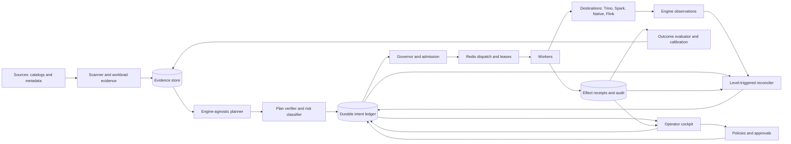

# Cryo 10/10 Master Plan

> - **Status:** Living strategy and execution plan
> - **Baseline date:** 2026-08-04
> - **Horizon:** 18-24 months, advanced only by evidence gates
> - **Planning assumption:** Six full-time engineers, one product/design lead, and fractional
>   security, technical-writing, and data-science support
> - **Purpose:** Turn Cryo from a strong, ambitious Iceberg maintenance platform into the most
>   trusted open control plane for keeping brownfield lakehouse fleets fast, safe, and economical.

## How this document fits the repository

The root [`plan.md`](../plan.md) remains the product vision and scope source of truth.
[`hld.md`](../hld.md) and [`lld.md`](../lld.md) remain the architecture and contract sources of
truth. This document owns the **sequencing, evidence bar, outcome metrics, and graduation gates**
for the journey to category leadership.

When older execution or research documents disagree with this plan:

1. Safety invariants and architecture constraints in `plan.md`, `hld.md`, `lld.md`, and
   `AGENTS.md` win.
2. This document wins for future sequencing and release gates.
3. Detailed implementation specifications remain authoritative inside their declared scope.
4. A capability is considered shipped only when the capability manifest and its conformance tests
   say it is shipped. Prose, checkboxes, and screenshots are not sufficient evidence.

This plan is deliberately outcome-gated rather than calendar-gated. Dates are forecasts; passing
evidence gates is the commitment.

**If you are an AI agent picking this plan up cold: read §0 first.** It is real, verified
production ground-truth gathered this cycle, not aspiration — it will save you from re-discovering
things at real production cost.

---

## 0. Operational ground truth as of 2026-08-04 — read this before Wave 0

This plan is a target-state strategy. This section is the actual, verified current state, gathered
from live work against the real `data-platform-cluster` production deployment, not from
documentation or memory. Treat it as more current and more trustworthy than any capability claim
elsewhere in this document or the repository until Wave 0 generates the capability manifest v0 that
is meant to supersede it.

### 0.1 Confirmed, already-fixed instances of the exact failure class Wave 1 targets

Three real production bugs were found and fixed on 2026-08-03/04, all sharing the root-cause shape
the Architecture workstream (§7.2) treats as a first-class risk: **unbounded per-tick work that
scales with backlog depth instead of with capacity.** Use these as calibration for A2/A3/A6, not as
solved-forever — they were fixed once, under time pressure, without the fault-injection matrix
(§9.7) this plan requires before a fix should be trusted long-term.

- **Governor admission-scan** (`cryo/governor/governor.py`, `run_wave()`): the per-destination
  admission loop's `if not replicas: break` throttle is tripped by every engine type via
  `replicas.pop(0)` except native `k8s_dispatch` destinations, which are packed on admit rather than
  assigned a replica — so the throttle never fires. At 11,000+ queued native jobs this scanned the
  entire queue every 30s tick, OOM-crashing the Governor 22 times in ~3 hours. Fixed by bounding the
  first prefetch pass to `len(replicas)` for native destinations via a `native_candidates_seen`
  counter. Regression test:
  `tests/test_queue_and_governor.py::test_governor_bounds_native_k8s_scan_to_replica_budget_not_full_queue`.
- **NativeJobWatcher dispatch-scan** (`cryo/engines/native/watcher.py`,
  `cryo/db/repositories/native_dispatch.py`): `tick()` called `list_active_dispatches()` with no
  limit — one `read_namespaced_job` K8s API round-trip per active dispatch, every 30s. Real K8s Jobs
  completed in 6-12s, but once several hundred dispatches were in flight the watcher fell behind and
  `MaintenanceJob` rows sat at `status='running'` 20+ minutes after the underlying Job had finished.
  Fixed with `limit` plus oldest-first ordering on `list_active_dispatches()` and a
  `max_dispatches_per_tick` cap (default 200) on the watcher. Regression test:
  `tests/test_native_dispatch_watcher_scan_bound.py`.
- **Dead-table classifier gap** (`cryo/engines/base.py`, `is_table_not_found_error()`): didn't
  recognize `NoSuchKey` combined with a missing `metadata.json`/manifest reference as a genuinely
  dead table (catalog metadata gone, not just a data file) — risked retrying forever on a table that
  can never succeed. Fixed by extending the pattern match narrowly enough not to also swallow the
  repairable phantom-manifest-entry corruption class.

### 0.2 A known, currently-real native-engine gap — relevant to the capability manifest (A4)

`optimize_manifests` has **zero direct native (iceberg-go) engine support** today. In the observed
production configuration, every job requiring it fell back to a full Spark-on-K8s dispatch, which is
both much slower (30s-5min+, versus 6-12s for native-only operations) and has produced real
production failures during live fleet maintenance (an AWS S3 `headObject` error reading a manifest
list inside `RewriteManifestsSparkAction`, plus a separate `BaseMetastoreTableOperations` error).
The canonical manifest now marks the operation as fallback-required and permits a compatible Trino
or Spark destination; runtime routing rejects incompatible destinations. This is exactly the kind
of silent capability gap A4's manifest exists to surface instead of leaving implicit: the
`(native, optimize_manifests)` cell must not look equivalent to `(native, optimize)`, and the
planner/UI must not imply direct native coverage. Scope rule 6 (§2.3 — "no hand-rolled native
manifest rewrite while upstream support ... [is] insufficient") is written correctly against this
exact gap; do not relax it without new upstream evidence.

### 0.3 Real observed scale — a starting data point for §6.6 and Wave 0's baseline

The live production fleet behind the findings above is on the order of 11,000-16,000 Iceberg tables
(an 11,222+-table zero-query cohort alone was large enough to OOM the Governor at full queue depth)
— nowhere near the 100,000-table GA scale target, which sits at the very top of the stated ICP range
(§2.1: "1,000-100,000 tables"), not at a typical point in it. A single native `k8s_dispatch`
destination's `slot_cap` was raised from 1 to 80 under urgent business pressure this cycle; observed
concurrent pod count stayed well below even that cap, meaning `slot_cap` itself was empirically
**not** the throughput bottleneck — the real ceiling is still open (candidates: the 30s Governor tick
interval, dispatch-packing/`chunk_gb` batch sizing, or pod scheduling/startup overhead). This is
tracked as its own investigation (Jira PDAE-8275) and lines up directly with A6's admission-latency
SLO (§10.1: "Eligible intent admission latency, p95 <=60s when capacity exists") — pull that
investigation's findings into A6 rather than re-deriving them from scratch.

### 0.4 Staffing reality check

Everything in §0.1-0.3 was found, fixed, deployed, and verified against real production load by one
human operator working with one AI pairing session — not the "six full-time engineers, one
product/design lead, fractional specialist support" planning assumption this document is
denominated in. Before treating any week-number in §8 as a commitment rather than a target, confirm
whether that staffing level now actually exists. If not, §2.4's "at most 10% to discovery" and the
wave-by-wave critical paths still hold as a *dependency order*, but every duration needs an explicit
multiplier for the real team size — this document does not currently provide one for fewer than
three engineers, and the project has so far operated with fewer than that.

### 0.5 Work already tracked — check before re-proposing

Jira project PDAE, epic PDAE-2572, has active tickets covering some of §0.1's fixes and adjacent
work: PDAE-8267 (critical bug fixes), PDAE-8272 (Governor OOM specifically), PDAE-8273 (dead-table
classifier), PDAE-8274 (fleet-wide cold-table cleanup, in progress), PDAE-8275 (admission-tick
throughput ceiling — see §0.3), PDAE-8276 (extending maintenance to actively-queried tables, i.e.
this plan's territory beyond the current zero-query-only cohort), PDAE-8277 (Trino query-log
ingestion gap feeding `query_count_30d`), PDAE-8278 (verifying a Spark cost-regression fix in
Grafana). Check current ticket state before treating any of this as unstarted work.

A separate real-dollar cost investigation exists at
[`docs/s3-cost-investigation-2026-08.md`](s3-cost-investigation-2026-08.md), pulled from the org's
actual AWS Cost & Usage Report (not Cryo's internal cost model — that's §7.7/D2 territory instead).
Its headline finding — a single actively-written table's uncontrolled snapshot/file growth was the
dominant real cost driver, not the much larger zero-query cold-table cohort — is an early, real data
point for what §5.1's Verified Maintenance Yield metric will eventually need to compute at scale, and
a concrete illustration of why AutoComp-style benefit ranking (§7.3, I3) needs to weight
write-frequency and retention debt, not just size or staleness.

### 0.6 Environment notes for whoever runs commands next

- `kubectl`, `aws`, and `infra` CLIs may not be on `PATH` in a fresh shell in this environment even
  though they are installed — check `/usr/local/bin` explicitly before concluding they are missing.
- Grafana (`platform-grafana.penpencil.co`) has two datasources that both surface under a "cost"
  search; only one is reachable (`ef75vmxq6mnswf`, Postgres). The other (`bdtp4f7ymy8zkd`, MySQL,
  found via an older dashboard's panel JSON) hangs indefinitely on every query, tested up to 100
  seconds. Full detail and a working query pattern are in `docs/s3-cost-investigation-2026-08.md` §1.
- `infra.penpencil.co` (an external auth service `infra use` depends on) has shown transient timeout
  failures independent of cluster health — retry `infra use data-platform-cluster` once or twice
  before concluding the cluster itself is unreachable.

---

## 1. Executive verdict

Cryo is already a compelling product idea. Its strongest code is not another scheduler or another
dashboard. It is the combination of:

- partition-aware planning from precomputed evidence;
- live engine-load-aware admission;
- explicit safety and blast-radius controls;
- explainable projected value;
- audited execution across separate sources and destinations.

That combination is rarer than the README makes clear. Amoro is the closest mature open-source
comparison; Dremio is the strongest commercial functional comparison. Managed services from AWS,
Databricks, and Snowflake are increasingly capable, but their best automation is coupled to tables
inside their managed boundary. Catalog projects such as Polaris, Lakekeeper, and Nessie solve a
different layer.

Cryo's weakness is equally clear: **the breadth of implementation and documentation has grown
faster than the body of production proof**. Conflicting status claims, multiple native-engine
stories, a long migration history, large central modules, and limited public scale or failure
evidence make the platform look more mature than it has yet proven itself to be.

> **The diagnosis:** Cryo is ahead on product insight and control logic, but behind on proof,
> coherence, and earned operator trust.

The path to 10/10 is therefore not "add every attractive feature." It is:

1. make the truth unambiguous;
2. make destructive effects recoverable and bounded;
3. prove the system under representative load and failure;
4. calibrate the intelligence from observed outcomes;
5. make every recommendation legible to an operator;
6. publish evidence that competitors cannot dismiss.

### 1.1 The category statement

> **Cryo is the open, catalog-agnostic maintenance control plane that continuously finds, proves,
> schedules, and verifies the highest-value Iceberg maintenance without harming production
> workloads.**

Short version:

> **Keep every Iceberg table fast, safe, and cost-efficient - automatically, but never blindly.**

### 1.2 The four promises

Every major product surface must reinforce four promises:

1. **Know:** identify the fleet's highest-value maintenance debt.
2. **Prove:** show evidence, uncertainty, blast radius, and expected return before acting.
3. **Protect:** execute only inside live workload, policy, and safety budgets.
4. **Learn:** measure the result, calibrate the model, and improve the next decision.

Anything that does not strengthen one of these promises is not on the critical path.

### 1.3 Directional baseline

These are qualitative planning estimates, not marketing scores. Wave 0 replaces them with measured
baselines.

| Dimension | Directional baseline | What is already strong | What prevents 10/10 |
|---|---:|---|---|
| Product idea | 8.5/10 | Clear operational pain and brownfield wedge | ICP proof and packaging are still thin |
| Architecture | 8.0/10 | Good source/destination separation and planning boundaries | Durable-effect semantics and state reconciliation need proof |
| Core intelligence | 8.3/10 | Partition-aware, benefit-aware, load-aware planning | Prediction calibration and controlled outcome studies are missing |
| UI/UX | 7.4/10 | Broad operator coverage and useful detail | Generic admin-console feel, weak uncertainty, limited usability evidence |
| Engineering maintainability | 6.8/10 | Strong tests and domain vocabulary | Oversized modules, migration/doc drift, overlapping implementation paths |
| Production maturity | 5.8/10 | Many correct ingredients | No sustained public soak, fault matrix, DR proof, or external security review |
| Differentiation potential | 9.0/10 | Unique closed-loop control-plane thesis | The moat is not yet packaged, proven, or publicly legible |
| **Overall** | **about 7.7/10** | Serious and unusually thoughtful foundation | Proof must catch up with ambition |

### 1.4 Where Cryo is better, and where it is not

| Comparison | Cryo can win on | Competitor currently wins on |
|---|---|---|
| Apache Amoro | Brownfield catalog neutrality, live query-load admission, explicit value proof | Project maturity, community recognition, integrated optimization history |
| Dremio | Open deployment, engine/catalog choice, auditable policy boundary | Turnkey UX, integrated query telemetry, commercial support |
| AWS Glue / S3 Tables | Cross-cloud and external-catalog control, operator-visible decisions | Managed operations, cloud-native integration, low setup burden |
| Databricks predictive optimization | Open engines and catalogs, no platform lock-in | Deep telemetry, automatic operation, production scale |
| Snowflake managed Iceberg | Multi-engine control and transparent execution | Fully managed experience inside Snowflake's boundary |
| Emerging LakeOps / Firn / Floe | Deeper governor, planner, and evidence-loop architecture | Narrower scope may permit a simpler first-run story; maturity remains unproven |
| Polaris / Lakekeeper / Nessie | Active maintenance and workload protection | Catalog governance, branch/version semantics, simpler category |

Cryo is not unconditionally "better." It is potentially best for teams that already have a mixed,
brownfield Iceberg estate and need automation without surrendering engine or catalog choice.

---

## 2. Strategic focus and non-goals

### 2.1 Ideal customer profile

Primary ICP:

- 1,000-100,000 Iceberg tables;
- multiple catalogs, engines, or clouds;
- maintenance currently implemented through Airflow, dbt macros, ad hoc SQL, or vendor-specific
  jobs;
- foreground query reliability matters more than maximum compaction throughput;
- a platform team owns cost and table health but cannot manually tune every table.

Primary users:

| User | Job to be done | Trust question |
|---|---|---|
| On-call platform operator | Stabilize the fleet without worsening an incident | "What is unsafe, and what can I stop now?" |
| Lakehouse owner | Keep tables performant and within policy | "What should run next, and why?" |
| FinOps / engineering lead | Prove maintenance pays for itself | "What was actually saved, not merely predicted?" |
| Data-product owner | Understand a table's health and proposed changes | "Will this improve my workload or surprise it?" |
| Security / governance lead | Verify who approved and changed data state | "Can I reconstruct every decision and effect?" |

### 2.2 Product boundaries

Cryo **is**:

- an Iceberg maintenance decision and execution control plane;
- a source of fleet health, maintenance debt, and realized-value evidence;
- an admission governor protecting shared query engines;
- an auditable automation layer across catalogs and execution engines.

Cryo **is not**:

- a replacement catalog;
- a query engine;
- a generic data-observability suite;
- a workflow orchestrator for arbitrary data jobs;
- an Airflow replacement;
- an autonomous LLM agent allowed to invent or execute destructive SQL;
- a reason to support every table format or every engine before Iceberg is excellent.

### 2.3 Scope rules

Until the Production Beta gate passes:

1. No new table format.
2. No new execution engine unless required by an active design partner.
3. No new AI provider feature on a destructive path.
4. No generic plugin framework before three real integrations demonstrate a stable contract.
5. No Kubernetes CRD/controller rewrite. Apply level-triggered reconciliation principles to the
   existing Postgres, Redis, and external-engine architecture.
6. No hand-rolled native manifest rewrite while upstream support and differential correctness are
   insufficient.
7. No native capability is enabled by default before differential, concurrency, and fault tests
   pass.
8. No autonomy level advances on benchmark evidence alone; representative production evidence is
   required.

### 2.4 Portfolio rule

At least 70% of engineering capacity goes to the current graduation gate, 20% to reliability and
maintainability, and at most 10% to discovery. The team may have no more than two net-new feature
initiatives in progress at once.

---

## 3. Evidence policy

Cryo must be stricter about evidence than the vendors it compares itself with.

### 3.1 Evidence grades

| Grade | Meaning | Allowed use |
|---|---|---|
| EV1 | Peer-reviewed primary research or independently reproducible production evidence | Can justify an experiment and target |
| EV2 | Official implementation documentation or a strong primary engineering report | Can justify constraints and design choices |
| EV3 | Reproducible Cryo benchmark with fixtures, raw results, environment, and code | Can graduate Alpha to Beta |
| EV4 | Representative production result from at least three independent deployments | Can graduate Beta to GA |
| Q | Unverified, contradictory, vendor-only, or citation-drifted evidence | Discovery only; never an autonomy justification |

Research suggests a mechanism; it does not prove that the mechanism will work for Cryo's fleets.
The required path is:

`paper or hypothesis -> offline replay -> shadow -> recommendation -> approved canary -> bounded
auto-apply -> broad auto-apply`

### 3.2 Research translated into product decisions

| Evidence | What it supports | What it does **not** support |
|---|---|---|
| AutoComp, SIGMOD 2025 | Fleet-wide benefit ranking, budgeted selection, outcome feedback | Trusting point estimates without calibration |
| LST-Bench, PACMMOD 2024 | Reproducible table-format workload packages | Calling a synthetic benchmark production proof |
| WAIR, SIGMOD 2026 | Incremental boundary-file reclustering driven by workload | Immediate autonomous reclustering on all tables |
| Okolnychyi et al., PVLDB 2024 | Minor/major delete maintenance based on delete state | A single engine-independent threshold |
| Qd-tree, SIGMOD 2020 | Workload-aware layout search as valuable prior art | Adding deep reinforcement learning to Cryo now |
| PTO author publication page (DOI verified, §3.3) | Candidate-space reduction, sampling, and learned scoring | Production use until results are independently reproduced by Cryo's own replay/shadow evaluation |
| Apache Iceberg maintenance docs | Snapshot/orphan safety and manifest-maintenance rules | Treating orphan deletion as an ordinary retryable task |
| Borg, Autopilot, SRE, Chubby, ARIES, FoundationDB | Bounded admission, fencing, reconciliation, write-ahead recovery, simulation | Claiming exactly-once effects through orchestration alone |
| Ecological Interface Design and NUREG-0700 | State visibility, abnormal-condition emphasis, operator control | Decorative "mission control" visuals without usable decisions |

### 3.3 Citation verification note

The PTO author page links DOI `10.1145/3786681`. Verified against Crossref's canonical metadata on
2026-08-04: this DOI correctly resolves to "PTO: A Workload-driven Predictive Table Optimizer for
Lakehouse Systems" (Meduri, Kreismann, Barber, Reinwald; IBM Research; *Proceedings of the ACM on
Management of Data*) — the same paper it is cited for here. There is no DOI/title mismatch. An
earlier draft of this plan asserted a mismatch with the Unity Catalog paper; that assertion was
incorrect and is retracted. PTO's evidence grade should rest on the normal EV1-to-EV4 replication
ladder (§3.1) — single-paper, not-yet-independently-reproduced results — not on a citation defect
that does not exist. This correction is itself exactly the kind of unverified claim the
documentation-truth gate (§12.3) exists to catch; it should have been checked before this plan was
first written, not after.

### 3.4 Quantitative anchors and transfer limits

These findings are useful because they shape experiments, not because Cryo can inherit their
results:

| Research result | Planning consequence |
|---|---|
| AutoComp reports deployment across more than 35,000 OpenHouse tables. Selecting its top 10 tables removed 7.44 million files versus 6.59 million for a manually selected top 100, about 12% more while selecting 10x fewer tables. One reported prediction missed compute cost by 19% and overestimated file reduction by 28%. | Fleet ranking is worth finishing. Point estimates are not trustworthy enough for automation without ranges and outcome calibration. |
| WAIR reports that more than 60% of queries in its real Mirrors workload ran at least 80% faster than no reclustering, with negligible reclustering overhead. | Boundary-file selection deserves a shadow experiment, but micro-partition results must be revalidated on Iceberg files and Cryo engines. |
| PTO's author page reports 11% lower average TPC-H latency and 36% lower TPC-DS latency at SF10K, with larger gains on scan-heavy queries. | Candidate-space reduction and simulation are promising. Single-paper, not-yet-independently-reproduced evidence (not a citation defect — see §3.3) keeps this at provisional evidence and out of autonomous execution. |
| The row-level operations study reports order-of-magnitude gains from engine and write-path improvements and shows that eager, lazy, minor, and major strategies have different cost profiles. | Delete maintenance must optimize combined read-plus-write cost by table class, not apply one global threshold. |
| LST-Bench packages multiple usage patterns rather than testing one isolated operation. | CryoBench must combine ingestion, reads, updates, maintenance, and failure rather than publish a compaction microbenchmark alone. |
| Qd-tree reports large physical-layout gains and results near the data-skipping lower bound on its evaluated workloads. | Learned layout is credible prior art, but simpler interpretable PTO/WAIR experiments come first. |

---

## 4. The measurable 10/10 scorecard

"10/10" means **independently defensible excellence**, not perfection and not a large feature count.
Every dimension must pass its gate for two consecutive release cycles, and all safety stop-ship
conditions must remain green.

| Dimension | 10/10 outcome | Required evidence |
|---|---|---|
| Product idea | The ICP repeatedly reaches measurable value faster than with scripts or a vendor silo | 12 design partners, 6 active pilots, 3 production references; median first useful scan <=30 minutes and first safely approved action <=1 business day; >=70% of activated fleets return weekly |
| Architecture | Restartable, bounded, multi-tenant control that does not lose acknowledged intent or widen planned effects | RPO 0 for acknowledged intent; stale-worker rejection; deterministic reconciliation; 2x target-load soak; source/destination separation fitness tests; recovery proof across every crash point |
| Core intelligence | Decisions create more verified value per maintenance dollar than simple baselines without harming query workloads | >=15% higher verified maintenance yield than size-only and threshold-only baselines at 95% confidence; prediction calibration gates; no autonomous cohort whose 95% VMY lower bound is below zero |
| UI/UX | An operator can understand state, decide, intervene, and verify outcomes under pressure | >=95% success on critical usability tasks, zero critical-task failures; SUS >=85; interventions <=3 interactions; WCAG 2.2 AA; p75 LCP <=2.5s and INP <=200ms |
| Engineering maintainability | A new engineer can change a core capability safely without decoding hidden coupling | documented package contracts; architecture fitness tests; critical-kernel mutation score >=80%; PR critical path <=15 minutes; flaky-test rate <1%; capability/docs drift check is blocking |
| Production maturity | The platform survives realistic load, dependency loss, operator error, and upgrades without unsafe effects | 30-day representative-load soak; 99.9% API SLO; kill/pause propagation p99 <=30s; restore drill RTO <=30 minutes; external security review; signed reproducible release and SBOM |
| Differentiation potential | The market can reproduce why Cryo is meaningfully different | Public benchmark and raw evidence; 3 production case studies; 4 supported source/engine combinations proven by conformance; 3 independent external contributors; a stable Maintenance Decision Record export |

### 4.1 Stop-ship conditions

Any one of these blocks a release regardless of schedule:

- a correctness invariant fails or live-row equivalence is uncertain;
- a predicate, partition, or byte scope can widen between plan and execution;
- a stale worker can commit after lease or approval revocation;
- an acknowledged intent can disappear;
- orphan deletion can run with uncertain writer activity or unsafe path normalization;
- plan hash, policy version, approval, and executed effect cannot be joined in audit;
- credentials are returned, logged, stored unencrypted, or exposed to the browser;
- queue growth is unbounded or a tenant can starve another tenant;
- pause/kill cannot bound new work within 30 seconds;
- an autonomous decision lacks calibrated uncertainty or an applicable capability proof;
- a migration or downgrade path can strand an existing production deployment.

---

## 5. North-star outcomes and metrics

### 5.1 Primary metric: Verified Maintenance Yield

Cryo's north-star metric is:

```text
Verified Maintenance Yield (VMY)
  = verified downstream savings / total maintenance cost
```

Where:

- verified downstream savings includes measured query-compute reduction, measured storage/request
  reduction, and avoided recurring maintenance cost with an explicit attribution method;
- total maintenance cost includes engine compute, object-store requests, rewritten bytes, and Cryo
  infrastructure;
- predictions never count as realized value;
- safety violations and material foreground-query regressions invalidate the measurement window.

Report the numerator and denominator beside the ratio. A high ratio on trivial spend must not look
better than meaningful absolute value.

### 5.2 Guardrail metrics

| Metric | Initial gate |
|---|---:|
| Data correctness violations | 0 |
| Scope-widening events | 0 |
| Unauthorized or stale effects | 0 |
| Foreground query p95 regression during maintenance | <=2% versus matched control |
| Foreground query p99 regression during maintenance | <=5% versus matched control |
| Maintenance budget overshoot | <=5%, never above hard byte/object cap |
| Actions admitted when their predicted value lower bound is <=0 | 0 |
| Jobs without complete decision-to-effect lineage | 0 |

### 5.3 Decision-quality metrics

- recommendation precision: percent of approved recommendations with positive realized VMY;
- recommendation coverage: percent of fleet maintenance spend represented by measured outcomes;
- calibration error by confidence band;
- median and p90 absolute percentage error for rewrite bytes, runtime, and compute cost;
- interval coverage: percent of actual outcomes inside predicted ranges;
- regret versus the best eligible action found in offline replay;
- percent of recommendations blocked for missing evidence rather than silently guessed;
- percent of workloads with a valid matched baseline.

Initial graduation targets:

- cost and rewrite-byte MAPE <=15% median and <=30% p90;
- 80% prediction intervals contain 75-85% of realized outcomes;
- >=90% of autonomous maintenance spend has a measured post-action outcome;
- >=85% recommendation precision over a rolling 90-day window.

### 5.4 Product and operator metrics

- time to first healthy connection;
- time to first complete scan;
- time to first understood recommendation;
- time to first safely approved action;
- time to detect, explain, and stop abnormal maintenance;
- percent of recommendations approved, dismissed with reason, or expired;
- percent of pages with a clear primary decision;
- weekly active fleets and weekly active operators;
- operator trust score: "I understand why Cryo acted" >=4.5/5.

---

## 6. Target architecture

The target architecture keeps Cryo's strongest existing separation and adds a durable,
level-triggered control loop. Postgres is the source of truth. Redis is an acceleration and lease
mechanism, never the sole keeper of acknowledged intent.



### 6.1 Durable intent contract

Every effectful action is bound to an immutable intent containing:

- tenant and actor;
- source table identity and destination identity;
- operation type and exact scope;
- observed base snapshot or metadata version;
- policy ID and policy version;
- canonical plan and plan hash;
- idempotency key and attempt lineage;
- approval identity, reason, and expiry;
- fencing epoch;
- maximum input bytes, output bytes, files, objects, partitions, and duration;
- required capability and minimum maturity tier;
- rollback or containment action where one exists.

Changing any bound field creates a new intent. A worker cannot "helpfully" re-plan.

### 6.2 Effect semantics

Cryo must not claim exactly-once execution. The correct contract is:

> **Durable orchestration with effectively-once external effects where the destination supports
> idempotency, conditional commit, or a safely probeable completion state.**

For each operation/engine pair, the capability manifest declares one effect strategy:

1. destination idempotency token;
2. conditional Iceberg commit against an observed snapshot;
3. stable external query/job reference plus outcome probe;
4. non-repeatable dangerous effect requiring manual reconciliation.

Unknown is never treated as failed and automatically retried. Dangerous plus unknown means stop,
probe, and escalate.

### 6.3 Reconciliation

The reconciler periodically compares desired intent with:

- job and step ledger state;
- Redis lease/fencing state;
- destination query/job state;
- current Iceberg snapshot and metadata;
- effect receipts;
- operator pause or cancellation.

It converges state without re-executing an ambiguous effect. Event notifications may accelerate
reconciliation, but a full sweep must recover from missed events.

### 6.4 Capability manifest

One machine-readable manifest is generated from conformance results and exposed through the API and
UI. Each source, destination, and operation combination has:

- `unsupported`;
- `experimental`;
- `shadow`;
- `human_approved`;
- `bounded_auto`;
- `ga`.

The UI, planner, worker, docs, and release notes consume the same manifest. This removes the current
class of "docs say shipped, worker says skipped" failures.

### 6.5 Multi-tenancy and security boundary

- tenant identity is mandatory in every repository query, queue key, audit row, and trace;
- authorization is checked at request, approval, admission, and execution;
- source credentials and destination credentials remain separate;
- secret values use encrypted storage or external secret references and never enter plan JSON;
- per-tenant queue, byte, concurrency, and object-delete budgets are enforced before global budgets;
- all policy changes and emergency overrides are append-only audited.

### 6.6 Scale target

See §0.3 for the real observed production scale this target should be measured against — it is
currently well below this profile, and `slot_cap` has already been shown empirically not to be the
binding throughput constraint at that scale.

The first GA target profile is:

- 100,000 tables;
- 10 million retained partition summaries;
- 10,000 candidate tables per planning cycle;
- 10,000 queued intents;
- 100 worker processes with governor-controlled real concurrency;
- 30 days of representative churn and dependency failure;
- 2x the expected peak admission and scan load without unbounded backlog.

If design-partner data shows a different bottleneck, the profile may change, but it must remain
customer-shaped and published.

### 6.7 Existing behavior is a non-regression contract

Hardening must not erase the operational behavior that already makes Cryo valuable. Conformance and
parity tests must preserve:

- partition-aware OPTIMIZE from stored scan evidence, with no live `$files` scan on a hot path;
- GB-budgeted chunking and maximum-partitions-per-chunk limits;
- oversized partitions running alone and the small-table full-table bypass;
- identity, day, month, and year partition transforms with correct raw-value conversion;
- `min_small_files` gating and small-file-count-descending partition priority;
- live load admission, per-replica caps, and round-robin destination use;
- cooldown, IST off-peak windows, adaptive budgets, deadlines, and quiet-window gates;
- failure isolation, per-table locking, and no duplicate maintenance;
- operation order:
  `expire_snapshots -> remove_orphan_files -> optimize -> optimize_manifests`;
- the established A-F health grade and WARN/CRIT deductions unless a versioned model migration is
  explicitly approved;
- complete action audit with table, operation, state, detail, engine, and duration;
- catalog-level Trino writer target configuration and only supported session properties before
  OPTIMIZE;
- separate Trino and Spark renderers, with no SQL emitted by the planner.

---

## 7. Workstreams

### 7.1 Product idea: make the wedge undeniable

| ID | Initiative | Deliverable | Exit evidence |
|---|---|---|---|
| P1 | ICP discovery program | 12 structured interviews and fleet profiles across platform, FinOps, and data-product roles | Top three jobs and blockers recur in >=70% of interviews |
| P2 | Design-partner program | Six instrumented pilots with a written success plan and baseline | Three progress to production and permit anonymized evidence |
| P3 | Time-to-value path | Connection check, capability check, first scan, first recommendation, safe approval | Median first useful scan <=30 min; first approved action <=1 business day |
| P4 | Value contract | A per-fleet value statement with measured numerator, cost, attribution, and confidence | Finance and platform owners agree on the calculation in 5/6 pilots |
| P5 | Packaging | Clear OSS core, optional enterprise boundary, support policy, and upgrade promise | No core safety or explainability feature is paywalled |
| P6 | Product pruning | Remove, archive, or explicitly mark features outside the four promises | Every nav item and roadmap epic maps to a promise and owner |

Required product narrative:

```text
Cryo does not merely run Iceberg procedures.
It chooses the next best maintenance action, proves why it is safe,
protects foreground workloads while it runs, and verifies whether it paid off.
```

### 7.2 Architecture: build the safety kernel

| ID | Initiative | Deliverable | Exit evidence |
|---|---|---|---|
| A1 | Durable intent ledger | Immutable intent, approval, scope, plan hash, budgets, expiry, and attempt lineage | Kill after every state transition; no acknowledged intent disappears |
| A2 | Fencing and conditional effects | Monotonic epoch plus per-engine effect strategy | 10,000 stale-worker attempts produce zero accepted stale effects |
| A3 | Level-triggered reconciler | Full-state sweep and engine probes separate from dispatch | Missed events and Redis loss converge without duplicate dangerous effects |
| A4 | Capability manifest | Test-generated source/destination/operation maturity matrix | API, UI, worker, and docs display identical status |
| A5 | Tenant boundary | Mandatory tenant context, row scoping, queue budgets, RBAC | Cross-tenant fuzz and integration tests show zero leakage or starvation |
| A6 | Bounded queues | Admission backpressure, fairness, deadlines, shedding, and age SLO | 2x load does not grow queues without bound; oldest eligible work progresses |
| A7 | API contracts | Versioned OpenAPI, generated web types, idempotent command endpoints | Contract suite covers compatibility and replay |
| A8 | Upgrade contract | Supported schema/API versions, expand-contract migrations, tested rollback boundary | N-1 to N upgrade and backup restore pass on production-shaped data |

### 7.3 Core maintenance intelligence: calibrated, not magical

#### The autonomy ladder

| Level | Behavior | Graduation rule |
|---|---|---|
| L0 Observe | Scan and explain current state | Evidence completeness and freshness pass |
| L1 Recommend | Rank actions with cost, value range, and blockers | Offline replay beats simple baseline |
| L2 Simulate | Replay workload or metadata without changing the table | Simulation error is calibrated |
| L3 Approve | Human approves an immutable plan | Canary outcomes are positive and correctly attributed |
| L4 Bounded auto | Low-risk policy executes within hard budgets | EV4 evidence, kill switch, negative-value gate |
| L5 Closed loop | Policy and ranking adapt from measured outcomes | External review and two release cycles without stop-ship event |

No table, operation, or engine inherits the level of another. Maturity is per capability.

| ID | Initiative | Deliverable | Exit evidence |
|---|---|---|---|
| I1 | Outcome data foundation | Joined observation -> plan -> attempt -> effect -> post-scan -> workload outcome dataset | >=90% lineage completeness for eligible jobs |
| I2 | Baseline suite | Size-only, file-count, threshold, FIFO, and random eligible baselines | Every model report includes baseline regret and confidence |
| I3 | AutoComp completion | Partition query frequency, MOOP traits, fleet budget, effectiveness loop | >=15% VMY lift over threshold-only baseline on holdout fleets |
| I4 | Cost calibration | Per-engine runtime, rewritten-byte, request, and query-impact intervals | Meets MAPE and interval-coverage gates in Section 5 |
| I5 | Delete lifecycle policy | Minor versus major policy by delete type, density, version, engine, and workload | Better combined read-plus-maintenance cost than threshold-only control |
| I6 | PTO shadow optimizer | Reduced candidate search, simulation, and interpretable recommendation; no auto-apply | Positive holdout results; provisional citation clearly labeled |
| I7 | WAIR boundary optimization | Offline boundary detector, then shadow and approved canary | Achieves >=80% of full-recluster pruning gain with <=35% rewrite bytes on target workloads |
| I8 | Engine differential oracle | Live-row multiset, snapshot, delete, partition, and scope equivalence across engines | Zero unexplained differential across the supported fixture matrix |
| I9 | Drift and abstention | Data/model drift alarms and explicit "insufficient evidence" outcome | Models abstain rather than extrapolate beyond tested domains |
| I10 | Safe policy learning | Contextual budget/ranking experiments only after deterministic baselines | Offline policy evaluation and bounded canary beat static policy without guardrail regression |

**Wave 3 implementation evidence (2026-08-04):** I1 now has a versioned
`cryo.maintenance-outcome/v1` dataset joining durable intent and plan identity, the nearest bounded
pre-action observation, audited effect, and first bounded post-action scan. Calibration abstains
when any required link is missing. This replaced an answer-leaking training path that copied
`actual_bytes_freed` into `predicted_bytes_freed`; incompatible caches are rejected and rewritten
atomically after retraining. History reads are bounded to 90 days before and seven days after the
selected outcomes rather than loading all history for selected tables.

I2 now reports deterministic size-only, file-count, threshold, FIFO, and seeded-random controls
against the same benefit-score utility and selection budget. The authenticated API and Table
Evidence UI report absolute/relative regret plus evidence confidence. This is repository proof of
the comparison machinery, not proof of the >=15% VMY exit gate.

Cost holdout evaluation is chronological and no longer substitutes heuristic predictions into
learned-model MAE. Outcomes outside the observed feature envelope are counted as abstentions,
excluded from learned accuracy and interval coverage, and surfaced in the Intelligence and Cost
views. Production lineage completeness, calibration coverage, VMY lift, and design-partner
automation evidence remain open.

Runtime and measured rewrite-output-byte intervals are now implemented with split-conformal
calibration. They use disjoint chronological fit, calibration, and evaluation slices; prefer
per-engine/action evidence; label pooled fallback; apply the finite-sample conformal rank; and
abstain outside the observed domain or when bands are too wide. Rewrite-byte outcomes are sourced
from durable effect receipts' measured `actual_bytes_written`, never mislabeled reclaimed bytes.
The local evaluation API reports MAPE, coverage, abstention, lineage completeness, and group scope.
Representative production sample size and the Section 5 calibration thresholds remain open gates.

The AutoComp realized-value loop is also implemented. Per-table feedback joins the frozen reclaim
prediction to audited realized reclaim and effect-receipt rewrite output, measures temporal drift,
and persists a versioned evidence record. Future partition scores receive a bounded 0.5-1.5
multiplier only after at least 20 lineage-complete, stable optimize outcomes; sparse, drifting,
malformed, or unknown-schema evidence leaves scores unchanged. This closes the repository feedback
mechanism, not the production VMY-lift gate.

I5 now derives successful minor position-delete runs since the latest major rewrite from the audit
ledger, escalates after a configurable bounded cycle, and routes equality-delete files directly to
major rewrite because the minor position-delete action cannot consume them. V3 position-delete
heuristics still abstain. A fail-closed evaluator compares complete, engine-matched minor and
threshold-only cohorts using delete-density reduction, measured rewrite output, runtime, and
subsequent p95 query latency. Sparse or unmatched evidence abstains, and historical cohorts always
remain advisory because they are not randomized counterfactuals. The repository measurement seam
is complete; a controlled representative holdout remains required before I5 can pass its
read-plus-maintenance cost gate.

#### Core ordering

1. Finish and calibrate AutoComp.
2. Finish delete-file lifecycle correctness.
3. Build PTO as a shadow recommendation and simulator.
4. Build WAIR boundary selection as an offline report.
5. Enable approved canaries.
6. Consider bounded autonomy only after production outcome evidence.

Qd-tree remains prior art, not an implementation track. Deep reinforcement learning is out of
scope until simple, interpretable models plateau on a large, clean outcome dataset.

### 7.4 UI/UX: the operator decision cockpit

The visual target is a **precise industrial control plane**, not a generic SaaS dashboard and not a
science-fiction theme. Normal state is calm. Warning colors are reserved for conditions that require
action. Data density is high, but hierarchy and progressive disclosure keep decisions clear.

Five primary product spaces:

1. **Fleet Pulse:** health debt, engine pressure, policy coverage, realized value, and top risks.
2. **Decision Inbox:** ranked recommendations with evidence, uncertainty, blockers, and approval.
3. **Table Evidence:** health history, workload, files/deletes, prior actions, and counterfactual.
4. **Control Room:** queue, active effects, engine saturation, pause/kill, and incident context.
5. **Connections:** catalogs, destinations, AI providers, Slack, and credential/capability health.

Engine choices in run and recommendation controls come from the capability manifest. Native and
Flink appear when configured and proven; the UI must never hardcode a Trino-only execution path.

| ID | Initiative | Deliverable | Exit evidence |
|---|---|---|---|
| U1 | Canonical design system | Resolve Ant Design versus Radix/Tailwind documentation and keep one supported stack | No duplicate primitive set; visual and accessibility gates cover all primitives |
| U2 | Decision card | Evidence, counterfactual, confidence range, blast radius, policy, and primary action | 90% of test users explain "why, risk, cost, and next step" without help |
| U3 | Fleet Pulse | One screen answers health, debt, saturation, value, and blockers | Five operator questions answered in <=60 seconds each |
| U4 | Control Room | Pause all, pause tenant, reduce budget, cancel where safe, and inspect unknown effects | Every critical intervention takes <=3 interactions |
| U5 | Simulation comparison | Current versus proposed outcome ranges with assumptions and caveats | Users distinguish predicted from realized value in 100% of tests |
| U6 | Guided activation | Connection tests, capability preview, scan progress, first recommendation | Meets P3 time-to-value target |
| U7 | Empty/error/unknown states | Actionable copy and recovery path; no success-shaped fallback | Usability tests cover dependency loss and partial evidence |
| U8 | Accessibility | Keyboard, focus, contrast, screen reader, charts, 200% zoom, reduced motion | WCAG 2.2 AA plus manual critical-flow audit |
| U9 | Performance | Route budgets, virtualization, query caching, payload and bundle budgets | p75 LCP <=2.5s, INP <=200ms, CLS <=0.1 on target hardware |
| U10 | Research cadence | Quarterly task-based studies with operators and incident scenarios | >=95% task success and SUS >=85 |

Every recommendation must visibly distinguish:

- observation;
- inference;
- prediction interval;
- policy decision;
- approval;
- execution state;
- realized outcome.

### 7.5 Engineering maintainability: reduce change risk

| ID | Initiative | Deliverable | Exit evidence |
|---|---|---|---|
| E1 | Architecture fitness tests | Import/layer rules for domain, planner, repositories, API, sources, and engines | Boundary violations block CI |
| E2 | Module decomposition | Split oversized API, worker, model, and repository modules along owned contracts | No new >800-line hand-written module without recorded exception; hotspot trend falls |
| E3 | Safety-kernel test quality | Property, metamorphic, golden, state-machine, differential, and mutation tests | >=80% mutation score for planner/verifier/admission/idempotency kernel |
| E4 | Deterministic fixtures | Versioned Iceberg fixtures across partitions, deletes, schema evolution, and engines | Same fixture runs locally and in CI |
| E5 | Migration hygiene | Document supported baseline, verify every migration, plan pre-1.0 squash with upgrade bridge | Fresh install, N-1 upgrade, and restore all pass |
| E6 | Documentation as code | Capability tables generated; links, API examples, and status claims checked | Drift check blocks merge |
| E7 | Ownership and ADRs | CODEOWNERS, package contracts, risk owners, and ADR index | Every critical package and invariant has an owner |
| E8 | Fast feedback | Split unit/contract/integration/soak lanes with caching and hermetic inputs | PR critical path <=15 min and flake rate <1% |
| E9 | Dependency policy | Automated updates, pinned artifacts, support windows, and vulnerability SLA | Critical fix <=48h; high <=7d |
| E10 | Developer activation | One-command supported setup plus realistic minimal fixture | New engineer runs a scan and targeted test in <=30 min |

Generated files, migrations, and vendored code are excluded from module-size targets. The purpose is
to expose hidden coupling, not game line counts.

### 7.6 Production maturity: prove the ugly cases

| ID | Initiative | Deliverable | Exit evidence |
|---|---|---|---|
| R1 | SLO and error-budget program | API, scan freshness, admission, kill, reconciliation, and audit SLOs | 30-day dashboard and alert history |
| R2 | End-to-end observability | OpenTelemetry traces, Prometheus metrics, structured logs, correlation IDs | One trace joins request, intent, queue, engine, Iceberg snapshot, audit, and outcome |
| R3 | Fault-injection matrix | Crash, network, Redis, Postgres, catalog, object store, engine, and clock scenarios | All crash points have expected convergence assertions |
| R4 | Soak and scale lab | Customer-shaped fleet generator and 2x target load | 30-day run without stop-ship event or unbounded resource growth |
| R5 | Safe rollout | Shadow, canary, cohort, automatic halt, and rollback policy | Forced regression halts rollout inside the declared budget |
| R6 | Backup and DR | Encrypted backup, restore automation, lost-region and lost-Redis drills | RPO 0 intents; RTO <=30 min in two consecutive drills |
| R7 | Security baseline | OIDC/SSO, RBAC, secret encryption/references, audit retention, threat model | External review has no open critical/high finding |
| R8 | Supply-chain integrity | SBOM, provenance, signature, pinned images, dependency scan | Release verifies from source to image |
| R9 | Upgrade safety | Compatibility matrix, expand/contract process, canary migration | Failed upgrade restores service and state within RTO |
| R10 | Runbooks and game days | Top incident runbooks and quarterly operator exercises | On-call resolves tested scenarios within SLO without author help |

### 7.7 Differentiation: turn implementation into a moat

| ID | Initiative | Deliverable | Exit evidence |
|---|---|---|---|
| D1 | CryoBench | LST-Bench-derived workload packages plus control-plane, failure, and cost scenarios | Public raw data, environment, scripts, confidence intervals, and competitor-safe methodology |
| D2 | Maintenance Decision Record | Stable export joining evidence, policy, immutable plan, effect, and outcome | JSON schema, examples, compatibility policy, three consumers |
| D3 | Capability conformance | Public matrix for source/catalog/engine/operation combinations | Every GA cell links to its exact test evidence |
| D4 | Production proof | Anonymized case studies with before/after, costs, caveats, and failures | Three independent production references |
| D5 | Ecosystem fit | OpenAPI, webhooks, Slack, Prometheus/OTel, Terraform/Helm, catalog integrations | Three integrations maintained outside the core team |
| D6 | Community trust | Governance, roadmap, security policy, good-first issues, release cadence | Three repeat external contributors and response-time SLO |
| D7 | Outcome flywheel | Privacy-preserving local calibration plus opt-in aggregate telemetry | Models improve without requiring customers to export query text or secrets |
| D8 | Category education | Honest comparisons, maintenance playbooks, benchmark reports, and talks | External references describe Cryo using the category statement |

The open Maintenance Decision Record is deliberately an export schema first, not a new network
protocol or standards project. It packages Cryo's strongest differentiated asset without creating a
platform detour.

---

## 8. Roadmap and graduation gates

Durations assume the staffing model at the top. With three engineers, execute the same dependency
order serially; do not halve quality gates.

### Wave 0: Truth, focus, and baseline (weeks 0-3)

**Goal:** make one honest version of Cryo exist.

Deliver:

- capability manifest v0 generated from current conformance tests (§0.2 has a known cell to seed it
  with: native has zero `optimize_manifests` support);
- reconciled current-state, roadmap, TODO, native-engine, and UI-stack claims;
- measured baseline for all scorecard metrics (§0.3-0.4 have real starting numbers — do not
  re-derive them from zero);
- package/hotspot map and migration support statement;
- 12 design-partner interview plan and first six interviews;
- feature freeze and stop-ship policy;
- evidence registry with source grade and verification date;
- corrected PTO citation and quarantined unsupported claims.

Exit gate:

- every operator-visible capability maps to code, owner, test, maturity, and limitation;
- no P0 contradiction remains among the canonical docs;
- baseline dashboard is reproducible;
- the next two waves are staffed and no out-of-scope feature is active.

### Wave 1: Safety kernel (weeks 3-11)

**Goal:** make acknowledged intent durable and external effects bounded.

Critical path: `A1 -> A2 -> A3 -> A4 -> A6`, with `A5` and `A7` in parallel.

Deliver:

- immutable intent and approval contract;
- per-engine idempotency/fencing strategy;
- full-state reconciler;
- bounded fair queues and emergency pause;
- joined decision-to-effect audit;
- property/state-machine tests and fault harness;
- native engine exposed only at its conformance-proven maturity.

Exit gate:

- RPO 0 for acknowledged intents;
- zero stale commits across 10,000 adversarial attempts;
- zero duplicate dangerous effects across the crash matrix;
- p99 pause propagation <=30 seconds;
- unknown effects halt and reconcile rather than retry;
- all stop-ship tests green.

**Release label:** Safety Alpha. No broad autonomy.

**Repository status (verified 2026-08-04):** the Wave 1 implementation gate passes.
Immutable intents, fencing, attempts, destination-specific receipts, cumulative
containment, level-triggered reconciliation, bounded tenant fairness, durable
pause controls, audited operator attestation, and the Control Room are wired and
covered by backend, Go, frontend, migration, lint, and type checks. Python-Go
scanner parity is exact for the full parity matrix.

**Graduation evidence still open:** durable intents remain default-off. The
production-shaped 10,000-attempt adversarial campaign, deployed p99 pause
propagation measurement, and RPO/duplicate-effect recovery report have not been
substituted with local unit evidence. Safety Alpha is therefore an available
release label, not a production-autonomy claim.

### Wave 2: Production-proof beta (weeks 8-20)

**Goal:** demonstrate that the system remains safe and useful under real conditions.

Deliver:

- CryoBench v1 and customer-shaped fleet generator;
- OTel/Prometheus/log correlation;
- SLO and error-budget dashboards;
- backup/restore and game-day program;
- OIDC/SSO, RBAC, secret protection, and security review;
- design-partner pilots;
- Fleet Pulse and Control Room critical flows;
- first 14-day soak followed by 30-day soak.

Exit gate:

- 30-day representative-load soak at target and 2x burst;
- three pilots complete safe maintenance;
- no correctness, authorization, or scope event;
- API 99.9% and kill/reconciliation SLOs pass;
- restore drill passes twice;
- no open critical/high security finding.

**Release label:** Production Beta. Human-approved maintenance is supportable.

**Repository status (verified 2026-08-04):** the first production-proof slices are implemented.
Bounded request/run/job/intent/attempt/effect correlation now survives asynchronous execution and
reconciliation; API and daemon processes expose SLO and durable-safety metrics; Prometheus rules and
the Cryo Safety & SLOs dashboard cover availability, pause propagation, and uncertain-effect RPO.
The supply-chain baseline now builds production dependencies from `uv.lock`, pins base-image
digests, verifies every downloaded Spark JAR, scans release images, emits an SPDX SBOM, publishes
build provenance, keyless-signs release digests, and requires Helm production image digests.
Dependabot covers Python, npm, GitHub Actions, Go, and Rust. Maintenance audit rows have a bounded,
indexed, configurable 365-day retention sweep owned by the leader scheduler. CryoBench v1 now emits
a deterministic, digest-addressed 12,938-table heavy-tailed fleet (including the known
397,000-partition outlier) and an evidence-linked fault matrix. Local fault models prove rollback
and retry, queue reconstruction from SQL state, and database-authoritative intent expiry; real
PostgreSQL failover, Redis process/data loss, and deployed clock-skew cells remain visibly open.
Encrypted PostgreSQL backup/restore tooling now uses authenticated chunked encryption, checksum
manifests, secret-safe subprocess arguments, and a destructive restore force gate. An optional Helm
CronJob publishes backups to offsite S3 with manifest-last commit semantics and scoped retention.
The associated runbook defines recovery order and evidence capture. Destination-scoped rollout
policies now enforce
minimum samples and automatically write an audited durable pause when terminal-attempt failures or
unknown-effect rates breach their declared canary/cohort budgets; automatic resume is forbidden.
The web client seeds API correlation IDs and presents the server-returned ID on failures so an
operator can move directly from an error toast to logs and traces.

**Graduation evidence still open:** repository controls are not proof of the Wave 2 exit gate.
External security review, representative 14/30-day soak, target and 2x fleet evidence, three
production pilots, scheduled off-host backup evidence, two restore drills, and deployed 30-day SLO
history remain required. The
checked-in production values also disable the insecure development token bridge; a real OIDC
configuration is required before production deployment.

### Wave 3: Calibrated intelligence and decision UX (weeks 16-32)

**Goal:** prove that Cryo makes materially better choices, not merely more choices.

Critical path: `I1 -> I2 -> I3/I4 -> I5`, with `U2/U5/U10` consuming the same evidence.

Deliver:

- complete outcome dataset and simple baselines;
- AutoComp fleet ranking and outcome feedback;
- calibrated cost/value intervals;
- delete lifecycle policy;
- decision cards, simulation comparison, and realized-outcome views;
- bounded automation for proven low-risk operations only.

Exit gate:

- >=15% VMY lift over simple baselines at 95% confidence;
- calibration targets pass;
- 90% decision-to-outcome lineage;
- >=95% critical UX task success and SUS >=85;
- no autonomous cohort has a negative 95% VMY lower bound; any such cohort halts automatically;
- three design partners opt into bounded automation.

**Release label:** Intelligent Beta.

**Current status:** in progress. The I1 lineage substrate, I2 baseline comparison machinery, cache
compatibility boundary, chronological holdout, cost-model domain abstention, local I4
runtime/measured-rewrite-byte interval machinery, and fail-closed I5 lifecycle evidence evaluator
are implemented and locally verified. The exit gate remains open pending production completeness,
statistically significant baseline lift and calibration, controlled lifecycle-policy evidence,
critical-task usability results, and design-partner automation evidence.

### Wave 4: Workload-aware layout optimization (weeks 28-48)

**Goal:** create the category-defining optimization layer without overclaiming.

Deliver:

- PTO shadow candidate search and simulation;
- WAIR offline boundary analysis and approved canary;
- cross-engine differential oracle for supported rewrites;
- model/domain drift and abstention;
- native Go compaction only for conformance-proven table classes;
- public benchmark report with raw data and caveats.

Exit gate:

- PTO and WAIR each beat declared baselines on holdout workloads;
- WAIR meets rewrite-efficiency target;
- every recommendation identifies domain, model version, evidence, and uncertainty;
- no unsupported table class reaches execution;
- approved canaries show positive realized VMY.

**Release label:** Advanced Optimization Preview. Auto-apply remains capability-specific.

**Current status:** in progress. PTO B1 now generates operator-only shadow recommendations from a
cardinality-aware candidate space and a low-confidence `heuristic_v1` objective. Final ranking is
bounded, insufficient distinct-query history abstains, and existing recommendations or approved
decisions are not overwritten. Read-only simulation uses observed file-touch history, exposes its
uncalibrated interval, and leaves recommendation state unchanged. Frozen workload distributions
support total-variation drift detection. WAIR has an offline boundary detector and bounded greedy
selector over deterministic bounded file samples from both scanners and frequency-ranked
two-sided SQL range evidence, with explicit missing-evidence abstention. A Trino/Spark differential
oracle now renders and fingerprints each candidate, rejecting any parameter not honored by both
engines. Versioned partition scopes are checked against 10 GiB/500-file ceilings and normalized
across dialects. Spark now exposes a rewrite-only rendering mode so scoped binpack can match Trino
without changing Spark's existing property-persistence default. Equivalent recommendations remain
canary-ineligible until holdout and production safety evidence exists. There is no PTO/WAIR
execution or auto-apply path. Holdout lift, production conformance, canaries, and benchmark
evidence remain open.

Temporal baseline replay is implemented as advisory holdout evidence. It uses chronological splits
and persists actor-attributed results, but explicitly cannot establish causal lift without
candidate-layout observations and therefore cannot satisfy the canary gate.

The controlled-shadow evidence contract and production-shaped output fixture contract are now
implemented. Controlled shadow can satisfy the causal holdout blocker only when an isolated,
adequately powered, evidence-bound A/B run clears scan, latency, and error thresholds. Output
fixtures prove row/schema/spec/scope invariants but remain synthetic and cannot satisfy production
provenance. Cryo does not orchestrate either rewrite path and no canary is enabled.

The production-safety proof now derives from Cryo's rollout policy, durable attempts/effects,
automatic halt audit, subsequent resume, and current pause state. It is short-lived and
policy-hash-bound. Every recommendation evidence link is revalidated against current PTO/scope
hashes, preventing stale evidence reuse. Real deployed output provenance remains an external gate.

The deployed provenance boundary is now implemented without widening operator authority. A
dedicated `evidence_collector` identity has no viewer/operator permissions, and ordinary operators
or admins cannot submit collector evidence. Fresh production observations are attestation-bound to
the authenticated collector, exact PTO and rewrite-scope hashes, source/output snapshot IDs,
metadata-location hashes, and row/schema/spec/scope fingerprints. The harness and runbook exist;
no real deployed run or canary is claimed.

### Wave 5: GA and external validation (weeks 44-64)

**Goal:** earn the right to call Cryo production-grade.

Deliver:

- three production case studies;
- independent architecture and security review;
- signed, reproducible release with upgrade/restore proof;
- stable Maintenance Decision Record v1;
- complete operator/developer docs and support policy;
- public capability and benchmark evidence;
- two consecutive releases meeting every GA gate.

Repository foundation now includes stable privacy-safe Maintenance Decision Record v1, its JSON
Schema and compatibility policy, plus a deterministic release dossier attached to the signed
release workflow. The dossier fingerprints repository-owned evidence and fails closed with explicit
missing statuses for production soaks, restore/upgrade proof, external reviews, case studies,
independent consumers, and contributors. Every signed release also renders and fingerprints the
complete transaction-wrapped PostgreSQL Alembic graph for both `base -> head` and `head -> base`.
This catches disconnected or non-renderable rollback paths but remains explicitly
non-production-qualified until a production-shaped drill verifies data preservation, API health,
availability, and duration in both directions. A public support policy now defines the release
window, safe support channels, stop-ship classification, diagnostic bundle, and capability
boundary without inventing a commercial response-time SLA. The dossier can consume external gates
only as gate-context-checked, exact-revision Ed25519 attestations under explicitly trusted verifier
keys. It enforces distinct evidence counts for restore drills, case studies, MDR consumers, and
repeat contributors; altered, stale-revision, self-unsigned, or duplicate evidence cannot graduate
a gate. The registry includes every Wave 0-6 external graduation dependency: interviews and
staffing, production baselines, the 10,000-attempt safety campaign, pause/RPO proof, infrastructure
faults and SLO history, calibration and controlled holdouts, bounded automation, deployed
conformance/canaries, reviews, qualifying releases, and independent adoption. This completes the
evidence-ingestion trust path, not any external gate itself.

Exit gate:

- all seven scorecard dimensions meet their required evidence;
- EV4 production evidence exists;
- no stop-ship event for two release cycles and 90 production days;
- external reviewers can reproduce the core claims.

**Release label:** 1.0 GA.

### Wave 6: Category leadership (months 16-24)

**Goal:** compound the moat rather than restart feature sprawl.

Candidates, admitted only through evidence:

- policy learning from a sufficiently large outcome corpus;
- deeper workload-layout adaptation;
- more source/catalog/engine combinations driven by partner demand;
- privacy-preserving aggregate fleet benchmarks;
- ecosystem-maintained connectors;
- upstream Iceberg contributions that remove native-engine gaps.

**Repository foundation (2026-08-05):** Cryo now has an admin-only, opt-in aggregate fleet
benchmark that publishes coarse rounded cohorts only after at least 10 distinct tables and 20
lineage-complete outcomes. Smaller cohorts are suppressed, direct identifiers are excluded, and the
record explicitly states that it is k-anonymous rather than differentially private. No telemetry is
sent automatically. `cryo.connector/v1` also defines a stable manifest and protocol-conformance
boundary for ecosystem source and engine packages without arbitrary plugin discovery or implied
core ownership. These are contribution and measurement seams, not evidence that policy learning,
external integrations, adoption, or category leadership has graduated.

Exit gate:

- improvements compound VMY without guardrail regression;
- external contributors and integrations reduce, rather than increase, core-team ownership;
- the category statement is reflected in independent adoption and comparisons.

---

## 9. Validation and experiment program

### 9.1 Benchmark matrix

Every benchmark report declares:

- Cryo commit and image digest;
- engine, catalog, Iceberg, object-store, and infrastructure versions;
- table schema, partition spec, sort order, snapshot count, delete mode, and file distribution;
- warm/cold cache state;
- workload trace and replay method;
- failure injection and background load;
- total cost, not only runtime;
- repetitions, confidence intervals, outliers, and raw data;
- limitations and where the result should not generalize.

Minimum table fixtures:

- unpartitioned and identity/day/month/year partitioned;
- small, medium, large, and oversized partitions;
- COW, position deletes, equality deletes, and supported v3 cases;
- schema and partition evolution;
- concurrent append, overwrite, and maintenance;
- mixed file sizes and manifest debt;
- path normalization and object-store edge cases.

Minimum execution combinations:

- REST catalog + Trino;
- REST catalog + Spark;
- at least one production-priority additional catalog;
- native Go only for its proven capability cells;
- MinIO for deterministic CI and at least one real cloud object store for EV4 evidence.

### 9.2 AutoComp experiment

Hypothesis: benefit-ranked, budgeted selection produces more verified file and query savings per
maintenance dollar than size-only and threshold-only selection.

Method:

1. Replay at least eight weeks of fleet observations.
2. Compare equal maintenance budgets.
3. Use temporal holdout to avoid future leakage.
4. Run shadow ranking before approved canaries.
5. Use a stepped-wedge or matched-table design where randomization is impractical.
6. Report absolute value, VMY, regret, calibration, and query guardrails.

Advance only if the lower confidence bound exceeds the baseline by 15%.

### 9.3 PTO experiment

PTO remains provisional until its results are independently reproduced in Cryo's own replay and
shadow evaluation (its citation metadata is verified as correct — see §3.3).

Method:

1. Generate candidate layouts from historical predicates.
2. Replay file min/max pruning on samples.
3. Compare with current layout and simple single-column alternatives.
4. Show feature attribution and uncertainty.
5. Rewrite only disposable fixtures, then approved canary tables.
6. Require enough post-rewrite queries to avoid declaring victory from noise.

Kill criteria:

- cannot beat simple heuristics after two representative evaluation cycles;
- prediction error remains above 30% p90 after calibration;
- rewrite payback exceeds the policy horizon;
- explanations are unstable under small workload changes.

### 9.4 WAIR experiment

Hypothesis: boundary-file selection captures most pruning improvement with materially fewer rewritten
bytes than full reclustering.

Compare:

- no reclustering;
- overlap-only selection;
- recent/hot-partition selection;
- WAIR boundary selection;
- full reclustering upper bound.

Advance only if it reaches at least 80% of full-recluster pruning gain with at most 35% of rewritten
bytes on the intended workload class and produces positive realized VMY.

### 9.5 Delete-policy experiment

Measure combined cost:

```text
read cost + write cost + delete maintenance cost + rewrite cost
```

Stratify by delete type, density, age, partition concentration, format version, and engine. Compare
minor, major, and threshold-only policies. A faster compaction that increases end-to-end cost does
not pass.

### 9.6 Governor experiment

Replay foreground load with:

- no maintenance;
- fixed maintenance concurrency;
- Cryo live-load admission;
- Cryo adaptive budget;
- engine degradation and recovery.

Pass if Cryo remains within foreground-query guardrails while completing more positive-value work
than a fixed-concurrency control under the same window.

### 9.7 Reliability simulation

Inject a crash before and after every durable transition and every external call:

- intent creation;
- approval;
- admission;
- lease acquisition;
- step begin;
- engine submit;
- engine completes but response is lost;
- effect receipt;
- audit write;
- outcome evaluation;
- lock release.

Run with duplicate delivery, reordered events, expired approvals, stale leases, clock skew, catalog
unavailability, Redis loss, Postgres failover, and engine timeouts. Assert convergence and every
safety invariant, not just process exit.

### 9.8 UX validation

Critical tasks:

1. identify the highest-risk table;
2. explain why the top recommendation exists;
3. distinguish prediction from realized outcome;
4. inspect blast radius and capability support;
5. approve a bounded plan;
6. stop new maintenance during an incident;
7. reconcile an unknown effect;
8. diagnose a failed connection without exposing credentials.

Test with realistic pressure and partial failures, not only happy-path prototypes.

---

## 10. SLOs, observability, and operations

### 10.1 Initial service levels

| SLI | Target |
|---|---:|
| API availability | 99.9% monthly |
| Acknowledged intent durability | 100% |
| Eligible intent admission latency | p95 <=60s when capacity exists |
| Emergency pause propagation | p99 <=30s |
| Orphan/unknown-effect detection | p95 <=2 min |
| Reconciliation convergence after dependency recovery | p95 <=5 min |
| Audit lineage completeness | 100% |
| Fleet scan freshness | 99% within configured interval + 10 min |
| Outcome evaluation completeness | >=90% of eligible spend within 24h |

Correctness and authorization are invariants, not percentage SLOs.

### 10.2 Required observability

Every intent gets one correlation identity across:

- API request;
- actor and approval;
- policy and plan hash;
- queue and lease;
- worker and step;
- engine query/job reference;
- Iceberg base and resulting snapshot;
- bytes/files/objects touched;
- audit receipt;
- post-action scan;
- realized outcome and model calibration.

Dashboards:

- fleet health and evidence freshness;
- admission demand, capacity, and rejected/expired work;
- queue age and fairness by tenant;
- engine pressure and foreground-query guardrails;
- unknown effects and reconciliation;
- value prediction versus outcome;
- model calibration and abstention;
- security and authorization denials;
- SLO/error-budget burn.

### 10.3 Safe rollout

Every behavior change follows:

1. offline fixture;
2. deterministic integration;
3. shadow;
4. internal canary;
5. one design partner;
6. cohort rollout;
7. default-on only after evidence.

Automatic halt conditions include query guardrail breach, cost overshoot, calibration drift,
unknown-effect increase, safety-test failure, or outcome lower bound below zero.

---

## 11. Security and governance

### 11.1 Security baseline

- OIDC/OAuth2 SSO and scoped service identities;
- least-privilege RBAC for observe, recommend, approve, execute, pause, override, and administer;
- multi-party approval option for orphan deletion and large rewrites;
- workload identity, IAM roles, IRSA, or equivalent short-lived cloud identity as the preferred S3
  authentication path; static keys only as an encrypted compatibility option;
- envelope encryption or external secret references;
- credential rotation without redeploy;
- no secrets in logs, traces, plans, browser responses, or support bundles;
- immutable, exportable decision and effect audit;
- signed images, SBOM, provenance, and verified dependency pins;
- documented threat model for catalogs, engines, object stores, callbacks, and AI providers;
- retention and redaction controls for query text and workload telemetry.

### 11.2 Destructive-operation policy

Orphan deletion, snapshot expiry, and broad rewrites require:

- verified writer quietness appropriate to the operation;
- retention greater than maximum observed writer duration plus safety margin;
- canonical path normalization and allowlisted storage prefix;
- dry-run inventory and object/byte cap;
- approval appropriate to blast radius;
- immutable plan and expiry;
- unknown-effect reconciliation;
- post-action Iceberg metadata and live-row validation where feasible.

### 11.3 Governance cadence

- weekly graduation-gate review;
- monthly scorecard and risk review;
- quarterly design-partner and usability synthesis;
- quarterly restore/game day;
- release-by-release evidence dossier;
- public roadmap changes include reason, owner, and removed scope.

---

## 12. Maintainability operating model

### 12.1 Architectural fitness functions

CI must enforce:

- domain and planner do not import database, API, or engine clients;
- planner emits no SQL;
- Trino and Spark SQL remain in separate renderer packages;
- sources and destinations never share credential/config models;
- API reaches persistence through repositories;
- all effectful worker paths use intent, verifier, step ledger, and audit;
- frontend API types are generated from OpenAPI;
- bulk selection sends a filter specification rather than page IDs;
- capability use is gated by the generated manifest.

### 12.2 Critical kernel

Treat these as the safety kernel with the highest assurance:

- predicate and partition transform math;
- chunking and blast-radius caps;
- plan canonicalization, hashing, and verification;
- admission budgets and fairness;
- intent state machine and fencing;
- step ledger and orphan recovery;
- destructive-operation quiet-window logic;
- secret redaction and tenant scoping.

Use property, model-based, mutation, differential, and fault tests here. Do not demand mutation
testing across low-risk presentation code simply to inflate a metric.

### 12.3 Documentation truth

Build a docs check that:

- validates local links and external citation metadata;
- detects capability tables not generated from the manifest;
- flags stale "shipped" claims;
- verifies command examples against CLI help/OpenAPI where practical;
- requires verification dates on volatile upstream claims;
- distinguishes present behavior, target behavior, and proposal.

Point-in-time analyses are dated and never silently treated as living truth.

---

## 13. Category and open-source strategy

### 13.1 The public proof package

A release evidence dossier contains:

- capability manifest;
- benchmark commit, raw data, and environment;
- safety and fault matrix;
- scale/soak summary;
- SLO and known-limitations summary;
- security and supply-chain artifacts;
- migration and rollback proof;
- measured case studies;
- model cards and calibration where intelligence is enabled.

### 13.2 Community trust

Before a major public launch:

- clear governance and maintainer roles;
- security policy and private disclosure path;
- support and compatibility windows;
- contributor guide with a 30-minute path;
- issue/PR response-time targets;
- public roadmap with explicit non-goals;
- good-first issues that are real, bounded work;
- no benchmark whose raw data or method is withheld.

Track CHAOSS-aligned health signals, but do not optimize vanity counts. Repeat contributors, review
latency, contributor retention, and ownership distribution matter more than stars.

### 13.3 Competitive response

| Threat | Response |
|---|---|
| Managed vendors support more external catalogs | Win on cross-vendor neutrality, evidence portability, and visible governance |
| Amoro broadens and matures | Win on live workload protection, outcome calibration, and operator trust; contribute upstream where interests align |
| Catalogs add maintenance | Integrate; remain the cross-catalog decision and evidence layer |
| Lightweight daemons copy basic automation | Publish why safe admission, reconciliation, and outcome proof matter |
| AI-first tools claim autonomous tuning | Demonstrate calibrated abstention and immutable policy boundaries |
| Scope makes Cryo too difficult to operate | Keep one-command activation, capability-driven UI, and ruthless non-goals |

---

## 14. Staffing and ownership

Recommended core team:

| Role | Primary ownership |
|---|---|
| Control-plane engineer 1 | Intent, fencing, reconciliation |
| Control-plane engineer 2 | Governor, queue, tenancy, API contracts |
| Maintenance/engine engineer | Planner, engine conformance, native Go, Iceberg correctness |
| Data/experimentation engineer | Outcome dataset, calibration, benchmarks, models |
| Frontend/product engineer | Decision cockpit, performance, generated clients |
| Reliability/security engineer | Observability, fault injection, DR, security, supply chain |
| Product/design lead | ICP, usability, packaging, narrative, design system |
| Fractional reviewers | Security, technical writing, statistics, accessibility |

Each graduation gate has one directly responsible owner and one independent reviewer. The author of
a destructive capability cannot be its only release approver.

---

## 15. Risk register

| Risk | Leading indicator | Prevention / containment | Owner |
|---|---|---|---|
| Data loss from destructive maintenance | Unknown writer state, path drift, scope mismatch | Quiet windows, canonical prefixes, dry run, caps, conditional commit, stop-ship tests | Engine + reliability |
| Duplicate or stale effect | Lease churn, lost response, ambiguous query state | Durable intent, fencing, engine probe, no blind retry | Control plane |
| Intelligence overconfidence | Calibration drift, sparse outcomes, unstable features | Ranges, abstention, model card, shadow/canary, simple baseline | Data/experimentation |
| Foreground workload harm | p95/p99 burn, queue saturation | Live admission, automatic halt, hard budget, pause SLO | Governor |
| Documentation drift | Conflicting shipped claims | Generated capability truth and blocking docs check | Tech writing + package owners |
| Native engine corruption | Differential mismatch, unsupported table class | Capability cells, fixture oracle, upstream primitives, default-off | Engine |
| Multi-tenant leak/starvation | Missing tenant filters, dominant queue | Mandatory context, row tests, weighted fairness, quotas | Control plane + security |
| Migration failure | Long chain, irreversible step, old deployment gap | Expand-contract, production-shaped upgrade/restore test | DB owner |
| UI hides uncertainty | Point estimates, warning saturation | Decision anatomy, calibrated ranges, task tests | Product/design |
| Feature sprawl returns | WIP growth, roadmap items without metric | Portfolio rule, non-goals, gate review | Product lead |
| Vendor closes feature gap | External-catalog announcements | Double down on neutrality, evidence, and integrations | Product |
| OSS trust stalls | Core-only ownership, slow reviews | Contributor paths, governance, maintained integration seams | Maintainers |

---

## 16. The first 90 days

### Days 0-30

- [x] Freeze net-new scope.
- [x] Generate capability manifest v0 from existing tests.
- [x] Reconcile current-state, TODO, native, UI-stack, and roadmap claims.
- [x] Correct or quarantine citation drift, beginning with PTO.
- [~] Baseline every scorecard metric and hotspot (repository and known production facts captured;
  production SLO, workload, scale, security, and usability measurements remain explicitly open).
- [ ] Complete six ICP interviews and recruit three pilots.
- [ ] Write the durable-intent and effect-semantics ADR.
- [ ] Define CryoBench v1 workload and failure matrix.
- [ ] Instrument missing intent-to-engine trace links.

### Days 31-60

- [ ] Land immutable intent and approval lineage behind a feature flag.
- [ ] Implement per-engine effect strategy and fencing tests.
- [ ] Build full-state reconciliation without automatic dangerous retry.
- [ ] Add bounded queue/fairness overload tests.
- [ ] Ship the first Fleet Pulse and emergency Control Room usability prototype.
- [ ] Run the first crash-point simulation suite.
- [ ] Establish SLO and calibration dashboards.
- [ ] Start the first two instrumented pilots.

### Days 61-90

- [ ] Pass RPO 0 and stale-worker adversarial gates.
- [ ] Run a 14-day target-load soak.
- [ ] Complete backup/restore and lost-Redis game days.
- [ ] Publish internal CryoBench v1 results with raw data.
- [ ] Complete outcome lineage for existing AutoComp decisions.
- [ ] Run critical-task usability tests with at least eight operators.
- [ ] Close all critical/high security-baseline gaps or block the release.
- [ ] Re-score the seven dimensions from evidence, not opinion.

---

## 17. Final 10/10 graduation checklist

Cryo may describe itself as meeting this plan only when all are true:

### Product

- [ ] Twelve design partners, six active pilots, and three production references.
- [ ] Time-to-value and weekly-return targets pass.
- [ ] The top jobs and product boundary are stable across two quarters.

### Architecture

- [ ] RPO 0 for acknowledged intent.
- [ ] Fencing, reconciliation, queue fairness, tenancy, and upgrade gates pass.
- [ ] Source/destination and planner/engine boundaries are CI-enforced.

### Intelligence

- [ ] VMY lift, calibration, lineage, abstention, and query guardrails pass.
- [ ] Every autonomous capability has EV4 evidence for its exact engine/table class.
- [ ] Negative-value actions automatically halt the responsible policy cohort.

### UI/UX

- [ ] Critical-task success >=95%, no critical-task failure, SUS >=85.
- [ ] WCAG 2.2 AA and performance budgets pass.
- [ ] Operators can explain, intervene, and verify within the target times.

### Engineering

- [ ] Architecture, drift, test-quality, migration, and feedback-time gates pass.
- [ ] Every critical invariant has an owner and independent reviewer.
- [ ] A new engineer completes the activation target.

### Production

- [ ] 30-day 2x-load soak and 90 production days pass without a stop-ship event.
- [ ] DR, game day, external security, supply-chain, and SLO gates pass.
- [ ] Upgrade and rollback are proven on production-shaped data.

### Differentiation

- [ ] Public reproducible benchmark and three measured case studies exist.
- [ ] Capability evidence covers at least four valuable source/engine combinations.
- [ ] Maintenance Decision Record v1 has three consumers.
- [ ] Three repeat external contributors or maintainers exist.

### Independent review

- [ ] An external Iceberg expert reviews correctness claims.
- [ ] An external SRE/security reviewer signs off the production evidence.
- [ ] Operators from outside the core team reproduce the critical usability tasks.
- [ ] All known limitations are published beside the claims they constrain.

---

## 18. Primary research and source bibliography

### Maintenance intelligence and lakehouse systems

- Gruenheid et al.,
  [AutoComp: Automated Data Compaction for Log-Structured Tables in Data Lakes](https://doi.org/10.1145/3722212.3724430),
  SIGMOD 2025.
- Liu et al.,
  [Workload-Aware Incremental Reclustering in Cloud Data Warehouses](https://doi.org/10.1145/3802127),
  SIGMOD 2026.
- Yang et al.,
  [Qd-tree: Learning Data Layouts for Big Data Analytics](https://doi.org/10.1145/3318464.3389770),
  SIGMOD 2020.
- Okolnychyi et al.,
  [Petabyte-Scale Row-Level Operations in Data Lakehouses](https://doi.org/10.14778/3685800.3685834),
  PVLDB 2024.
- Camacho-Rodriguez et al.,
  [LST-Bench: Benchmarking Log-Structured Tables in the Cloud](https://doi.org/10.1145/3639314),
  PACMMOD 2024.
- Meduri, Kreismann, Barber, and Reinwald,
  [PTO: A Workload-driven Predictive Table Optimizer for Lakehouse Systems](https://doi.org/10.1145/3786681),
  Proceedings of the ACM on Management of Data (SIGMOD 2026). DOI verified against Crossref
  canonical metadata on 2026-08-04 — resolves correctly to this paper. Still treated as provisional
  pending independent reproduction (§3.3), not for citation-integrity reasons.
- Apache Iceberg,
  [Maintenance documentation](https://iceberg.apache.org/docs/latest/maintenance/).

### Reliable control planes

- Verma et al.,
  [Large-scale cluster management at Google with Borg](https://research.google/pubs/large-scale-cluster-management-at-google-with-borg/).
- Rzadca et al.,
  [Autopilot: Workload Autoscaling at Google](https://research.google/pubs/autopilot-workload-autoscaling-at-google-scale/).
- Google,
  [Handling Overload](https://sre.google/sre-book/handling-overload/), Site Reliability Engineering.
- Amazon Builders' Library,
  [Making retries safe with idempotent APIs](https://aws.amazon.com/builders-library/making-retries-safe-with-idempotent-APIs/).
- Brooker,
  [Exponential Backoff and Jitter](https://aws.amazon.com/blogs/architecture/exponential-backoff-and-jitter/).
- Burrows,
  [The Chubby lock service for loosely-coupled distributed systems](https://research.google/pubs/the-chubby-lock-service-for-loosely-coupled-distributed-systems/).
- Mohan et al.,
  [ARIES: A Transaction Recovery Method](https://doi.org/10.1145/128765.128770).
- Zhou et al.,
  [FoundationDB: A Distributed Unbundled Transactional Key Value Store](https://www.foundationdb.org/files/fdb-paper.pdf).
- Kubernetes,
  [Leases](https://kubernetes.io/docs/concepts/architecture/leases/) and
  [controller pattern](https://kubernetes.io/docs/concepts/architecture/controller/).

### Operator UX, engineering quality, and open-source trust

- Vicente and Rasmussen,
  [Ecological Interface Design: Theoretical Foundations](https://doi.org/10.1109/21.156574).
- Parasuraman, Sheridan, and Wickens,
  [A Model for Types and Levels of Human Interaction with Automation](https://doi.org/10.1109/3468.844354).
- U.S. NRC,
  [NUREG-0700: Human-System Interface Design Review Guidelines](https://www.nrc.gov/reading-rm/doc-collections/nuregs/staff/sr0700/).
- Nielsen Norman Group,
  [Progressive Disclosure](https://www.nngroup.com/articles/progressive-disclosure/).
- Hullman et al.,
  [Hypothetical Outcome Plots outperform error bars and violin plots](https://doi.org/10.1371/journal.pone.0142444).
- W3C,
  [Web Content Accessibility Guidelines 2.2](https://www.w3.org/TR/WCAG22/).
- Ford et al.,
  [Building Evolutionary Architectures](https://www.oreilly.com/library/view/building-evolutionary-architectures/9781491986356/).
- Ousterhout,
  [A Philosophy of Software Design](https://web.stanford.edu/~ouster/cgi-bin/book.php).
- Papadakis et al.,
  [Mutation Testing Advances: An Analysis and Survey](https://doi.org/10.1016/bs.adcom.2018.03.015).
- OpenTelemetry,
  [Documentation](https://opentelemetry.io/docs/).
- CHAOSS,
  [Community health metrics](https://chaoss.community/kb-metrics-and-metrics-models/).
- ACM,
  [Artifact Review and Badging](https://www.acm.org/publications/policies/artifact-review-and-badging-current).

### Competitive primary sources

- Apache Amoro, [project documentation](https://amoro.apache.org/).
- Dremio, [Open Catalog](https://www.dremio.com/platform/open-catalog/).
- AWS Glue,
  [Automatic compaction of Iceberg tables](https://docs.aws.amazon.com/glue/latest/dg/compaction-management.html).
- Amazon S3 Tables,
  [Maintenance](https://docs.aws.amazon.com/AmazonS3/latest/userguide/s3-tables-maintenance.html).
- Databricks,
  [Predictive optimization for Unity Catalog managed tables](https://docs.databricks.com/aws/en/optimizations/predictive-optimization).
- Snowflake,
  [Apache Iceberg tables](https://docs.snowflake.com/en/user-guide/tables-iceberg).
- Apache Polaris, [project site](https://polaris.apache.org/).
- Lakekeeper, [project site](https://lakekeeper.io/).
- Project Nessie, [project site](https://projectnessie.org/).

---

## Closing standard

Cryo becomes category-defining when an operator can ask:

> "What is the safest, highest-value thing we can do for this fleet right now?"

and Cryo can answer with evidence, act within a hard budget, survive interruption, and return with a
measured result.

That is the 10/10 product. Everything in this plan exists to earn that answer.
