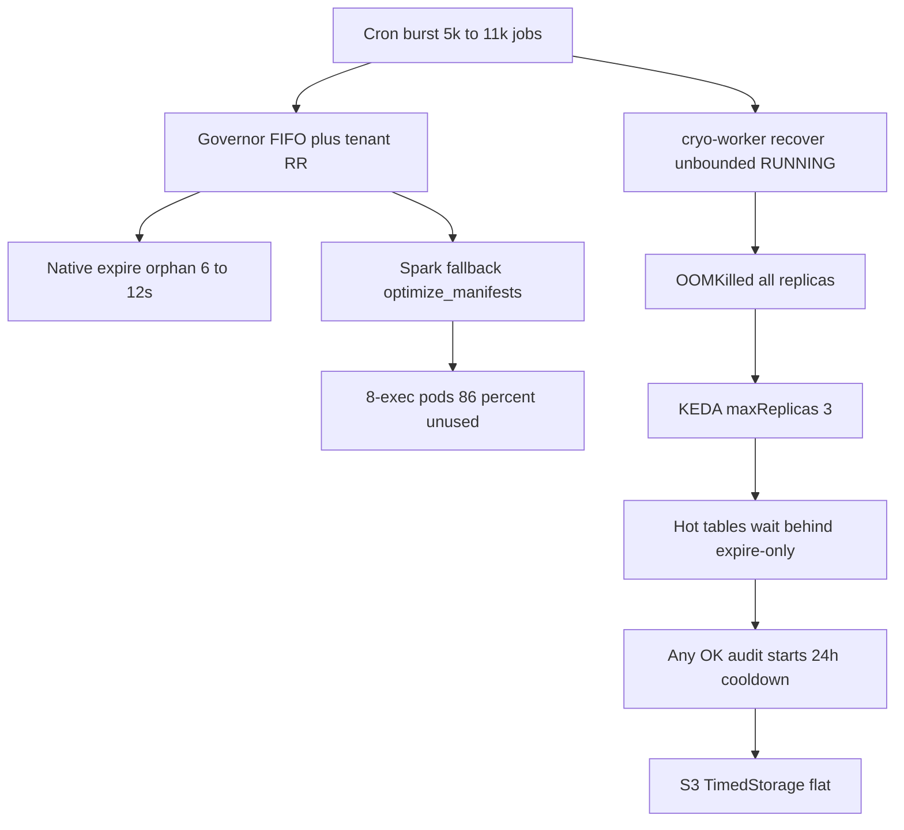

# Cryo cost rescue — make maintenance move S3 and Trino dollars

> For the implementing agent: REQUIRED SUB-SKILL after approval: `superpowers:executing-plans` (or subagent-driven-development). Wave 0 is an active production outage; do not start Wave 2–4 until Wave 0 is deployed and workers stop OOMKilling.

**Goal:** Stop the 2026-09-10 worker OOM cascade, then make Cryo reclaim S3 bytes and cut Trino scan/GET cost on the tables that actually drive the bill — not add more unused intelligence surfaces.

**Architecture:** Keep Cryo as a catalog-agnostic control plane (Scanner → Planner → Governor → Native/Spark). Do not adopt Amoro AMS. Close the gaps that already exist: unbounded worker recover, fail-open table locks, expire-only “success,” FIFO admission that ignores AutoComp scores, and Spark fallback pods sized as if every table were huge.

**Tech Stack:** Existing Python 3.12 backend (`cryo/worker`, `cryo/governor`, `cryo/planner`, `cryo/engines/spark`), Helm `[deploy/helm/cryo/values-prod.yaml](deploy/helm/cryo/values-prod.yaml)`, Grafana CUR for proof.

## Global Constraints

- No Airflow; sources ≠ destinations; Planner emits no SQL strings.
- Do not raise worker memory again (already 4Gi→6Gi→8Gi; still OOM).
- Do not flip `CRYO_ROI_GATE_SHADOW_MODE=false` to “save money” — SKIP would drop reclaim work, not delete bytes.
- Do not revert `native.keda.maxReplicas: 3` until Wave 0 is live and workers stay up.
- Presets live in **Postgres**, not Helm — Wave 1 starts with a live API audit.
- Trino **unused** EKS (coordinator/gateway requests) is out of Cryo’s control. Cryo only moves Trino **used** cost via fewer files scanned.

---

## Live evidence (2026-09-10, this session)

Cryo is running and still failing the north star.

**Workers (right now):** 3/3 KEDA replicas, all `lastState=OOMKilled`. One pod: **12 restarts in 77 minutes**. `kubectl top` after restart shows 139–153Mi — same signature as `[docs/AGENT_HANDOFF.md](docs/AGENT_HANDOFF.md)`: Python RSS looks small, then kill after Spark Job create. KEDA metric is `12/1` against max **3**, so admission is throttled on purpose.

**S3 (CDP 7 buckets, Grafana `cost-db`):** 30d **$12,039** — storage **$8,082** ($269/day), GET/HEAD **$2,878** ($96/day), PUT/LIST **$1,061** ($35/day). Mix is the same as August. Daily total still **~$440–475**. Gold 30d $3,248; bronze $3,510; silver $3,122. Slack 2026-09-08: gold **$140.84/day**, bronze **$155.84/day** — not falling.

**Trino `trino-db`:** latest billed day 2026-09-09 **$482** ($271 used / $210 unused). Mid-August post-burst dip (~$316–430) **did not hold**. Replica-2/3 workers still +12–14% WoW (Slack).

**Cryo namespace unused:** 2026-09-09 **$16 used / $101 unused = 86% unused**. Sep 1–9 ≈ **83% unused**. ~88% of unused is **untagged Spark driver/executor Jobs**. Live cluster is spawning Spark jobs that finish in **44–101s** (manifest rewrite, not 24TB compact) and at least one job with **8 executors** (destination config, not Helm’s 2).

**North star vs vitals mismatch:** `[cryo/reporting/impact_signals.py](cryo/reporting/impact_signals.py)` counts GB from `remove_orphan_files` / `optimize` only. Expire-only SUCCEEDED jobs inflate vitals success rate and start cooldown, while **GB freed stays 0**.

---

## Diagnosis (why Cryo is not beating Amoro / not cutting cost)

Cryo’s product idea is ahead of Amoro on load-aware admission, partition planning, and explainable ROI. **Production proof is behind.** The failure is not “missing compaction SQL.” It is four compounding loops:

1. **Control plane is crashing under its own backlog.** `[cryo/worker/orphan_recovery.py](cryo/worker/orphan_recovery.py)` still calls unbounded `list_running_jobs()` (line 192) and `list_admitted_jobs()` (line 198) every 5s on **every** worker. Queued scan was capped (`68bc82eb`); RUNNING/ADMITTED siblings were not. KEDA counts native RUNNING jobs that do not need a worker, so recover load scales with native slot_cap.
2. **“Maintenance succeeded” often means expire-only.** `[cryo/planner/planner.py](cryo/planner/planner.py)` lines 72–73: `remove_orphan_files` is **DEEP-only**. STANDARD never deletes LIST-orphans. Seeded `default-native-deep` historically listed expire+orphan **without optimize** (migration `20260707_0013`). Native MOR tables skip OPTIMIZE; Spark fallback failure is swallowed (`[cryo/governor/native_admit.py](cryo/governor/native_admit.py)`). Job still SUCCEEDED.
3. **The expensive tables are not the ones getting rewrite.** `unified_bq.gold_dbt_pw_bq` (24.5TB, ~190k files, ~123 commits/day) still wins expire+orphan in ~4 min under `spark-large` 240 min deadline / 48h cooldown (`[docs/PDAE-8542-gold-dbt-pw-bq-schedule.md](docs/PDAE-8542-gold-dbt-pw-bq-schedule.md)`). Slack gold GET spikes are `mview.gold_dbt_test_results`, `gold_dbt_video_stats_v3`, `*_evolving` — hot writers, not the dark-table campaign.
4. **Intelligence is scored, then ignored at admit time.** Scheduler sorts by reclaim × query. Redis enqueue is **run-age FIFO** (`[cryo/scheduler/scheduler.py](cryo/scheduler/scheduler.py)` `fifo_priority`). Governor wave is **tenant round-robin**. `pack_fleet_budget` / MOOP exist but `fleet_budget_gb` default is `None`. AutoComp, layout recs, PTO, Puffin `compute_statistics` are generated; layout autopilot and PTO execute are **off**.

`[cryo/worker/worker.py](cryo/worker/worker.py)` `_ensure_table_lock` (1184–1187) **returns and runs anyway** if another job holds the lock. Recover can adopt a live execute. That matches dual logs on `cdp.user360.silver_user360`.

Do **not** treat Cryo-namespace unused % as the S3/Trino problem. Rightsizing Spark/native Jobs is Wave 2; it does not shrink TimedStorage. Tightening the $250 cost ceiling would **pause admission** and make S3 worse.

---

## Approaches (pick one sequencing; recommended is A)

**A — Stability then bytes then brains (recommended).** Wave 0: stop OOM. Wave 1: live preset audit + DEEP+optimize on catchall and top-N hot tables + cooldown from reclaim ops only. Wave 2: admit by scan-cost × fragmentation + Spark/native rightsizing. Wave 3: apply layout/stats on query-hot tables. Matches Amoro where it matters (quota + generational cadence) without importing AMS/Flink.

**B — Config-only coverage while workers crash.** Enable `default-native-deep`, pin gold tables, hope. Queue grows, OOM continues, expire-only still “succeeds.” Rejected.

**C — Feature race vs Amoro/Lakehouse.** WAIR, PTO auto-apply, catalog service, minor/major rewrite of the planner. Attractive later; does not move this month’s CUR. Rejected as the *first* move.

---

## Wave 0 — Stop the worker OOM cascade (deploy this first)

Active outage. Tests first, then code, then image deploy via `bash deploy/deploy.sh` (code change, not values-only).

**Files:**

- Modify: `[cryo/worker/orphan_recovery.py](cryo/worker/orphan_recovery.py)`, `[cryo/db/repositories/job_store.py](cryo/db/repositories/job_store.py)` (`list_running_jobs` / `list_admitted_jobs` add `limit=`, oldest-first, exclude native watcher-owned)
- Modify: `[cryo/worker/worker.py](cryo/worker/worker.py)` `_ensure_table_lock` fail-closed; `acquire_job_owner` at start of `_process_claimed_job`
- Modify: `[cryo/cli.py](cryo/cli.py)` KEDA metric: count only Spark/Trino jobs that need a worker, not native `dispatch_id` RUNNING
- Modify: `[cryo/engines/trino/engine.py](cryo/engines/trino/engine.py)` call `ctx.on_engine_ref` as soon as `query_id` exists (side thread / TrinoQuery), so killed workers are recoverable
- Test: `[tests/test_orphan_recovery.py](tests/test_orphan_recovery.py)`, new tests for bounded running/admitted lists and fail-closed lock
- After soak (workers 0 OOM for ≥4h): remove `native.keda.maxReplicas: 3` override in `[values-prod.yaml](deploy/helm/cryo/values-prod.yaml)` (Helm-only upgrade)

**Done when:** `kubectl get pods -n cryo -l app.kubernetes.io/component=worker` shows 0 recent OOMKilled; recover logs no longer materialize thousands of RUNNING native jobs; KEDA replica count tracks Spark/Trino admitted+running only.

Do not raise 8Gi. Do not keep maxReplicas=3 as a “cost win.”

---

## Wave 1 — Make jobs delete S3 bytes (coverage × cadence × semantics)

Code + **live DB preset changes** (admin API). Helm cannot answer preset truth.

**1. Live audit (read, then patch):** port-forward `cryo-api`, viewer/admin token per `[docs/AGENT_HANDOFF.md](docs/AGENT_HANDOFF.md)`. Pull `/api/v1/vitals`, `/api/v1/presets`, unmatched gauge, and runs for `gold_dbt_pw_bq` (`1ae85c5b-...`). Confirm `default-native-deep.operations` includes `optimize` + `remove_orphan_files`, `enabled=true`, cron set. If still expire-only from migration 0013, PATCH it.

**2. Cooldown and success lie:** `[cryo/db/repositories/job_store.py](cryo/db/repositories/job_store.py)` `_last_maintained_at` currently any `AuditLog.status==OK` (including expire and property autopilot). Restrict to reclaim actions matching `_RECLAIM_ACTIONS` in `[cryo/reporting/impact_signals.py](cryo/reporting/impact_signals.py)`. Populate `TableCandidate.last_maintained_at` in `[cryo/db/repositories/presets.py](cryo/db/repositories/presets.py)` so schedule-time cooldown is not a no-op. Mark job PARTIAL when planned `optimize` was skipped/failed.

**3. Hot-table rewrite path:** dedicated DEEP preset for `gold_dbt_pw_bq` (and next ~20 TB-hot / high-GET tables from Slack drill-down: `mview.gold_dbt_test_results`, `gold_dbt_video_stats_v3`, evolving revenue tables). No 240 min deadline. Spark-sized for expire/orphan vs rewrite separately (orphan LIST OOM’d this table before). Native consecutive-failure exclusion already exists — keep Spark in `engine_pool`. Success = file count and snapshots **not rebounding** 7 days, and at least one completed **optimize** step.

**4. Native Spark fallback must fail the job** if OPTIMIZE was planned and fallback did not run (`[native_admit.py](cryo/governor/native_admit.py)` currently logs and continues). MOR/CDC bronze otherwise “succeeds” with expire-only.

**Done when:** `/api/v1/dashboard/fleet-trends` north-star GB/day > 0 on days with DEEP runs; `gold_dbt_pw_bq` runs show optimize; unmatched `needs_compaction` stays low (alert already in `[deploy/prometheus/rules/cryo-safety.yml](deploy/prometheus/rules/cryo-safety.yml)`).

---

## Wave 2 — Admit by value + cut Cryo unused cost (does not throttle OPTIMIZE)

**Admission:** change Redis score from `fifo_priority(run.created_at)` to combined weight already computed at enqueue (`_combined_priority_weight`: reclaimable GB + `query_count_30d` + projected savings). Keep tenant RR as **tie-break**, not primary order. Optionally set a real `fleet_budget_gb` so `pack_fleet_budget` actually packs. Leave ROI **shadow**; use BCR to **order**, not SKIP.

**Spark unused ($833 / 9d empty-tag bucket):** `[cryo/governor/native_admit.py](cryo/governor/native_admit.py)` `_dispatch_fallback_operations` must `with_table_stats` + `[cryo/engines/spark/sizing.py](cryo/engines/spark/sizing.py)` like the worker path. Manifests-only: 1 executor, ~500m/1024Mi. Cap destination `executor_instances` (live jobs are using **8**). TTL 3600s → ~300s; drop `do-not-disrupt` after Succeeded.

**Native packing:** `[cryo/engines/native/resources.py](cryo/engines/native/resources.py)` — do not bump tiny/missing-stats rewrites to 2.7–5.3Gi packing floor. Keep quality `max_bytes_per_group`; stop inflating **requests** (unused is billed on requests).

**Planner:** skip `optimize_manifests` when `manifest_count` is already low (no gate today → Spark Job per DEEP table). Prefer native for large COW OPTIMIZE in `[adaptive_routing.py](cryo/scheduler/adaptive_routing.py)` (today Spark +40 vs native +35 at ≥100GB).

**Scanner:** HPA minReplicas 3 → 1 while `scanner.jobDispatch.enabled` (small unused, not the $90/day).

**Done when:** Cryo unused/used ratio trending down from ~6× toward <2× on billed days **without** pausing admission; Spark wrapper Jobs no longer default to 8×2Gi.

---

## Wave 3 — Intelligence that actually executes (Trino used-cost)

Only after Waves 0–1. These beat Amoro on *explainable* optimization if they **write**.

- Opt query-hot presets into `params.compute_statistics: true` and a Spark/Trino fallback (global `compute_statistics_enabled` today only updates benefit scores, it does **not** plan ANALYZE).
- Enable `layout_autopilot` / PTO execute **only** for a canary of high `query_count_30d` tables (sort-order is a rewrite, not a property flip). Property autopilot is already on (tier1 metadata only).
- Wire AutoComp MOOP into the Wave 2 admit order (scores already on `table_partitions.autocomp_traits`).
- Borrow Amoro **per-table slot quota** inside a destination group (already recommended in `[docs/amoro-evaluation.md](docs/amoro-evaluation.md)` §3.1) so `gold_dbt_pw_bq` cannot starve 10k small expires, and vice versa.
- Generational cadence (reference Amoro minor/major, do not port the GC taxonomy): hot writers get frequent small-file OPTIMIZE; weekly DEEP orphan. That is a preset/ops split, not a planner rewrite.

**Defer:** WAIR per-file utilization (QueryLog path is empty in prod; iceberg_table aggregator is the live path), Flink engine, Amoro catalog integration, Paimon.

---

## Wave 4 — Platform levers Cryo cannot code (still required for “drastic” S3)

- S3 Intelligent-Tiering on **gold** (bronze already has INT-*; gold had zero `INT-`* in Aug CUR). Slow storage cut, not a substitute for expire+orphan.
- Lifecycle on `pw-data-cdp-prod-temp` (~27 TB non-Iceberg) and `_temp`/`_backup` tables (~18 TB, `[docs/TABLE_DEDUPLICATION_DESIGN.md](docs/TABLE_DEDUPLICATION_DESIGN.md)`).
- Payer CUR user-tags `eks-workload-name` / `cryo-engine` so Spark unused is attributable (PDAE-8544).
- Trino coordinator/gateway **request** trims — separate from Cryo (`[~/deployment_repo/TRINO_COST_OPTIMIZATION_REPORT.md](~/deployment_repo/TRINO_COST_OPTIMIZATION_REPORT.md)`).

---

## What “success” looks like (do not declare win from vitals)

| Signal                 | Today                          | Target (4 weeks)                              |
| ---------------------- | ------------------------------ | --------------------------------------------- |
| Worker OOM             | 12 restarts / 77 min           | 0                                             |
| North-star GB/day      | expire-only ≈ 0                | Sustained > 0 on DEEP days                    |
| `gold_dbt_pw_bq` files | ~190k, rebounding              | Down and held 7d                              |
| S3 7-bucket daily      | $440–475                       | Down vs this baseline (storage lag 1–2 weeks) |
| Gold GET WoW           | Slack spikes on mview/evolving | Fewer GETs on compacted hot tables            |
| Trino **used** $/day   | ~$271 (Sep 9)                  | Down vs same-weekday; ignore unused           |
| Cryo unused ratio      | 6.3×                           | < 2× used, not via pause                      |

Append every cost pull to `[docs/cost-tracking/daily-cost-log.csv](docs/cost-tracking/daily-cost-log.csv)` (last cryo row is **2026-08-10** — the standing daily check has been skipped).

Update `[docs/AGENT_HANDOFF.md](docs/AGENT_HANDOFF.md)` when Wave 0 lands so the next session does not re-raise memory.

---

## Competitive stance (after the machine works)

Stay the **open, catalog-agnostic maintenance control plane**. Amoro’s catalog+Flink+streaming is a different product. Cryo wins if Verified Maintenance Yield is public and boring: table, files before/after, bytes reclaimed, GET/scan before/after, engine, duration — which competitors cannot fake. Do not grow more UI/AI surfaces until Waves 0–2 move CUR.