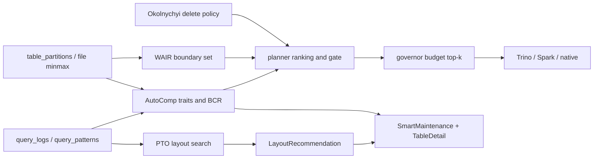

# Workload-Aware Optimization — Implementation Spec

Deployed Trino/Spark output evidence is collected through the isolated collector contract described
in [`../DEPLOYED_CONFORMANCE.md`](../DEPLOYED_CONFORMANCE.md). Operator-submitted fixtures remain
synthetic and cannot qualify a canary.

> Written 2026-07-20. Implementation specification (docs only — no code landed with this file).
> Grounds three research tracks in the **actual Cryo codebase**, not greenfield redesigns.
>
> **Primary papers**
> - AutoComp — [arXiv:2504.04186](https://arxiv.org/abs/2504.04186) (SIGMOD 2025, LinkedIn / OpenHouse)
> - PTO — [author page](https://vamsikrishna1902.github.io/publication/SIGMOD-2026),
>   DOI [`10.1145/3786681`](https://doi.org/10.1145/3786681). Crossref metadata was rechecked on
>   2026-08-04 and identifies this DOI as PTO; the earlier mismatch warning was incorrect.
> - WAIR — [arXiv:2602.23289](https://arxiv.org/abs/2602.23289)
> - Okolnychyi et al. — [VLDB 2024 PDF](https://vldb.org/pvldb/vol17/p4159-okolnychyi.pdf)
> - Qd-tree — Yang et al., SIGMOD 2020 (prior art only)

Cross-links: [`../research-and-roadmap.md`](../research-and-roadmap.md) Part 2,
[`../architecture.md`](../architecture.md) §2.6, Smart Maintenance UI
[`../../web/src/pages/SmartMaintenance.tsx`](../../web/src/pages/SmartMaintenance.tsx).

---

## 0. Ground truth — shipped vs gap

> **Status 2026-09-24:** superseded in part by
> [`../PAPER_IMPLEMENTATION_AUDIT_2026-09-24.md`](../PAPER_IMPLEMENTATION_AUDIT_2026-09-24.md),
> which reads each paper against the code on the running batch path. AutoComp now ranks the
> batch pipeline (`cryo/maintenance/selection.py`), WAIR is implemented recommend-only (§C1), and
> PTO's scorer is still a heuristic. The table below describes the older governor path.

Cryo already has substantial scaffolding. **Do not rebuild** what exists; close the gaps below.

| Area | Already shipped | Real gap |
|------|-----------------|----------|
| AutoComp scoring | **Part A (A1–A3) shipped 2026-07-20.** [`cryo/planner/partition_query_affinity.py`](../../cryo/planner/partition_query_affinity.py) (per-partition query attribution, coverage-gated fallback to table-broadcast); [`compute_moop_scores`](../../cryo/planner/benefit_score.py) (MOOP trait normalization + scalarization, `table_partitions.autocomp_traits`); [`pack_fleet_budget`](../../cryo/governor/admission.py) (fleet top-k GB-budget pack) + `min_moop_score`/`fleet_budget_gb` admission gates with `below_moop_score`/`budget_exhausted` skip reasons; [`update_table_effectiveness`](../../cryo/planner/benefit_score.py) persisting effectiveness onto `table_stats.raw`; `GET /tables/{id}/autocomp/candidates`; ROI drawer effectiveness + top-5 MOOP partitions; Table Detail candidates table with MOOP column + skip reasons + delete-policy chip. Also fixed 3 dead-wiring gaps found while landing this (score/traits never reached the planner's candidate dicts; `AdmissionJob.estimated_benefit_score` never populated from a live per-table signal; a double-`/api/v1` prefix bug that made 5 route files' endpoints unreachable). | Fleet-wide (cross-table) MOOP normalization batch (current implementation normalizes per-table, which the paper allows as a valid variant); file-entropy trait (`file_entropy` column exists, scanner doesn't populate it yet — T3 weight redistributes to T1/T4 when absent, see `benefit_score.py`); no dedicated fleet-wide "Compaction queue" UI tab (per-table view only) |
| Layout | [`cryo/optimizer/layout_analyzer.py`](../../cryo/optimizer/layout_analyzer.py), [`partition_analyzer.py`](../../cryo/optimizer/partition_analyzer.py), [`clustering.py`](../../cryo/optimizer/clustering.py), Smart Maintenance approve/execute, TableDetail bloom + partition tips | No PTO search-space reduction + sampling + GBT; no joint optimization of partition × target file size × row group × strategy |
| Delete ops | **§C2 shipped and extended through 2026-08-04.** `OperationType.REWRITE_POSITION_DELETES`; planner `_delete_compaction_policy` (minor/major/skip, format-version-3-aware); audit-derived successful minor-run count with bounded major escalation; equality-delete files route directly to major rewrite because the position-delete action cannot consume them; Spark `rewrite_position_delete_files`; Trino raises a clear unsupported error (no equivalent procedure) instead of silently downgrading to a full rewrite; native engine routes to SQL fallback or skips-with-note via the existing `NATIVE_ALWAYS_DISCONNECTED` mechanism; Table Detail delete-file health chip. | Production read-plus-maintenance cost comparison against threshold-only control and workload-conditioned thresholds remain open. |
| WAIR | Hot/cold skip via `partition_write_idle_hours` in planner | No boundary micro-partition identification or incremental reclustering cost model |



### Sequencing (ROI order)

1. **Part A** AutoComp finish (A1→A3) — weeks; builds on live scoring.
2. **Part B** PTO (B1→B2 first; B3–B4 after outcomes exist).
3. **Part C** WAIR + Okolnychyi after layout execute path is trusted.
4. Correctness / differential CI gate remains a prerequisite for any **auto-apply** of PTO or WAIR rewrites.

### Non-goals

- Decima-style RL scheduling, Chronos/TimesFM fleet forecasting, full Qd-tree implementation.
- Engine-internal changes (Trino/Spark forks). Cryo stays a control plane: recommend → plan → admit → execute via existing engines.
- Planner/domain emitting SQL strings (AGENTS.md hard rule).

---

# Part A — Finish AutoComp (highest near-term ROI)

## A.1 Paper mapping

AutoComp’s production loop (LinkedIn / OpenHouse):

1. **Observe** — collect table/partition file stats and usage signals.
2. **Orient** — compute independent **traits** (benefit vs cost).
3. **Decide** — multi-objective scalarization (MOOP) + compute budget → top-k candidates.
4. **Act** — schedule compaction (prefer partition-scope hybrid; sequential per table to avoid Iceberg commit conflicts even on distinct partitions).

Cryo today implements a simplified Observe→Orient→Act path:

```
score = (small_files × query_frequency) / max(partition_size_gb × cost_per_gb, 0.1)
```

in `compute_benefit_score()`, with `query_frequency` currently **broadcast from table-level** QueryLog counts (`update_partition_benefit_scores` comment: “Future: join with per-partition filter predicates”).

Paper MOOP (normalized traits \(T'_i \in [0,1]\), weights \(\sum w_i = 1\)):

\[
S_c = w_1\,T'_{1,c} - w_2\,T'_{2,c}
\]

OpenHouse production weights used in the paper’s evaluation: **\(w_1=0.7\)** (file-count reduction benefit), **\(w_2=0.3\)** (compute cost). Candidates ranked by \(S_c\) descending; top-k that fit the GB·hr (or fixed capex) budget are scheduled.

## A.2 Shipped behavior (do not regress)

| Component | Behavior |
|-----------|----------|
| [`benefit_score.py`](../../cryo/planner/benefit_score.py) | Score update after scan; `get_top_compaction_candidates`; `compare_scheduling_strategies`; `get_compaction_effectiveness_stats`; `enhanced_bcr_from_table` USD BCR |
| [`planner.py`](../../cryo/planner/planner.py) | `OptimizeCandidate.benefit_score`; sort prefers benefit when both sides have scores, else small_files DESC; `partition_write_idle_hours` hot skip |
| [`admission.py`](../../cryo/governor/admission.py) | Reject when `estimated_benefit_score < min_benefit_score` (if configured > 0) |
| [`bandit.py`](../../cryo/governor/bandit.py) | Arms over `min_benefit_score` |
| DB | `table_partitions.query_frequency`, `compaction_benefit_score`, effectiveness columns |
| API / UI | `/tables/{id}/autocomp/compare`, Smart Maintenance ROI drawer, TableDetail AutoComp tab stub |

## A.3 Gaps to close

### A3.1 Per-partition query frequency (phase A1)

**Problem:** All partitions of a table share the same `queries_per_day`, so cold partitions with many small files outrank hot partitions with fewer files.

**Algorithm:**

1. For each `QueryLog` row in the window (`_QUERY_WINDOW_HOURS`, default 168h), extract partition-key predicates (equality / IN / range on partition columns from table partition-spec).
2. Map predicates → set of `partition_value` keys that the query could hit (conservative: if no partition predicate, attribute `1/N` fractional credit across N latest-scan partitions, or attribute to “unknown” and exclude from per-partition boost).
3. Aggregate `hits[partition_value] += weight`.
4. `query_frequency_partition = hits[p] / days_in_window`.
5. Call `compute_benefit_score(small_files, query_frequency_partition, size_gb)`.

**Module plan:**

- New helper `cryo/planner/partition_query_affinity.py` (pure; unit-tested).
- Change `update_partition_benefit_scores` to use affinity map; keep table-level frequency as fallback when affinity coverage < threshold (e.g. &lt;20% of queries have parseable partition filters).
- Persist both: keep `query_frequency` as partition-local; optionally store table-level in `table_stats.raw["query_frequency_table"]` for dashboards.

**Inputs:** `QueryLog` (or curated predicates in `QueryPattern` + SQL text if needed), `TablePartition` latest scan, partition field specs from table metadata / scan raw.

**Edge cases:**

- Unpartitioned tables → single virtual partition; table-level frequency is correct.
- Transformed partitions (`day(ts)`) → convert filter literals to raw epoch-day ints the same way engines/dbt macros do (reuse renderer transform helpers; do not invent parallel math).
- Missing query logs → score uses floor `0.1` frequency (existing behavior); do not invent fake hits.

### A3.2 MOOP traits + fleet top-k budget (phase A2)

**Traits per candidate** (candidate = table partition, or whole table if unpartitioned):

| Trait | Definition | Normalization |
|-------|------------|---------------|
| \(T_1\) file-count reduction | `small_files` (or estimated files after binpack to target size) | min-max across fleet batch, or within table |
| \(T_2\) compute cost | `partition_size_gb` (proxy for GB·hr) | min-max |
| \(T_3\) file entropy (optional) | Shannon entropy of file-size histogram in partition (Syam 2023 / paper) | min-max; higher entropy → higher benefit |
| \(T_4\) query affinity | `query_frequency_partition` | min-max |

Default scalarization (paper-aligned, extensible):

\[
S_c = 0.55\,T'_1 + 0.15\,T'_3 + 0.15\,T'_4 - 0.15\,T'_2
\]

(Weights configurable via destination/preset params; document OpenHouse 0.7/0.3 as the two-trait special case when entropy/affinity unavailable.)

**Fleet Decide** (governor or scheduler tick, not only per-table planner sort):

1. Collect candidates with `S_c >= min_moop_score` and not hot (`partition_write_idle_hours`).
2. Sort by \(S_c\) DESC.
3. Greedy pack until `sum(size_gb) <= remaining_budget_gb` (reuse adaptive budget / off-peak from existing admission).
4. Emit skip reasons into audit / queue metadata:
   - `below_min_benefit`
   - `below_moop_score`
   - `budget_exhausted`
   - `hot_partition`
   - `cooldown`
   - `effectiveness_poor` (optional: soft-deprioritize tables with ratio &lt; 10:1)

**Act constraints (from paper):**

- Prefer **partition-scope** hybrid (already Cryo’s default path).
- **Sequential per table** even for distinct partitions (Iceberg commit conflicts observed in AutoComp §4.4). Cryo’s per-table lock already helps; document that governor must not admit two OPTIMIZE jobs for the same `table_id` concurrently (verify / harden if missing).

### A3.3 Effectiveness loop (phase A3)

`get_compaction_effectiveness_stats` already classifies excellent/good/fair/poor from `AuditLog` input/output file counts (target 50:1; alert &lt; 10:1).

**Finish:**

- Persist last effectiveness onto `table_stats.raw["compaction_effectiveness"]` after each optimize finalize.
- API: include in Smart Maintenance overview + table ROI.
- UI: badge + recommendation text (already returned by helper).
- Optional alert channel: Slack when fleet median ratio &lt; 10:1 for 7d.

## A.4 Data model (AutoComp)

Migration (additive):

```text
cryo.table_partitions
  + file_entropy            float null
  + autocomp_traits         jsonb null   -- {t1,t2,t3,t4,s_c,weights_version}
  # query_frequency already exists; redefine semantics as partition-local
```

Optional fleet queue snapshot table (if audit volume is high):

```text
cryo.autocomp_candidate_snapshots
  id, created_at, table_id, partition_value, s_c, size_gb,
  selected bool, skip_reason text null
```

## A.5 API deltas (AutoComp)

### `GET /tables/{table_id}/autocomp/candidates`

```json
{
  "table_id": "…",
  "scan_at": "2026-07-20T06:00:00Z",
  "items": [
    {
      "partition_value": {"day": 20300},
      "small_files": 420,
      "size_gb": 12.4,
      "query_frequency": 18.2,
      "benefit_score": 615.3,
      "moop_score": 0.81,
      "traits": {"t1": 0.9, "t2": 0.4, "t3": 0.7, "t4": 0.85},
      "eligible": true,
      "skip_reason": null
    }
  ],
  "skipped": [
    {"partition_value": {"day": 20290}, "skip_reason": "hot_partition"}
  ],
  "effectiveness": {
    "effectiveness_ratio": 42.0,
    "effectiveness": "good",
    "recommendation": "…"
  },
  "compare": {
    "static_order": ["…"],
    "autocomp_order": ["…"],
    "improvement_ratio": 1.34,
    "autocomp_wins": true
  }
}
```

Keep existing `GET /tables/{table_id}/autocomp/compare` as a thin alias or embed under `compare`.

### Enrich `GET …/smart-maintenance/roi/{table_id}`

Add `effectiveness` and top-5 partition `moop_score` list to `details`.

## A.6 Module / file checklist (AutoComp)

| File | Change |
|------|--------|
| `cryo/planner/partition_query_affinity.py` | **New** — predicate → partition hits |
| `cryo/planner/benefit_score.py` | Partition-local frequency; MOOP `compute_moop_score`; fleet helper |
| `cryo/planner/planner.py` | Prefer `moop_score` when present; pass skip notes |
| `cryo/governor/admission.py` / `governor.py` | Fleet pack + skip reasons on job params |
| `cryo/scheduler/service.py` | Cadence already updates benefit scores; call MOOP refresh |
| `cryo/api/extensions.py` / smart maintenance routes | Candidates endpoint |
| `web/src/pages/SmartMaintenance.tsx` | Compaction queue tab |
| `web/src/pages/TableDetail.tsx` and `web/src/pages/table-detail/` | AutoComp tab enrichment |
| `tests/test_benefit_score*.py`, new affinity tests | Formulas + mapping |

## A.7 Phases

| Phase | Deliverable | Done when | Status |
|-------|-------------|-----------|--------|
| **A1** | Partition query affinity + score update | Unit tests; scores diverge across partitions on fixture with uneven filters | ✅ 2026-07-20 |
| **A2** | MOOP + fleet top-k budget + skip reasons | Governor audit shows skip_reason; golden planner fixtures | ✅ 2026-07-20 |
| **A3** | UI + effectiveness badges/alerts | SmartMaintenance + TableDetail show candidates & ratio | ✅ 2026-07-20 |

---

# Part B — PTO Predictive Table Optimizer (biggest net-new)

## B.1 Paper mapping

PTO (IBM Research; the author page reports SIGMOD 2026, but publication metadata remains
provisional) jointly chooses lakehouse layout parameters for Iceberg/Presto:

- Partitioning columns
- Target file size
- Row-group size
- Strategy: bin-pack vs sort (multidimensional)

Exhaustive search is intractable (each full rewrite at TB scale takes hours; parameters interact; optima are workload-sensitive).

**PTO approach:**

1. Analyze filter predicates in the workload.
2. **Reduce search space** with heuristics (scan selectivity × query frequency + sort cluster sizes) to drop poor partition / sort candidates.
3. Use **table sampling + Gradient Boosting Trees** to predict relative scan cost for remaining parameter tuples.
4. Emit the best combination without rewriting every candidate.

Reported gains (author page, not independently verified): ~11% TPC-H / ~36% TPC-DS average latency
at SF 10K; long scan-heavy queries up to ~3.4× / ~11×.

## B.2 Cryo adaptation (control-plane only)

Cryo must **not** fork Presto. Map PTO to:

| PTO concept | Cryo home |
|-------------|-----------|
| Workload predicates | `query_patterns` + `query_logs` (already ingested) |
| Candidate layouts | New `cryo/optimizer/pto/` |
| Recommendation store | Extend `layout_recommendations.detail` / columns |
| Human gate | Existing Smart Maintenance approve → execute |
| Rewrite | Existing `clustering.py` + engines (`OPTIMIZE` / `rewrite_data_files` with sort/zorder/binpack params) |
| Feedback labels | Post-apply `observed_prune_improvement`, scan-byte deltas already on `LayoutRecommendation` |

**Guardrails:**

- PTO **recommends**; engines **rewrite**.
- Domain/planner emit **no SQL**.
- Large tables: never recommend full-table OPTIMIZE without partition filters / chunking (Planner GB budget + max partitions/chunk).
- Auto-apply is **opt-in** and blocked until differential CI gate is green.

## B.3 Algorithm (Cryo phases B1–B3)

### B3.1 Inputs

- `QueryPattern` rows: `column_name`, `filter_count`, `equality_filter_count`, `range_filter_count`, `avg_selectivity`, `join_count`.
- Table schema + current partition spec + `has_sort_order` / current sort from scanner.
- File stats: total files, size GB, optional per-column min/max overlap from layout analyzer.
- Destination/preset: `target_file_size` defaults, engine capabilities.

### B3.2 Search-space reduction (B1)

1. Rank columns by `filter_count × (1 - avg_selectivity)` (higher = better pruning candidate).
2. Partition candidates:
   - Prefer low/medium cardinality time/identity columns already used in filters.
   - Drop high-cardinality identity (reuse `_HIGH_CARDINALITY_HINTS` / NDV when available) that would shatter partitions below ~128MB (`partition_analyzer` floor).
3. Sort / z-order candidates:
   - Top-k filter columns not chosen as partition keys.
   - Drop combinations whose estimated sort cluster size is tiny relative to target file size (paper heuristic).
4. Discrete grids (configurable):
   - `target_file_size_mb ∈ {128, 256, 512}`
   - `row_group_size_mb ∈ {16, 32, 64, 128}` (engine-dependent; omit if engine ignores)
   - `strategy ∈ {binpack, sort, zorder}`

Emit `CandidateTuple` list capped at e.g. 64 after pruning.

**Implemented B1 note:** candidate generation remains a small deterministic superset so the cap
cannot accidentally remove every candidate for a later partition option. The heuristic scorer
applies the final configured cap after evaluating that superset. This preserves partition-strategy
diversity while bounding persisted and returned rankings.

### B3.3 Scoring without GBT (B1 heuristic joint score)

Until enough labeled outcomes exist:

\[
\widehat{cost} = w_s\cdot\widehat{scan\_fraction} + w_f\cdot\widehat{file\_open\_cost} + w_r\cdot\widehat{rewrite\_cost}
\]

- \(\widehat{scan\_fraction}\): from selectivity of filters on partition/sort keys (layout_analyzer prune efficiency).
- \(\widehat{file\_open\_cost}\): function of expected file count at target size.
- \(\widehat{rewrite\_cost}\): GB to rewrite (partial vs full).

Pick argmin \(\widehat{cost}\). Confidence low (`heuristic_v1`).

### B3.4 Simulation mode (B2)

Without rewriting the table:

1. Sample file-level min/max (from manifests / stored stats) for candidate sort keys.
2. Replay historical filter predicates against sample → estimated files touched.
3. Compare to baseline files touched → `estimated_prune_improvement`.
4. Store simulation in `detail.pto_simulation`.

**Implemented shadow subset:** the read-only API currently replays aggregate historical
`files_read`/`files_pruned` observations against the candidate's heuristic scan fraction and
returns an explicitly uncalibrated interval. It never changes recommendation state and abstains
without enough observations. Manifest-bound predicate replay and persisted simulation labels remain
open; this aggregate estimator must not be represented as that stronger evidence.

### B3.5 Gradient Boosting (B3)

**Labels:** after approved apply + next scan window, record:

- `latency_ratio` or `bytes_scanned_ratio` vs baseline (from query logs / recommendation observed fields).
- Features: tuple params + table size + pattern vector.

**Training job:** offline (`cryo optimize pto-train` or scheduler weekly). Artifact path: `CRYO_PTO_MODEL_URI` (local or S3). Version string stored on each recommendation.

**Online:** if model present and `analysis_query_count >= pto_min_queries`, score candidates with GBT; else heuristic.

**Cold start:** require ≥ N labeled applies (suggest N=50 fleet-wide or 10 per table) before enabling GBT path in UI (“model: heuristic” vs “model: gbt-v3”).

## B.4 Outputs

Extend `LayoutRecommendation`:

```json
{
  "recommended_strategy": "sort",
  "recommended_columns": [{"column": "user_id"}, {"column": "event_date"}],
  "detail": {
    "source": "pto",
    "pto_params": {
      "partition_spec": "day(event_ts)",
      "target_file_size_mb": 256,
      "row_group_size_mb": 32,
      "strategy": "sort",
      "sort_columns": ["user_id", "event_date"]
    },
    "current_params": { "…": "…" },
    "predicted_latency_improvement_pct": 22.4,
    "estimated_rewrite_gb": 480.0,
    "model": "heuristic_v1",
    "model_version": null,
    "simulation": { "baseline_files_touched": 12000, "predicted_files_touched": 3100 },
    "driving_patterns": ["user_id equality", "event_date range"]
  }
}
```

Scheduler hook (`_generate_layout_recommendations`):

- If `pto_enabled` and query volume ≥ threshold → `cryo.optimizer.pto.recommend.generate_pto_recommendation`.
- Else → existing `generate_layout_recommendation` (heuristics / bloom).

## B.5 Module layout

```text
cryo/optimizer/pto/
  __init__.py
  candidate_space.py   # search-space reduction
  features.py          # feature vector from patterns + stats
  score_heuristic.py   # B1 joint score
  simulate.py          # B2 sample replay
  model.py             # GBT load/save/predict
  recommend.py         # orchestrate → LayoutRecommendation upsert
  train.py             # offline training entry
```

Config (`cryo/config.py` / destination jsonb):

- `pto_enabled: bool` (default false until B2 UI ships)
- `pto_min_queries: int` (e.g. 200)
- `pto_candidate_cap: int` (64)
- `pto_model_uri: str`
- `pto_auto_apply: bool` (default false; B4 only)

## B.6 API deltas (PTO)

| Method | Path | Purpose |
|--------|------|---------|
| `POST` | `/tables/{id}/pto/recommend` | Force refresh PTO recommendation |
| `POST` | `/tables/{id}/pto/simulate` | Run simulation only; no status change |
| `GET` | `/optimization/recommendations/{id}` | Already exists — ensure `detail.pto_params` returned |
| `POST` | `/smart-maintenance/layout/{id}/approve` | Unchanged |
| `POST` | `/smart-maintenance/layout/{id}/execute` | Pass `pto_params` into clustering plan |

## B.7 Phases

| Phase | Deliverable |
|-------|-------------|
| **B1** | `candidate_space` + heuristic joint score → LayoutRecommendation `source=pto` |
| **B2** | Simulation API + UI cards (Approve / Simulate / Dismiss) |
| **B3** | GBT train/infer from post-rewrite outcomes |
| **B4** | Opt-in auto-apply policy (destination flag + min confidence + BCR gate) |

---

# Part C — Strong secondaries

## C1 — WAIR (Workload-Aware Incremental Reclustering)

### Paper core

WAIR separates:

1. **Clustering-key selection** (what to sort by) — Cryo: PTO / layout_analyzer.
2. **Reclustering policy** (which micro-partitions to rewrite) — Cryo: new.

**Boundary micro-partitions:** files whose clustering-key min/max **partially overlap** a historical query range edge. Fully inside / outside ranges need not be rewritten for pruning gain.

Greedy Algorithm 1 (paper): after each range query, recluster all boundary partitions overlapping the range endpoints. Amortized cost \(O(\log q)\) under their potential analysis.

Practical extensions: memory limit \(k_{\max}\), warm-start budget, periodic key reselection.

Cost model (service): choose a set \(S\) of boundary files maximizing

\[
\sum_{f \in S} \mathbb{E}[\text{query savings}(f)] - \text{rewrite\_cost}(S)
\]

within a time/GB window.

### Cryo mapping

| WAIR | Cryo |
|------|------|
| Micro-partition | Iceberg data file (use file-level lower/upper bounds from manifests) |
| Query ranges | Parsed from `query_logs` / patterns on clustering columns |
| Recluster | `OPTIMIZE` / rewrite with `rewrite_scope=boundary_files` + file list or narrow predicates |
| Key selection | PTO / existing layout recommendation |

**Do not** recluster rarely touched historical files just because overlap depth is high (paper critique of pure data-driven Snowflake/Dremio metrics).

### Implementation sketch

1. Persist or on-demand load file stats: `file_path`, `size`, `lower_bounds`, `upper_bounds` for active sort/clustering columns (scanner enhancement or `$files` off hot path — prefer scanner-stored).
2. `cryo/optimizer/wair/boundary.py`: given query ranges + files → boundary set + utilization score.
3. `cryo/optimizer/wair/select.py`: greedy pack under `rewrite_gb_budget`.
4. Planner: if `params.wair_enabled` and boundary set non-empty, emit OPTIMIZE with params:
   ```json
   {"rewrite_scope": "boundary_files", "file_paths": ["…"], "max_files": 500}
   ```
   Engine SQL renderers must support file-list or equivalent filter; if engine cannot, fall back to partition predicates covering those files and note degraded mode.
5. Chunk with existing GB budget / max partitions (or max files) caps.

**Implemented C1.a subset:** the pure boundary detector, deterministic GB/file-budget selector, and
operator-only offline report are implemented. The report reads `wair_file_sample` and
`wair_query_ranges` from the `TableStats.raw` evidence contract and abstains if either is missing. Scanner
population is now implemented in both Python and Go: each retains the lexicographically smallest
bounded set of current-snapshot file paths with decoded column bounds, independent of manifest
completion order. Telemetry extracts only concrete two-sided SQL ranges and persists the top 100
frequency-ranked ranges per table. Planner/engine execution remains open.

**Collection turned off, then rebuilt scoped (2026-09-24).** The original samples held unbounded
column bounds and copied them into `table_stats_history`. They were purged, and history rows no longer
carry `wair_*` keys. The rebuilt pipeline is what the paper actually needs:

- **Query ranges** come from the Trino query log in both telemetry modes. A source in
  `iceberg_table` mode did not extract ranges, so most tables had none.
  Each range keeps per-day query counts plus the queries' own `cpu_time_millis` and
  `physical_input_bytes` over a 7-day window (`cryo/optimizer/wair/ranges.py`). One-sided ranges
  are kept, and only numeric/temporal literals are stored.
- **File bounds** are sampled only for the (at most 3) range-queried columns whose type is
  numeric or temporal, taken from the table's last scan (`wair_sample_columns`), in both the Python
  and Go scanners. `CRYO_SCANNER_WAIR_FILE_SAMPLE_SIZE` defaults to 1000 again.
- **Cost model** (`boundary.py`, `select.py`): Eq. 3 savings per boundary file, Algorithm 2's
  prefix cut against the recluster cost at the measured Spark rewrite rate, Eq. 4 aggressiveness.
- **Action** (recommend-only): `render_wair_recluster` in `engines/spark/sql.py` emits
  `rewrite_data_files(strategy => 'sort', sort_order => …, where => 'key = b1 OR …')`, where
  `where` selects exactly the files straddling the chosen endpoints. `sort_order` is a procedure
  argument, so the table's own write order is untouched. The UI surfaces it on Table detail,
  Health & Quality tab.

Not implemented, and labelled as such in the report's `model_notes`: measured utilization
(Cryo assumes uniform values within a file's min/max), the hybrid DBSCAN layout (single global
key, the paper's own baseline), the adaptive window, and debt accounting against realized
savings (the cost limit caps each recommendation instead).

The differential oracle renders PTO intent through both Trino and Spark and records SHA-256
fingerprints without returning executable SQL. It fails closed when either renderer ignores a
requested semantic. `partition-scope/v1` accepts only non-empty identity/day/month/year partition
predicates with positive evidence estimates capped at 10 GiB and 500 files. The oracle separately
proves normalized predicate equivalence, so a matching scope cannot conceal other engine effects.
At present, Trino does not render sort/z-order clustering, neither renderer evolves partition specs
or applies the requested row-group size. Spark keeps its existing property-persistence default, but
the renderer now supports an explicit rewrite-only mode used by the oracle so scoped binpack
semantics can match Trino without a hidden table mutation. Equivalent approved scopes are still
hard-blocked by `missing_holdout_evidence` and `production_safety_gates_not_passed`.

`POST /api/v1/tables/{table_id}/pto/holdout` records `pto-holdout/v1` evidence from a
chronological 50/50 replay of at least 40 historical file-touch observations. It reports baseline
stability and candidate-implied improvement on the later split. This is a leakage-resistant
stability check, not causal validation: because neither split observes the candidate layout, the
report always sets `qualifies_for_canary=false` with
`counterfactual_labels_unavailable`. The differential oracle therefore changes its blocker from
missing evidence to `holdout_evidence_not_qualified`; it does not unlock a canary.

`POST /api/v1/tables/{table_id}/pto/controlled-shadow` accepts evidence from an externally
orchestrated isolated-clone experiment. `pto-controlled-shadow/v1` is bound to the exact
`layout-differential/v2` PTO-parameter and rewrite-scope fingerprints. It requires query-signature
randomization, identical per-arm query-signature-set fingerprints, at least 30 observations per
arm, at least 5% scan-byte improvement, no p95 latency regression above 10%, and no error-rate
increase above 0.5 percentage points. A passing report may satisfy the holdout blocker, but it
cannot satisfy output provenance or production safety gates and does not create an execution path.

`rewrite-output-conformance/v1` checks row count, row multiset, schema, partition spec, and touched
scope fingerprints for Trino and Spark against a common baseline. The initial accepted provenance
is intentionally only `synthetic_fixture`; conformant fixtures are audited as advisory and always
set `qualifies_production_gate=false`.

`POST /api/v1/tables/{table_id}/pto/production-safety/{destination_id}` derives
`production-safety/v1` from internal durable records; callers do not submit a pass/fail payload.
Qualification requires an enabled `canary` rollout policy, a healthy cohort meeting its minimum
attempt count, at least the same minimum number of effect receipts, no active destination pause,
and an automatic rollout-controller halt followed by a resume within 30 days. The stored proof is
valid for 15 minutes and is invalidated by any rollout-policy hash change.

The differential gate re-hashes the current PTO parameters and rewrite scope on every evaluation.
Recorded differential, controlled-shadow, and output-conformance evidence must bind to those
current hashes. This prevents an older successful dossier from authorizing a modified
recommendation. Production safety is independently freshness- and policy-bound.

`POST /api/v1/tables/{table_id}/layout-differential/record` is operator-only and stores the latest
`layout-differential/v2` dossier under the PTO recommendation. The dossier binds the result to
separate SHA-256 fingerprints of the exact PTO parameters and rewrite scope, and records only
rendered SQL fingerprints, never the SQL text. Every recording appends an actor-attributed audit
event. The viewer-safe GET remains read-only and recomputes the current report without changing
durable evidence.

### UI

Table Detail / Smart Maintenance **Clustering health** card:

- Overlap depth/width proxy (optional, cheap metadata estimate).
- Boundary file count, proposed rewrite GB.
- Button: “Queue WAIR rewrite” (creates run from selection).

### Phases

| Phase | Work |
|-------|------|
| C1.a | File bound persistence + boundary detection offline report (no execute) |
| C1.b | Planner/engine execute path for boundary rewrite |
| C1.c | UI + governor budget integration |

## C2 — Okolnychyi VLDB’24 (row-level deletes / minor vs major)

> ✅ Shipped 2026-07-20 (percentage-threshold policy only; `iterations_since_major` counter not
> yet implemented — see §0's gap column).

### Paper core

For MOR tables with position deletes:

- **Eager** materialization (rewrite base on write) is write-heavy.
- **Lazy** position deletes keep writes fast but degrade reads as delete files accumulate.
- **Minor compaction** of position delete files restores much of the read performance cheaply (paper: after 10 iterations, minor compaction took ~23% of one eager iteration and cut read time ~45%).
- Eventually **major** compaction must merge deletes into base files.

### Cryo today

- Scanner counts `position_delete_files` / equality deletes.
- Planner `_convert_deletes_operation` emits `CONVERT_DELETES` when `delete_file_pct` ≥ threshold and optimize is not already planned.

### Gap

No explicit **minor** (`rewrite_position_delete_files`) vs **major** (data rewrite / convert) policy.

### Policy to implement

```text
if format_version >= 3 and deletion_vectors:
    skip eq→pos conversion; prefer DV-aware maintenance
elif position_delete_files >= minor_file_threshold and delete_pct < major_pct_threshold:
    plan REWRITE_POSITION_DELETES (minor)
elif delete_pct >= major_pct_threshold or iterations_since_major >= N:
    plan OPTIMIZE / CONVERT_DELETES (major) on affected partitions
```

Defaults (tunable): `minor_file_threshold=50`, `major_pct_threshold=10`, `N=10` (align with paper experiment narrative; calibrate on production).

### Domain / engines

- Add `OperationType.REWRITE_POSITION_DELETES` (or map to existing convert path with `mode=minor|major` param — prefer distinct type for audit clarity).
- Spark: `CALL system.rewrite_position_delete_files(...)`.
- Trino: document capability matrix; if unsupported, route to Spark/native or skip with note.

### UI

Table Detail health:

- Delete-file timeline (count / pct from `table_stats_history`).
- Chip: `Minor delete compaction recommended` | `Major rewrite recommended` | `Healthy`.

## C3 — Qd-tree (prior art only)

Yang et al., SIGMOD 2020 — learned multi-dimensional block assignment for analytics workloads. WAIR and PTO cite this lineage for **stationary** full-table layout learning.

**Cryo action:** cite in docs and design reviews; **no implementation track**. PTO’s reduced search + GBT and WAIR’s incremental boundary policy are the production-shaped successors for evolving lakehouse workloads.

---

# Appendix D — Shared data model

## D.1 Migrations (additive-first)

```text
-- AutoComp
ALTER TABLE cryo.table_partitions
  ADD COLUMN IF NOT EXISTS file_entropy double precision,
  ADD COLUMN IF NOT EXISTS autocomp_traits jsonb;

-- PTO (prefer jsonb evolution on layout_recommendations.detail;
-- add columns only when queried/filtered often)
ALTER TABLE cryo.layout_recommendations
  ADD COLUMN IF NOT EXISTS recommendation_source text,  -- heuristic|pto|manual
  ADD COLUMN IF NOT EXISTS pto_model_version text,
  ADD COLUMN IF NOT EXISTS pto_params jsonb;

-- WAIR cache (optional; can start as table_stats.raw)
CREATE TABLE IF NOT EXISTS cryo.wair_boundary_snapshots (
  id bigserial PRIMARY KEY,
  table_id uuid NOT NULL REFERENCES cryo.tables(id) ON DELETE CASCADE,
  created_at timestamptz NOT NULL DEFAULT now(),
  clustering_columns jsonb NOT NULL,
  boundary_file_count int NOT NULL,
  proposed_rewrite_gb double precision,
  detail jsonb
);

-- Okolnychyi / delete policy state
-- store on table_stats.raw:
--   delete_policy: {minor_runs, last_major_at, recommendation}
```

## D.2 Config knobs

| Key | Default | Used by |
|-----|---------|---------|
| `benefit_score_update_interval_hours` | existing | AutoComp refresh |
| `min_benefit_score` | 0 / bandit | Admission |
| `autocomp_moop_weights` | `{t1:0.55,…}` | A2 |
| `autocomp_fleet_budget_gb` | from adaptive budget | A2 |
| `pto_enabled` | false | B |
| `pto_min_queries` | 200 | B |
| `pto_auto_apply` | false | B4 |
| `wair_enabled` | false | C1 |
| `wair_rewrite_gb_budget` | 50 | C1 |
| `delete_minor_file_threshold` | 50 | C2 |
| `delete_major_pct_threshold` | 10.0 | C2 |
| `delete_max_minor_runs_before_major` | 5 | C2 |
| `delete_equality_file_threshold` | 50 | C2 |
| `delete_hot_query_count_30d` | unset (disabled) | C2 |
| `delete_hot_max_minor_runs_before_major` | half the normal cycle when enabled | C2 |

---

# Appendix E — UI specification (Ant Design)

Reuse existing Ant Design + TanStack Query patterns. No new design system. Prefer `Table`, `Tabs`, `Drawer`, `Tag`, `Statistic`, `Descriptions`, `Alert`, `Button`, `Space`.

## E.1 Smart Maintenance — [`web/src/pages/SmartMaintenance.tsx`](../../web/src/pages/SmartMaintenance.tsx)

**Current:** Overview stats, Detection Tiers table, Layout recommendations table, Inspect ROI drawer (BCR + forecast).

**Add Tabs:**

| Tab | Content |
|-----|---------|
| Overview | Existing stats; add `effectiveness_poor_tables` count; pending PTO count |
| Detection tiers | Unchanged |
| Compaction queue (**A3**) | Fleet or per-source candidates from new API (or top tables aggregated): columns Table, Partition, Small files, Query freq, Benefit, MOOP, Skip reason, BCR. Row click → Table Detail AutoComp. Empty state when ROI shadow-only |
| Layout / PTO (**B2**) | Extend recommendation columns: `Source` (`heuristic`/`pto`), `Model`, `Predicted Δ%`, `Rewrite GB`. Actions: Approve, Simulate (calls simulate API, opens Drawer with before/after files-touched), Dismiss, Execute (existing) |
| Clustering / WAIR (**C1.c**) | Table list with boundary file count + proposed GB; “Queue rewrite” |

**Inspect ROI Drawer additions:**

- Effectiveness badge + ratio.
- Top-5 partitions by MOOP (mini `Table`).
- If PTO pending: compact `Descriptions` of `pto_params` vs current.

### Wireframe (Compaction queue)

```text
┌─ Smart Maintenance ─────────────────────────────────────────┐
│ [Overview] [Tiers] [Compaction queue] [Layout] [WAIR]         │
│                                                              │
│  Budget remaining today: 120 GB   Skipped (hot): 34          │
│  ┌────────────────────────────────────────────────────────┐  │
│  │ Table          Partition   SF   Q/d   Score  MOOP Skip │  │
│  │ sales.events   day=20300   420  18    615    0.81  —   │  │
│  │ sales.events   day=20299    90   0.2   12    0.21  cold│  │
│  └────────────────────────────────────────────────────────┘  │
└──────────────────────────────────────────────────────────────┘
```

### Wireframe (PTO Layout card)

```text
┌─ PTO recommendation — analytics.orders ───────── [pto] [heuristic_v1]
│ Current: partition=day(ts)  files≈512MB  sort=none
│ Proposed: partition=day(ts)  target=256MB  sort=(user_id, ts)
│ Predicted latency −22%   Rewrite ~480 GB   Confidence 0.71
│ Driving filters: user_id = , ts BETWEEN
│ [Simulate] [Approve] [Dismiss]
└─────────────────────────────────────────────────────────────
```

## E.2 Table Detail — [`web/src/pages/TableDetail.tsx`](../../web/src/pages/TableDetail.tsx)

**AutoComp tab (exists stub / visibleTabs includes `autocomp`):**

1. Header: effectiveness `Tag` (color by excellent/good/fair/poor), last ratio, recommendation `Typography.Text`.
2. `Alert` if `autocomp_wins` from compare endpoint (static vs benefit order).
3. Partition `Table`: sort default `compaction_benefit_score` DESC; columns partition, small_files, query_frequency, benefit_score, moop_score, file_entropy, skip_reason.
4. Side panel / Collapse: BCR breakdown from ROI (`latency`, `storage`, `request`, costs).

**Optimize / Layout section:**

1. Parameter comparison matrix (`Descriptions` or 2-column Table): current vs PTO proposed (partition, file size, row group, strategy, columns).
2. Link chips to Query Performance / patterns that drove the pick.
3. Bloom recommendations (existing) stay; label “independent of PTO sort keys” when both present.
4. Delete policy chip (C2): Minor / Major / Healthy under health strip.

**Clustering health (new subsection):**

- Boundary files, proposed rewrite GB, last WAIR snapshot time.
- Primary button queues WAIR run (disabled if `wair_enabled` false).

## E.3 Datalake Health / Catalog

- [`DatalakeHealth.tsx`](../../web/src/pages/DatalakeHealth.tsx): statistic “Poor compaction effectiveness”; link to Smart Maintenance Compaction queue.
- Catalog / TableExplorer: optional sort/filter by `compaction_priority` already exists — add filter chip `benefit_score >= X` when API exposes field on table list (or map HIGH priority to high MOOP).
- Predicate builder ([`web/src/lib/predicate.ts`](../../web/src/lib/predicate.ts)): add optional field `compaction_benefit_score` / `needs_pto` only if list API supports it (do not send page IDs).

## E.4 Connections

On destination / query-log config panels ([`Connections.tsx`](../../web/src/pages/Connections.tsx)):

| Control | Type | Default |
|---------|------|---------|
| Enable PTO recommendations | Switch | off |
| Min queries before PTO | InputNumber | 200 |
| PTO auto-apply | Switch | off (danger; confirm Popconfirm) |
| AutoComp MOOP weights | advanced Collapse JSON or sliders | paper-ish defaults |
| WAIR enabled | Switch | off |
| Delete minor/major thresholds | InputNumber pair | 50 / 10 |

Copy must state: auto-apply rewrites data; requires approved differential CI posture.

## E.5 Frontend API client

Extend [`web/src/api/client.ts`](../../web/src/api/client.ts):

- `getAutoCompCandidates(tableId)`
- `postPtoRecommend(tableId)`, `postPtoSimulate(tableId)`
- Types: `AutoCompCandidatesResponse`, `PtoParams`, extend `SmartLayoutRecommendationRead` with `recommendation_source`, `pto_params`, `predicted_latency_improvement_pct`
- Regenerate OpenAPI types if project uses codegen; otherwise hand-update `types.ts` to match backend schemas.

## E.6 UX copy rules

- Prefer “why skipped” over silent omission.
- Label model source: `heuristic` vs `gbt-vN` vs `layout_analyzer`.
- Effectiveness “poor” → actionable: raise `min_small_files` / cooldown (mirror `_effectiveness_recommendation` text).
- Never imply guaranteed TPC-DS %-gains; cite as research benchmarks only in docs/help Popovers.

---

# Appendix F — Test plan

## F.1 Unit

| Area | Tests |
|------|-------|
| Affinity | Fixture queries with `day= X` → only that partition gets hits; unparseable → fractional/fallback |
| Benefit / MOOP | Golden numbers for normalization + weights; empty fleet |
| PTO candidate_space | High-card identity dropped; time column kept; cap enforced |
| PTO heuristic score | Monotonicity: higher selectivity on sort key → lower predicted cost |
| WAIR boundary | Range (10,20) marks overlapping files; interior-only file excluded |
| Delete policy | Threshold matrix → minor vs major vs skip |

## F.2 Planner golden

- Benefit ranking vs small_files when scores present.
- Hot partition skip + WAIR file list params in `Operation.params`.
- Delete minor op before optimize when policy says so; op order still respects expire → orphan → … invariants (extend carefully; document any intentional change in `lld.md`).

## F.3 API

- Candidates endpoint auth + shape.
- PTO simulate does not flip recommendation `status`.
- Approve/execute still audit-logged.

## F.4 UI (vitest)

- SmartMaintenance Compaction queue renders skip_reason tags.
- PTO card shows Simulate → Drawer content from mocked API.
- TableDetail AutoComp tab sorts by benefit.

## F.5 E2E (optional / CI later)

- Local stack: seed query logs → affinity scores diverge → governor skip_reason visible in audit.

---

# Appendix G — Definition of done (per phase)

1. Code matches this spec + `lld.md` contracts; AGENTS.md parity checklist preserved.
2. `make lint && make typecheck && make test` green; new golden/unit coverage for scoring and planner.
3. Migrations additive; OpenAPI / frontend types updated.
4. Docs: update this file’s “shipped vs gap” table as phases land; tick roadmap §2.5.
5. No secrets in logs; destructive layout auto-apply behind flags + audit.

---

# Appendix H — References

- AutoComp: https://arxiv.org/abs/2504.04186
- PTO: https://vamsikrishna1902.github.io/publication/SIGMOD-2026 — provisional author page; its
  linked DOI resolved to the unrelated Unity Catalog paper when verified on 2026-08-04
- WAIR: https://arxiv.org/abs/2602.23289
- Petabyte-Scale Row-Level Operations: https://vldb.org/pvldb/vol17/p4159-okolnychyi.pdf
- Qd-tree: Yang et al., SIGMOD 2020
- Cryo research triage: [`../research-and-roadmap.md`](../research-and-roadmap.md)
- Cryo architecture AutoComp note: [`../architecture.md`](../architecture.md) §2.6
