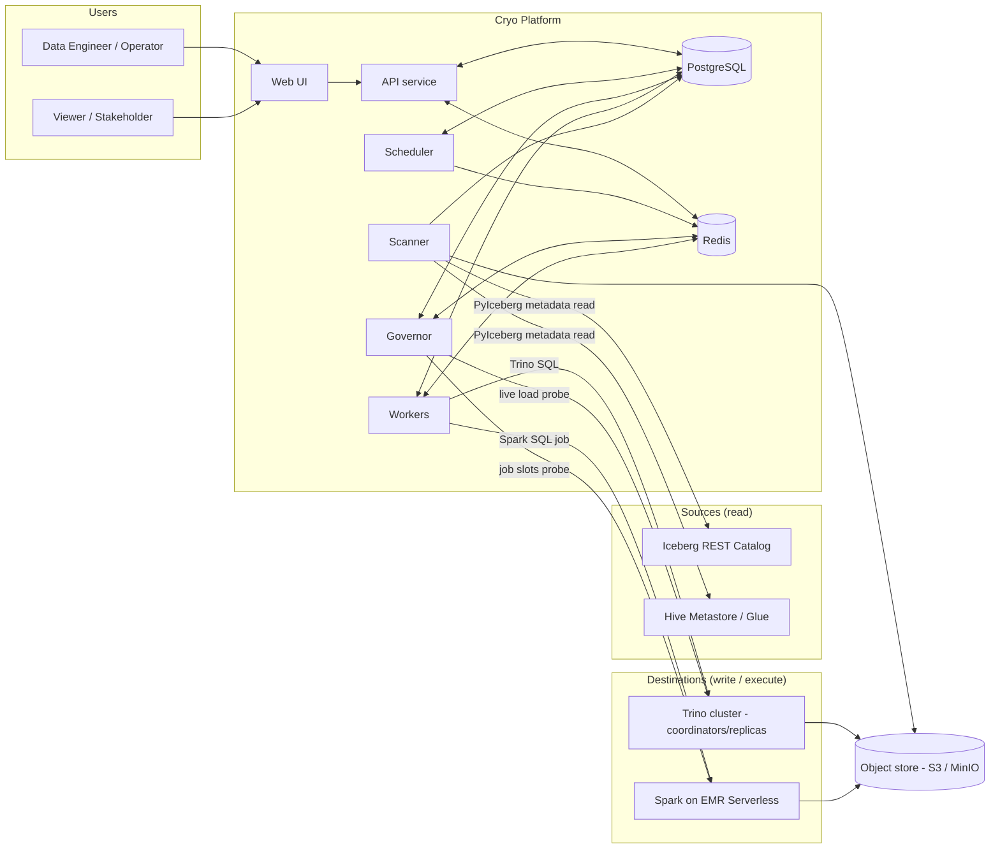
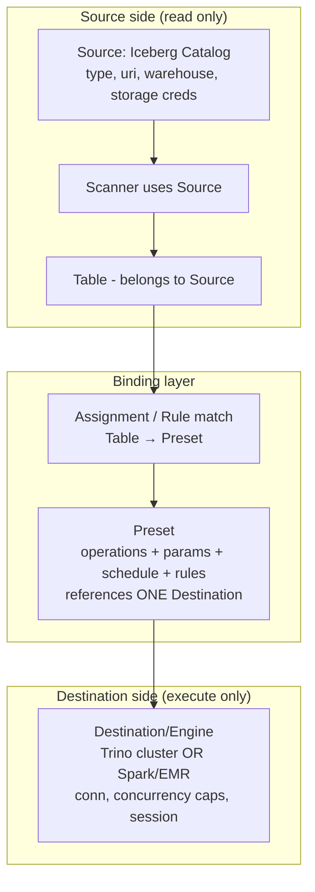
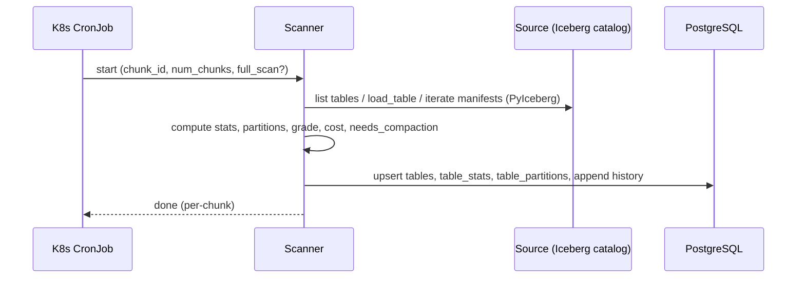
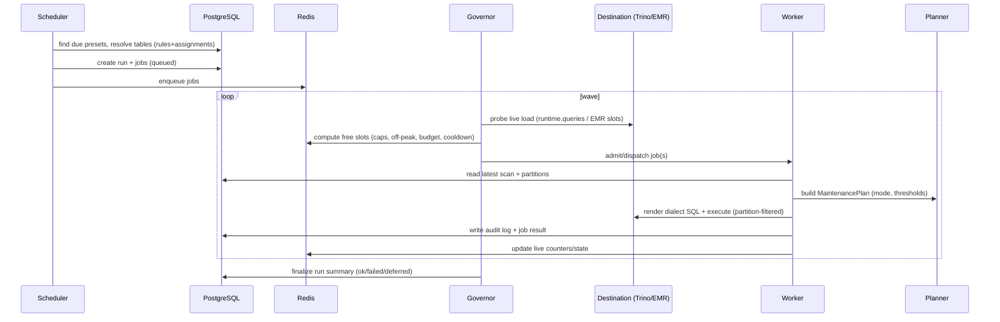
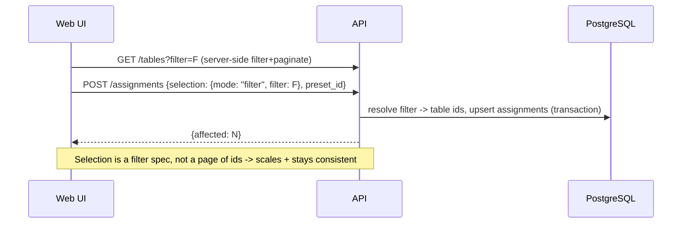
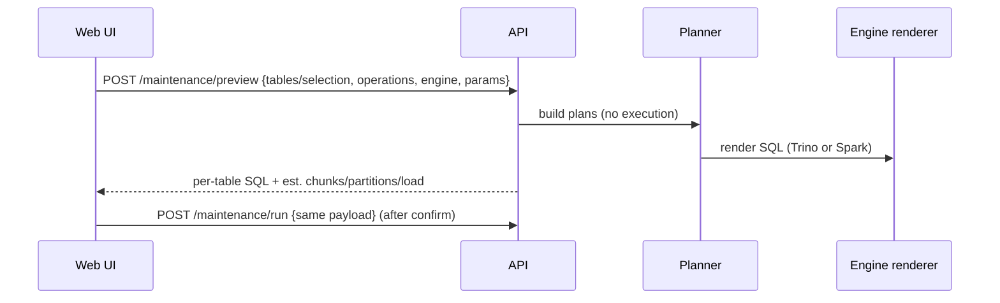
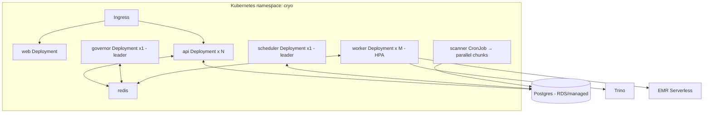

# Cryo — High-Level Design (HLD)

This document describes the system at the component level: responsibilities, boundaries, data flow,
and the deployment topology. Implementation detail (schemas, interfaces, SQL) is in `lld.md`.

---

## 1. Design goals (recap)

1. **Consolidate** scattered Iceberg maintenance (stats DAG + maintenance DAG + dbt macros + report)
   into one product. **No Airflow.**
2. **Separate** read-side **Sources** (Iceberg catalogs) from write-side **Destinations/Engines**
   (Trino, Spark/EMR). Separate config, separate storage, separate code paths for SQL generation.
3. **Preset-driven** maintenance with a UI to filter the fleet and **bulk-assign** presets.
4. **Preserve** all load-aware, partition-aware filtering that protects Trino today.
5. **Pluggable engines** and **format-pluggable** core (Iceberg first).
6. **Kubernetes-native** deployment.

---

## 2. System context

**Key boundary:** the **Scanner** only *reads* from **Sources**; the **Workers** only *write/execute*
against **Destinations**. A table row links to its Source (origin) and, via its effective preset, to a
Destination (where maintenance runs).

---

## 3. Components

### 3.1 Web UI (`web/`)
React + TypeScript SPA. Talks only to the API (REST + WebSocket).

Primary screens:
- **Datalake Health** — fleet overview: grade distribution (A–F), total tables/size/small-files,
  estimated S3 cost, drift alerts, cost-by-schema, top offenders.
- **Table Explorer** — virtualized, server-side-filtered table list. Filters: schema, size, file
  count, small-file count/%, grade, partition column, snapshots, write frequency, drift, current
  preset. **Filter → Select all matching (across pages) → Assign preset / Run now.**
- **Table Detail** — health card, partition breakdown, snapshot/manifest stats, query load, audit
  timeline, "Run maintenance" with **plan preview**.
- **Presets** — create/edit presets: operations + params, target engine, schedule, selection rules,
  guardrails. **Simulator**: "matches N tables, est. load/time/cost".
- **Runs / Live Console** — scheduled & ad-hoc runs; real-time wave view (running per engine/replica,
  concurrency gauges, queued/deferred/failed), drill into per-job logs.
- **Sources & Destinations** — connection management + health checks.

### 3.2 API service (`api/`)
FastAPI. Stateless, horizontally scalable. Responsibilities:
- CRUD for Sources, Destinations, Presets, Assignments.
- Table Explorer queries (server-side filter/sort/paginate over Postgres).
- **Bulk operations**: "assign preset to all tables matching filter F" is expressed as a *filter
  selection*, not a list of IDs — so it scales to thousands of tables and stays consistent.
- Ad-hoc maintenance trigger + **dry-run/plan preview** (calls Planner, returns SQL, runs nothing).
- Dashboard aggregations.
- Job/run monitoring via WebSocket/SSE (live state from Redis, history from Postgres).
- AuthN/Z (JWT; roles: admin / operator / viewer).

### 3.3 Scanner (`scanner/`)
Direct port + refactor of `iceberg_table_stats_batch.py`. A batch service run as a K8s `CronJob`
(and triggerable on demand from the API). Responsibilities:
- Enumerate tables from a **Source** (Trino `information_schema` or catalog listing).
- For each table, stream manifests via **PyIceberg** (O(1) memory) to compute: file/size/record
  counts, **small-file** counts (per-table and **per-partition**), partition skew, snapshot/manifest
  stats, delete-file metrics, table properties, partition spec/transform, **A–F health grade**,
  **needs_compaction + priority**, **S3 cost estimate**, and the **`partitions_to_rewrite`** detail
  used by the partition-aware planner.
- **Chunked, deterministic, resumable** (skip already-scanned-today unless full scan).
- Persist to Postgres (`tables`, `table_stats`, `table_partitions`, `table_stats_history`), and
  optionally append to the Iceberg `compaction_scan` history table (parity with today).

The Scanner is the single source of truth for "what shape is every table in" — exactly like
`iceberg_compaction_scan` today, which all maintenance reads from instead of doing live `$files`
scans.

### 3.4 Scheduler (`scheduler/`)
Single-active (leader-elected) service using APScheduler. Responsibilities:
- Evaluate each enabled **preset's** schedule (cron) + selection (rules + explicit assignments) to
  build a **MaintenanceRun** of candidate tables.
- Resolve the **effective preset** per table (explicit assignment > highest-priority matching rule),
  de-duplicate, apply cooldown pre-filter, and enqueue **MaintenanceJobs** (one per table) into Redis.
- Trigger the Scanner CronJob window awareness (don't schedule heavy maintenance before a scan, etc.).
- Persist runs/jobs to Postgres; emit "run created" events.

### 3.5 Governor (`governor/`)
The heart of load safety — generalizes the Airflow wave scheduler. Single-active controller.
Responsibilities:
- **Admission control**: before a job starts, check live engine capacity:
  - **Trino**: query each coordinator's `system.runtime.queries` for running/queued `EXECUTE
    optimize` (and orphan ops); enforce per-replica concurrency caps; **round-robin** across replicas.
  - **Spark/EMR**: count in-flight EMR job runs vs the engine's slot cap.
- Enforce **off-peak windows**, **adaptive budget** (fewer tables when busy), **cooldown** (skip
  recently maintained), **deadlines** (defer remaining when out of window).
- Dispatch admitted jobs to Workers; maintain live counters/locks in Redis; re-check between waves.
- **Failure isolation**: a job failure never blocks the rest; record and continue.

> The Governor decides *whether/when* a job may run; the Worker decides *what SQL* runs and executes it.

### 3.6 Workers (`worker/`)
Stateless, horizontally scalable executors. One job = one table's maintenance on one engine.
Responsibilities:
- Pull an admitted job; load the table's latest scan/partition data.
- Ask the **Planner** for an engine-agnostic **MaintenancePlan** (operations + partition predicates +
  params, honoring mode light/standard/deep).
- Hand the plan to the chosen **Engine adapter** to render dialect SQL and execute:
  - **Trino**: `ALTER TABLE … EXECUTE optimize(file_size_threshold=>…) [WHERE …]`,
    `expire_snapshots`, `remove_orphan_files`, `optimize_manifests`, with session tuning.
  - **Spark/EMR**: `CALL … system.rewrite_data_files(table=>…, where=>…, options=>…)`,
    `rewrite_manifests`, `expire_snapshots`, `remove_orphan_files`.
- Stream progress/logs to Redis; write the **audit log** + job result to Postgres.

### 3.7 Planner (`planner/`) — engine-agnostic
Pure logic, no I/O to engines. Ports the dbt macro intelligence:
- Reads partition stats; ranks partitions by small-file count; applies **min-small-files** filter.
- **GB-budgeted, partition-count-capped chunking**; **oversize** partitions alone; **small-table
  bypass**; **unpartitioned** path.
- Emits an ordered list of operations with structured **partition predicates** (transform-aware:
  identity/day/month/year) and parameters — but **no SQL strings**. Renderers turn predicates into
  Trino or Spark dialect. This keeps the smart filtering in one place and the dialects separate.

### 3.8 Engine adapters (`engines/`)
Two packages behind one interface:
- `engines/trino/` — connection (trino-python-client, per-coordinator), live-load probe, SQL
  rendering for Trino, execution.
- `engines/spark/` — EMR Serverless submission (boto3), status polling, SQL rendering for Spark,
  log retrieval. (Pluggable: Livy / Spark Connect / EMR-on-EKS adapters can be added.)

### 3.9 Stores
- **PostgreSQL** — durable truth: sources, destinations, presets, rules, assignments, tables, stats,
  partitions, runs, jobs, audit log. JSONB for flexible blobs (plan, partition detail, raw stats).
- **Redis** — job queue, distributed locks (single-active scheduler/governor; per-table lock to
  prevent double-maintenance), live counters (per-engine in-flight), live run/job state for the UI.
- **Object store (S3/MinIO)** — the actual Iceberg data; touched only by engines + PyIceberg.

---

## 4. Separation of Sources and Destinations (core model)

- A **Source** answers *"where does this table live and how do I read its metadata?"*
- A **Destination** answers *"where do I submit maintenance work?"*
- A **Preset** binds *what to do* + *on which Destination* + *when* + *to which tables*.
- A **Table** is discovered from a Source; its **effective preset** chooses the Destination.

This makes it trivial to, e.g., keep scanning from Hive Metastore while routing big tables to Spark
on EMR and small tables to Trino — purely by configuration.

---

## 5. Core data flows

### 5.1 Scan flow (scheduled, read side)

### 5.2 Scheduled maintenance flow (write side)

### 5.3 Assignment flow (UI, "filter → select all → assign")

### 5.4 Ad-hoc with preview (dry-run)

---

## 6. Concurrency & safety model (preserved from today)

| Concern | Mechanism |
|---|---|
| Cluster-wide OPTIMIZE cap | Governor reads `system.runtime.queries` per coordinator; admits only up to per-replica cap. |
| Multi-replica spread | Round-robin dispatch across configured Trino coordinators. |
| EMR slots | Governor counts in-flight EMR job runs vs engine slot cap. |
| Off-peak only (heavy ops) | Preset/engine off-peak window (IST-aware); Governor blocks heavy modes outside window. |
| Adaptive budget | Effective table budget shrinks as live load grows. |
| Cooldown | Skip tables maintained within N hours (audit log + engine history). |
| Don't double-run a table | Per-table Redis lock for the job's lifetime. |
| Failure isolation | One job's failure is recorded; the run continues. |
| Deadlines | Governor stops admitting when the maintenance window/run deadline nears; remainder deferred. |
| Partition safety | Planner caps partitions/chunk to avoid Trino `FilterNode` complexity errors; oversize alone. |
| Big-table guardrail | Planner/policy refuses unbounded full-table ops above file/size thresholds unless forced. |

---

## 7. Deployment topology (Kubernetes)

- **api**: Deployment + HPA, behind Ingress (serves UI static assets or a separate `web` Deployment).
- **scheduler / governor**: single active replica each (lease/leader-election); restart-safe.
- **worker**: Deployment with HPA (scales with queue depth); the Governor — not the replica count —
  bounds real concurrency against engines.
- **scanner**: `CronJob` spawning a parallel `Job` (N chunks), mirroring today's 4-chunk batch.
- **postgres**: external/managed in prod; in-cluster for dev.
- **redis**: in-cluster (or managed).
- Config via `ConfigMap`/`Secret`; images per service; one Helm chart with subcharts/values.

---

## 8. Observability

- **Structured logs** (JSON) per service; per-job log stream to Redis (live) + persisted summary.
- **Metrics** (Prometheus): jobs queued/running/succeeded/failed, admission decisions, live engine
  load, scan duration/coverage, fleet grade distribution, est. cost, drift counts.
- **Audit log** (Postgres): every operation (table, action, status, detail, engine, run, duration) —
  superset of today's `iceberg_maintenance_log`, powering reports + Table Detail timeline.
- **Reports**: scheduled HTML email/Slack (port `iceberg_maintenance_report.py`) + in-app alerts.

---

## 9. How today's pieces map onto Cryo

| Today | Cryo |
|---|---|
| `dag_iceberg_table_stats_batch.py` | **Scanner** service (CronJob) + Postgres stats model |
| `iceberg_compaction_scan` (Iceberg) | `tables` + `table_stats` + `table_partitions` (PG) + optional Iceberg history |
| `dag_iceberg_auto_maintenance_with_trino.py` (waves, load probe, replicas, deadlines) | **Governor** + **Scheduler** |
| dbt `iceberg_maintain_single_table` / `_partition_aware_optimize` | **Planner** + **Trino engine** (Worker) |
| dbt `iceberg_list_maintenance_targets` (discovery, budget, drift, cooldown) | **Scheduler** + **Governor** + Planner inputs |
| dbt `iceberg_lifecycle.sql` (orphan/manifests/full) | Planner operations + engine renderers |
| dbt `iceberg_health_check` / `iceberg_diagnostics` / `iceberg_cost_report` | **Dashboards** + read APIs |
| `iceberg_maintenance_report.py` | **Reporting** service/job |
| `iceberg_maintenance_log` (Iceberg) | `audit_log` / `maintenance_jobs` (PG) |
| Per-table dbt subprocess isolation | Per-table Worker job + per-table Redis lock |
| Hard-wired Trino-only | Pluggable **engines** (Trino + Spark/EMR) selected by preset |

See `lld.md` for concrete schemas, interfaces, and the rendered SQL for each operation/engine.
