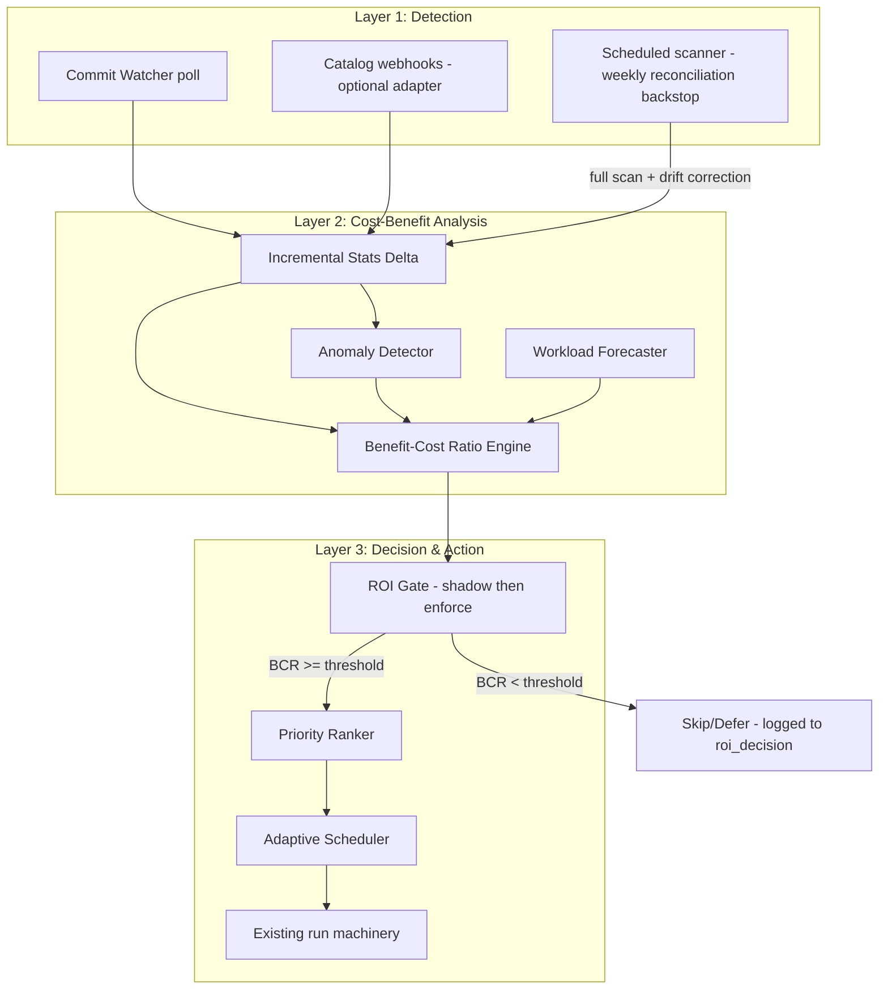

# Smart Maintenance System for Cryo

> **Revision 2 — 2026-07-08 architectural review.** Changes from draft 1, in order of
> importance: (1) cron scanning is **demoted to a reconciliation backstop, not removed** —
> an event-only maintenance system that misses events silently neglects tables, which is a
> trust incident for this product; (2) added previously missing sections: data model &
> migrations, delivery semantics & failure modes, testing, rollout/flags, observability;
> (3) API surface consolidated — operations route through the existing run machinery instead
> of per-operation endpoints; SSE cut in favor of polling; (4) UI scope cut from five new
> pages to one; (5) inventory and code sketches corrected against the actual codebase
> (verified 2026-07-08): signal protocol is `MaintenanceSignal.evaluate()`, the bandit lives
> in `cryo/governor/bandit.py`, `COMPUTE_STATISTICS` already exists in the enum,
> `LayoutOptimization.tsx` already exists, the health dashboard is `DatalakeHealth.tsx`, nav
> lives in `App.tsx`, and the API client is `web/src/api/client.ts` with generated OpenAPI
> types (`npm run gen:api`).

## Executive Summary

Evolve Cryo's cron-based "scan everything daily" model into an **event-driven, cost-aware,
self-tuning maintenance system**, inspired by:

- **CMU NoisePage**: workload forecasting + behavior modeling + action planning
- **LinkedIn AutoComp** (SIGMOD 2025): cost-benefit scoring for compaction decisions —
*already partially implemented* in `cryo/planner/benefit_score.py`
- **Databricks Enzyme**: incremental processing, skip low-ROI operations
- **LSM compaction research (EcoTune)**: compaction timing as an investment decision
- **Multi-armed bandits**: online learning for maintenance knob tuning — *already
implemented* as `AdmissionBandit` in `cryo/governor/bandit.py`

**Non-negotiable design constraint:** the periodic scanner is never removed. Event-driven
detection is an *optimization layer* on top of it. The scheduled full scan becomes the
weekly-cadence reconciliation pass that catches missed events, corrects incremental-stats
drift, and covers catalogs that emit no events. A maintenance product whose detection
silently stops is worse than one that is merely slow — see `docs/premortem.md`'s docs-vs-code
drift pattern and `PRODUCT.md`'s trust-first brand.

> **Relationship to the 25-move roadmap** (`docs/strategy-next-moves-2026-07.md`): this
> system spans Moves 9–20 (scanner wins, planner extensions, triggers, layout). It does NOT
> replace Move 5 (Puffin statistics — already shipped as `COMPUTE_STATISTICS`) or Moves
> 21–25 (UI hygiene, observability, Amoro spike). The phases below name their specific move
> prerequisites; do not trust this doc's snapshot of move status — check the strategy doc's
> implementation logs.

---

## Existing Inventory (verified against the working tree, 2026-07-08)

### Backend — already built


| File                                                                          | Status       | Notes                                                                                                                                                                           |
| ----------------------------------------------------------------------------- | ------------ | ------------------------------------------------------------------------------------------------------------------------------------------------------------------------------- |
| `cryo/events/watcher.py`                                                      | ✅ Exists     | `TableCommitWatcher` + `SnapshotProbe` protocol; `poll_once()` emits `TableCommitted`                                                                                           |
| `cryo/events/consumer.py`, `redis_stream.py`, `service.py`                    | ✅ Exist      | Redis-backed event stream + consumer; `service.py` already reads `is_streaming` from payloads                                                                                   |
| `cryo/scanner/signals.py`                                                     | ✅ Exists     | Computes `commits_per_day` from `TableStatsHistory` deltas; default HOT threshold 24.0 already present                                                                          |
| `cryo/scanner/cost.py`                                                        | ✅ Exists     | `bytes_to_usd`, `project_savings`                                                                                                                                               |
| `cryo/scanner/health.py`                                                      | ✅ Exists     | A–F grading; already consumes `commits_per_day` and `is_streaming` from stats raw                                                                                               |
| `cryo/scanner/orphans.py`, `compaction_candidates.py`, `persistence.py`       | ✅ Exist      | Persistence already stores `is_streaming` in stats raw                                                                                                                          |
| `cryo/planner/benefit_score.py`                                               | ✅ Exists     | AutoComp scoring: `score = (scan_savings × frequency_multiplier) / rewrite_cost`, persisted to `TablePartition.compaction_benefit_score`; min-score constant exists             |
| `cryo/planner/planner.py`                                                     | ✅ Exists     | Ops sequencing, GB-budget chunking; already streaming-aware (`is_streaming` branch)                                                                                             |
| `cryo/planner/guardrails.py`                                                  | ✅ Exists     | `CORRECT_ORDER` tuple + `validate_operation_order()` (Move 15)                                                                                                                  |
| `cryo/triggers/signals.py`                                                    | ✅ Exists     | `MaintenanceSignal` Protocol (`evaluate(session, table_id) -> SignalResult`); `FileDegradationSignal`, `QueryLatencySignal`, `CostAnomalySignal` (Move 18 shipped)              |
| `cryo/triggers/evaluator.py`                                                  | ✅ Exists     | Signal evaluation engine                                                                                                                                                        |
| `cryo/ml/anomaly_detector.py`                                                 | ✅ Exists     | Module functions `detect_table_anomalies()` / `detect_all_anomalies()` returning `AnomalyAlert` (severity: `info`/`warning`/`critical`) — **not** a class; wire accordingly     |
| `cryo/ml/cost_model.py`, `cost_integration.py`, `health_classifier.py`        | ✅ Exist      | Use for BCR cost terms — do not invent new cost models                                                                                                                          |
| `cryo/optimizer/layout_analyzer.py`, `partition_analyzer.py`, `clustering.py` | ✅ Exist      | Recommendations persisted to `LayoutRecommendation` (model exists in `cryo/db/models.py`)                                                                                       |
| `cryo/governor/admission.py`                                                  | ✅ Exists     | `AdmissionJob/Config/Decision/Budget` — admission math                                                                                                                          |
| `cryo/governor/bandit.py`                                                     | ✅ Exists     | `AdmissionBandit` + `BanditState`; persisted via `GovernorBanditState` model                                                                                                    |
| `cryo/governor/capacity.py`                                                   | ✅ Exists     | Capacity probes (note: native probe is static — Move 6)                                                                                                                         |
| `cryo/domain/enums.py`                                                        | ✅ Exists     | `OperationType` is a `StrEnum` and **already includes `COMPUTE_STATISTICS`** (Move 5 shipped)                                                                                   |
| `cryo/db/models.py`                                                           | ✅ Exists     | Already has `QueryLog`, `QueryPattern`, `LayoutRecommendation`, `ChunkCheckpoint`, `TableStatsHistory`, `TierPolicyRecord` (⚠ storage tiering — see naming note in §Data Model) |
| `cryo/api/route_helpers.py`, `routes_sources.py`                              | ✅ Exist      | Move 22 decomposition pattern established — follow it for new routers                                                                                                           |
| `cryo/api/routes.py`                                                          | ⚠️ 1,979 LoC | Still monolithic; add nothing here                                                                                                                                              |


### Backend — needs building


| File                                   | Action                                                                       | Depends on                                                |
| -------------------------------------- | ---------------------------------------------------------------------------- | --------------------------------------------------------- |
| `cryo/scanner/incremental.py`          | NEW: delta stats from commit-event snapshot summaries, watermarked           | `cryo/events/watcher.py`                                  |
| `cryo/scanner/detection_tiers.py`      | NEW: detection-tier classifier (named to avoid `TierPolicyRecord` collision) | `cryo/scanner/signals.py`                                 |
| `cryo/governor/roi_gate.py`            | NEW: ROI-based skip/defer gate, shadow-mode first                            | `benefit_score.py`, `scanner/cost.py`, `ml/cost_model.py` |
| `cryo/scheduler/forecaster.py`         | NEW: EWMA + seasonality workload forecaster                                  | Query-log pipeline (shipped 2026-07-07)                   |
| `cryo/domain/enums.py`                 | Add `CONVERT_DELETES`                                                        | —                                                         |
| `cryo/planner/guardrails.py`           | Insert `CONVERT_DELETES` into `CORRECT_ORDER`                                | Enum change                                               |
| `cryo/engines/spark/sql.py`            | `_render_convert_deletes` + golden tests                                     | Enum change                                               |
| `cryo/engines/native/routing.py`       | Add `CONVERT_DELETES` to `NATIVE_ALWAYS_DISCONNECTED`                        | Enum change                                               |
| `cryo/api/routes_smart_maintenance.py` | NEW read-side router (see §API Design — deliberately small)                  | Move 22 pattern                                           |


### Frontend — corrections to draft 1


| Draft-1 claim                                | Reality                                                                                   | Consequence                                         |
| -------------------------------------------- | ----------------------------------------------------------------------------------------- | --------------------------------------------------- |
| `web/src/pages/LayoutOptimization.tsx` "NEW" | **Already exists**                                                                        | Extend it; do not recreate                          |
| `web/src/pages/Dashboard.tsx`                | Does not exist — the health dashboard is `DatalakeHealth.tsx`                             | Widgets go there                                    |
| `web/src/components/Layout.tsx` (nav)        | Does not exist — nav lives in `App.tsx`                                                   | Nav change is an `App.tsx` edit                     |
| `web/src/api/index.ts`                       | Does not exist — client is `web/src/api/client.ts`, types generated via `npm run gen:api` | Never hand-write API types; regenerate from OpenAPI |


---

## Architecture: Event Layer + Reconciliation Backstop




The executor is the **existing** scheduler → governor → worker pipeline. This system changes
*when* and *whether* work is enqueued; it does not introduce a second execution path.

---

## Layer 1: Event Detection

### 1.1 Event sources, by portability


| Source                                                    | Mechanism                                                           | Portability                                      | Status                                                                                                                |
| --------------------------------------------------------- | ------------------------------------------------------------------- | ------------------------------------------------ | --------------------------------------------------------------------------------------------------------------------- |
| **Commit watcher**                                        | Poll `current_snapshot_id` via PyIceberg (`cryo/events/watcher.py`) | Works against every catalog Cryo supports        | **Baseline — build on this**                                                                                          |
| **Scheduled scanner**                                     | Existing chunked scan, demoted to weekly reconciliation             | Universal                                        | Exists; cadence change only                                                                                           |
| **Catalog webhooks** (EventBridge, Polaris notifications) | Push                                                                | AWS-/catalog-specific                            | Optional adapter behind `Source` config, per the vendor-neutral-core rule in `docs/research-and-roadmap.md` Part 5 §2 |
| **Iceberg REST `/events`**                                | Poll                                                                | ⚠ Not uniformly implemented across REST catalogs | **Deferred** — verify against target catalog before building; draft 1 overstated this as generally available          |
| **S3 Metadata journal tables**                            | Query journal                                                       | AWS-only, account-level feature                  | **Deferred** — optional adapter, not core path                                                                        |


### 1.2 Poll budget (new in rev 2)

Per-table polling multiplied across a fleet is itself a catalog-load problem —
`docs/native-engine-scoping-research.md` §3.2 documents HMS lock contention and Glue
account-level API rate limits. Therefore:

- One **global poll budget per source** (requests/min, configurable), enforced by the
watcher scheduler; tiers share the budget, HOT tables get priority.
- Poll intervals are **configurable with conservative defaults**: HOT 30s (not the draft's
5s), WARM 5min, COLD daily, DORMANT weekly. 5s/table against Glue at fleet scale would
trip rate limits.
- Jitter all polls; batch snapshot-id reads per namespace where the catalog supports listing.
- Catalog latency P50/P99 (Move 16) is the backpressure signal: if catalog latency degrades,
the watcher widens intervals automatically.

### 1.3 Detection tiers

Build on `cryo/scanner/signals.py`, which already computes `commits_per_day` from
`TableStatsHistory` deltas with a 24.0 threshold:

```python
# cryo/scanner/detection_tiers.py  (NEW)
class DetectionTier(StrEnum):
    HOT = "hot"          # event-driven, ≥24 commits/day or is_streaming
    WARM = "warm"        # 5-min metadata poll, 1–24 commits/day
    COLD = "cold"        # daily lightweight check, >0 but <1 commit/day
    DORMANT = "dormant"  # weekly check, zero commits across the history window

def classify_detection_tier(
    commits_per_day: float, is_streaming: bool, history_window_days: int
) -> DetectionTier:
    """Pure function over values the scanner already computes.

    Note: `is_streaming` lives in TableStats.raw (see cryo/scanner/persistence.py),
    not as an ORM column — callers pass the extracted value, the classifier does
    not reach into models.
    """
    if is_streaming or commits_per_day >= 24:
        return DetectionTier.HOT
    if commits_per_day >= 1:
        return DetectionTier.WARM
    if commits_per_day > 0:
        return DetectionTier.COLD
    return DetectionTier.DORMANT
```

Naming: `**DetectionTier` / `detection_tier`, never bare "tier"** — `TierPolicyRecord` in
`cryo/db/models.py` already owns the word "tier" for storage tiering, and overloading it
guarantees confusion in code review and UI copy alike.

Manual override: `detection_tier_override` column (nullable); when set, the classifier's
output is recorded but not applied. Auto-classification runs during scan persistence and on
each reconciliation pass.

**Scan-budget arithmetic** (illustrative, not a benchmark — see §Cost-Effectiveness): a
10,000-table fleet with 50 HOT / 500 WARM / 9,000 COLD / 450 DORMANT replaces 10,000 daily
full analyses with ~9,000 staggered daily lightweight checks + event-driven work on the 550
active tables + one weekly full reconciliation.

---

## Layer 2: Cost-Benefit Analysis Engine

### 2.1 Incremental stats delta

Iceberg snapshot **summaries** already carry `added-data-files`, `deleted-data-files`,
`added-files-size`, `removed-files-size`, `added-delete-files`, and partition summaries —
readable from the snapshot metadata with **no manifest walk**. That is the delta source; the
draft's `dataclasses.replace` sketch was wrong because `TableStats` is an ORM model, not a
frozen dataclass.

```python
# cryo/scanner/incremental.py  (NEW)
@dataclass(frozen=True)
class CommitDelta:
    table_id: uuid.UUID
    snapshot_id: int
    parent_snapshot_id: int | None
    files_added: int
    files_removed: int
    bytes_added: int
    bytes_removed: int
    delete_files_added: int

def apply_commit_delta(session: Session, delta: CommitDelta) -> bool:
    """Apply a delta to TableStats inside the caller's transaction.

    Returns False (no-op) when delta.snapshot_id <= the stored watermark —
    this is the idempotency guard for at-least-once Redis Stream delivery
    and for watcher/webhook double-reporting the same commit.
    """
```

**Delivery semantics (new in rev 2):** Redis Streams consumer groups are at-least-once, and
the watcher may race a webhook adapter reporting the same snapshot. Correctness rules:

1. **Watermark**: persist `last_applied_snapshot_id` (and its `sequence-number`) per table;
  apply a delta only if it advances the watermark. Duplicates and stale replays no-op.
2. **Gap detection**: if `parent_snapshot_id` ≠ current watermark, one or more commits were
  missed — do not guess; flag the table for a targeted single-table scan instead of
   applying a non-contiguous delta.
3. **Writer coordination**: incremental writer and full scanner both write `TableStats`;
  full-scan results always win (they reset the watermark to the scanned snapshot). Use
   `SELECT ... FOR UPDATE` on the stats row, matching the per-table locking discipline in
   `cryo/queue/locks.py`.

**Full-scan (reconciliation) triggers:** watermark gap detected · drift > 5% between
incremental stats and a sampled spot-check · format-version change · manual request · weekly
scheduled reconciliation (the demoted cron).

### 2.2 Enhanced BCR engine

Current implementation (`cryo/planner/benefit_score.py`):
`score = (scan_savings × frequency_multiplier) / rewrite_cost`, per partition, persisted to
`TablePartition.compaction_benefit_score`, with a documented "score < 1.0 means cost likely
exceeds benefit" convention. Extend — don't replace — that function.

**Enhanced formula — every term normalized to USD/month** (draft 1 left units undefined,
which makes a ratio meaningless):

```
BCR = (B_query + B_storage + B_metadata) / (C_compute + C_write_amp + C_opportunity)

B_query        = query_count_per_month × est_seconds_saved × engine_cost_per_second
B_storage      = bytes_reclaimable × storage_usd_per_byte_month        # scanner/cost.py bytes_to_usd
B_metadata     = est_planning_seconds_saved_per_query × query_count_per_month × engine_cost_per_second
C_compute      = est_rewrite_bytes × compute_usd_per_byte              # ml/cost_model.py
C_write_amp    = amortized: rewrite bytes that recent history says will be rewritten again within cooldown
C_opportunity  = expected engine-slot contention during the run window  # forecaster, §2.4
```

Source every cost coefficient from `cryo/scanner/cost.py` and `cryo/ml/cost_model.py`. When
query-log ingestion is disabled for a destination, `B_query`/`B_metadata` are unknown — fall
back to the existing benefit score rather than fabricating query counts, and say so in the
BCR breakdown payload (`query_terms: "unavailable — telemetry disabled"`).

### 2.3 Anomaly-driven trigger signal

`cryo/ml/anomaly_detector.py` exposes **module functions**, not a detector class; the
trigger protocol is `MaintenanceSignal.evaluate(session, table_id) -> SignalResult`
(severity strings `info`/`warning`/`critical`). Corrected wiring:

```python
# cryo/triggers/signals.py  (extend — follows FileDegradationSignal's shape)
@dataclass
class AnomalySignal:
    high_severity_threshold: int = 1
    medium_severity_threshold: int = 3

    def evaluate(self, session: Session, table_id: uuid.UUID) -> SignalResult:
        alerts = detect_table_anomalies(session, table_id)
        critical = [a for a in alerts if a.severity == "critical"]
        warning = [a for a in alerts if a.severity == "warning"]
        triggered = bool(critical) or len(warning) >= self.medium_severity_threshold
        return SignalResult(
            triggered=triggered,
            signal_name="anomaly",
            reason=critical[0].reason if critical else f"{len(warning)} warning-level anomalies",
            severity="critical" if critical else "warning",
        )
```

New anomaly types to add inside `anomaly_detector.py` (all computable from
`TableStatsHistory` deltas): delete-file accumulation rate spike · storage growth without
proportional record growth (fragmentation) · manifest-count explosion. Query-latency
degradation correlation already exists as `QueryLatencySignal` — do not duplicate it.

### 2.4 Workload forecaster

```python
# cryo/scheduler/forecaster.py  (NEW)
class WorkloadForecaster:
    """EWMA + daily/weekly seasonality over hourly query counts (14-day window).

    Deliberately not a TS foundation model: docs/research-and-roadmap.md Part 3
    already evaluated and rejected Chronos/TimesFM for this data shape.
    """
    def forecast(self, session: Session, table_id: uuid.UUID, horizon_hours: int) -> QueryLoadForecast: ...
```

Consumes `QueryLog`/`QueryPattern` (models exist). Output feeds `C_opportunity` in the BCR
and the scheduler's run-window choice. Tables without telemetry get a flat prior, not an
error.

---

## Layer 3: Decision and Action

### 3.1 ROI gate — shadow mode first

Draft 1's sketch declared `-> Decision` and returned tuples, and hard-coded thresholds as
class constants. Corrected contract:

```python
# cryo/governor/roi_gate.py  (NEW)
class GateAction(StrEnum):
    PROCEED = "proceed"
    SKIP = "skip"
    DEFER = "defer"

@dataclass(frozen=True)
class GateDecision:
    action: GateAction
    reason: str
    bcr: float
    threshold: float
    shadow: bool          # True = logged but not enforced

class ROIGate:
    """Thresholds come from config (per-destination overridable), not constants:
    roi_gate_enabled, roi_gate_shadow_mode (default True),
    roi_min_bcr (default 1.0), roi_min_bcr_streaming (default 0.5).
    """
    def decide(self, session: Session, job: AdmissionJob) -> GateDecision: ...
```

- **Placement**: inside the governor's admission loop, after `AdmissionBandit`
(`cryo/governor/bandit.py` — draft 1 misplaced it in `admission.py`) and before capacity
probes, so skipped work never consumes a probe.
- **Shadow mode is the launch state**: every decision is persisted to `roi_decision`
(§Data Model) with full BCR breakdown, but `SKIP`/`DEFER` are not enforced until operators
have reviewed shadow data. Flipping enforcement is a config change, not a deploy. This is
the same promotion discipline the repo already uses for the bandit's confidence gate.
- **DEFER on ineffectiveness** uses Move 13's metric with explicit semantics:
`reduction_ratio = input_files / output_files` for the table's last `OPTIMIZE`; defer when
`reduction_ratio < 2.0` (rewrites are churning, not consolidating). Draft 1's
`ratio < 0.5` was on an undefined scale.
- Every enforced SKIP/DEFER writes an `AuditLog` row — invisible skips are how "Cryo is
running but not helping" tickets happen.

### 3.2 Adaptive scheduling with bandit learning

Extend `AdmissionBandit` (`cryo/governor/bandit.py`, state persisted in
`GovernorBanditState`) with new arms:


| Knob                | Today                                | Extension                     |
| ------------------- | ------------------------------------ | ----------------------------- |
| `high_load_ratio`   | Yes                                  | Keep                          |
| `per_replica_cap`   | Yes                                  | Keep                          |
| `cooldown_hours`    | Fixed                                | Arm over (4, 8, 12, 24)       |
| `min_benefit_score` | Fixed constant in `benefit_score.py` | Arm over (0.5, 1.0, 2.0, 5.0) |


Detection-tier poll intervals stay **out of the bandit** (draft 1 had them in): poll cadence
is a catalog-load knob governed by the §1.2 budget, and letting a reward-seeking learner
tighten poll loops against a rate-limited catalog is a self-inflicted outage. Contextual
bandit (arms per table class) remains future work, gated on the §3.1 shadow data proving the
reward signal is sane.

### 3.3 Operation sequencing with delete conversion

Current `CORRECT_ORDER` (`cryo/planner/guardrails.py`):
`expire_snapshots → remove_orphan_files → optimize → optimize_manifests → compute_statistics`
(`COMPUTE_STATISTICS` already exists — Move 5 shipped).

**New order** inserts `CONVERT_DELETES` before `OPTIMIZE`:

```
expire_snapshots → remove_orphan_files → convert_deletes → optimize → optimize_manifests → compute_statistics
```

Changes land in one PR: enum member, `CORRECT_ORDER` insertion, planner gating, Spark
renderer + golden tests, native routing. `Operation` stays the unified non-polymorphic
dataclass.

```python
# cryo/planner/planner.py — gating (engine-agnostic; planner emits no SQL)
def should_plan_convert_deletes(stats: Mapping[str, Any], plan_has_optimize: bool) -> bool:
    return (
        stats.get("format_version") == 2
        and stats.get("equality_delete_count", 0) > 0
        and stats.get("delete_file_pct", 0.0) >= 5.0
        and not stats.get("v3_upgrade_candidate", False)  # Move 10: prefer the V3 path
        and not plan_has_optimize  # subsumption — see below
    )
```

**Subsumption rule (new in rev 2):** `convert_deletes` renders as Spark
`rewrite_data_files(delete-file-threshold=1)` — that *is* a compaction. If the plan already
contains `OPTIMIZE` for the same scope, running both back-to-back rewrites the same bytes
twice. When `OPTIMIZE` is planned, fold `delete-file-threshold` into its options instead of
emitting a second rewrite.

```python
# cryo/engines/spark/sql.py — rendering (dialect-isolated; identifiers quoted via the
# module's existing helpers, exactly as the other renderers do — no raw f-string interpolation
# of user-controlled names)
def _render_convert_deletes(catalog: str, table_name: str, params: dict[str, Any]) -> str:
    ...  # CALL {catalog}.system.rewrite_data_files(
         #   table => '<quoted>',
         #   options => map('delete-file-threshold','1','partial-progress.enabled','true'))
```

Engine routing: Trino has no eq→pos rewrite — not offered for Trino destinations. Native Go:
append to `NATIVE_ALWAYS_DISCONNECTED` in `cryo/engines/native/routing.py` (constant
verified) so it routes to Spark. **Golden/parity tests are mandatory** per `AGENTS.md` §5 —
a renderer change without golden tests fails review.

---

## Layer 4: Query-Aware Layout Optimization

`cryo/optimizer/layout_analyzer.py` produces recommendations into the existing
`LayoutRecommendation` table. Missing pieces, in order:

1. **Execution path**: approving a recommendation creates a maintenance run through the
  **existing run machinery** — an `OPTIMIZE` operation with sort/z-order params — not a
   parallel executor. The API is a thin approve/dismiss state transition (§API Design).
2. **Effectiveness tracking**: persist p50/p95 latency (from `QueryLog`) for 7 days
  before/after execution on the recommendation row. This is the feedback loop that
   justifies ever raising automation.
3. **No auto-apply at launch** (reversing draft 1): rewriting a table's physical layout from
  an inferred query pattern is exactly the class of action `PRODUCT.md` says must stay
   behind legible guardrails. Auto-apply ships later as `layout_auto_apply` (default off,
   HIGH-confidence only, per-preset opt-in, full audit trail) — and only after ≥30 days of
   before/after data shows recommendations are net-positive.

Sort-vs-z-order decision (extends `layout_analyzer.py`): single dominant filter column →
SORT; 2–4 recurring filter columns → Z-ORDER capped at 4; otherwise NONE. Trino
destinations get recommendations labeled "requires Spark" rather than a broken execute
button.

---

## API Design

**Principles (rev 2):** no per-operation endpoints — operations flow through the existing
plan/run machinery so guardrails, preview, RBAC, and audit apply uniformly. New routers
follow the Move 22 pattern (`routes_sources.py` + `route_helpers.py`), each <500 LoC.
Nothing is added to `routes.py`. Every route gets a role decorator (`cryo/api/deps.py`);
reads = `viewer`, state changes = `operator`. Frontend types come from `npm run gen:api`.


| Endpoint                                               | Method | Role     | Notes                                                                |
| ------------------------------------------------------ | ------ | -------- | -------------------------------------------------------------------- |
| `/smart-maintenance/overview`                          | GET    | viewer   | Tier counts, event throughput, gate stats                            |
| `/smart-maintenance/detection-tiers`                   | GET    | viewer   | Paginated; reuses existing filter-spec grammar                       |
| `/tables/{id}/detection-tier`                          | PUT    | operator | Set/clear `detection_tier_override`                                  |
| `/smart-maintenance/roi-decisions`                     | GET    | viewer   | Shadow + enforced decisions, filterable                              |
| `/tables/{id}/roi-breakdown`                           | GET    | viewer   | BCR terms; marks telemetry-unavailable terms                         |
| `/tables/{id}/layout-recommendations/{rec_id}/approve` | POST   | operator | Creates a run via existing machinery; returns `run_id`               |
| `/tables/{id}/layout-recommendations/{rec_id}/dismiss` | POST   | operator | State transition + audit row                                         |
| `/tables/{id}/workload-forecast`                       | GET    | viewer   | 404-free: returns flat prior + `telemetry: false` when no query logs |


**Cut from draft 1:** the SSE stream (`/events/stream`) — the repo's one streaming mechanism
is the WebSocket run console, and a dashboard that refreshes every 15–30s via TanStack Query
`refetchInterval` meets the operator need without a second streaming stack (DESIGN.md:
motion/updates convey state, and operators hate flickering numbers). Also cut:
`/tables/{id}/convert-deletes` (it's an operation — planner/run machinery),
`/anomalies/active` (extend the existing anomalies surface in `advanced_routes.py` instead
of forking a duplicate).

---

## Data Model & Migrations (new in rev 2)

Every change ships with an Alembic migration (`AGENTS.md` non-negotiable). All additive.


| Change                                                                                                                                              | Where                                                              | Notes                                                                                                                                                                |
| --------------------------------------------------------------------------------------------------------------------------------------------------- | ------------------------------------------------------------------ | -------------------------------------------------------------------------------------------------------------------------------------------------------------------- |
| `detection_tier` (str, indexed), `detection_tier_override` (nullable), `last_applied_snapshot_id` (bigint), `last_applied_sequence_number` (bigint) | `Table`                                                            | Watermark + tier live on the table row; named to avoid `TierPolicyRecord` collision                                                                                  |
| `roi_decision` table                                                                                                                                | NEW                                                                | `id, table_id FK, run_id nullable FK, action, reason, bcr, threshold, shadow bool, breakdown JSONB, created_at`; indexed `(table_id, created_at)`; retention 90 days |
| `equality_delete_count`, `position_delete_count`                                                                                                    | `TableStats` (or stats raw, matching how `is_streaming` is stored) | Scanner already walks delete manifests; split the count by type                                                                                                      |
| `latency_before_p95`, `latency_after_p95`, `measured_at`                                                                                            | `LayoutRecommendation`                                             | Effectiveness feedback loop                                                                                                                                          |
| Bandit arm extensions                                                                                                                               | `GovernorBanditState`                                              | Verify JSON state shape absorbs new arms without migration; migrate only if columns are typed                                                                        |


No new queue/broker infrastructure: Redis Streams (existing) carries commit events; Postgres
carries decisions and state.

---

## Reliability & Failure Modes (new in rev 2)


| Failure                               | Consequence if unhandled              | Design answer                                                                                                                  |
| ------------------------------------- | ------------------------------------- | ------------------------------------------------------------------------------------------------------------------------------ |
| Watcher pod down for hours            | Tables silently unmonitored           | Weekly reconciliation scan catches everything; `/healthz` + a `cryo_watcher_last_poll_timestamp` metric alert well before that |
| Redis Stream redelivery               | Double-applied deltas corrupt stats   | Snapshot-id watermark no-ops duplicates (§2.1)                                                                                 |
| Missed commit (gap)                   | Incremental stats silently wrong      | Parent-snapshot gap check → targeted single-table rescan, never a guessed delta                                                |
| Catalog rate-limited by our polling   | Cryo degrades the infra it monitors   | Global per-source poll budget + latency backpressure (§1.2)                                                                    |
| ROI gate miscalibrated                | Needed maintenance skipped fleet-wide | Shadow mode first; enforced skips are audited and surfaced in UI; kill switch = one config flag                                |
| Forecaster with no telemetry          | 500s or fabricated numbers            | Flat prior + explicit `telemetry: false` in payloads                                                                           |
| Incremental writer races full scanner | Lost updates on `TableStats`          | Row lock + full-scan-wins watermark reset (§2.1)                                                                               |


---

## Testing Strategy (new in rev 2)

- **Golden/parity tests** for `_render_convert_deletes` (Spark) and the routing assertion
that Trino/native never receive it — same fixtures pattern as existing renderer tests
(`AGENTS.md` §5 checklist).
- **Unit**: tier classifier (pure function — table-driven cases incl. boundary 1.0/24.0);
watermark idempotency (duplicate, stale, gap); BCR term math with telemetry
present/absent; guardrails order with `CONVERT_DELETES` inserted.
- **Integration**: commit event → delta applied → signal fired → shadow decision row
written, against the local REST catalog stack (existing `tests/integration/` harness).
- **Property**: `apply_commit_delta` never drives counters negative; replaying any event
sequence permutation with duplicates converges to the same stats given the watermark.
- **UI**: Vitest for the new page's tabs + `TierBadge`/`ROIDecisionBadge`; extend the
Playwright critical path (Move 21) with "override detection tier" once the page exists.

---

## Rollout & Feature Flags (new in rev 2)

All default-off, in `cryo/config.py` settings, promotable per environment without deploys:

1. `smart_detection_enabled` — watcher-driven evaluation + tier classification (Phase 1).
  Cron cadence unchanged until this has run clean for 2 weeks; then reconciliation drops to
   weekly.
2. `roi_gate_enabled` + `roi_gate_shadow_mode=True` (Phase 2). Enforcement flip is a
  deliberate, logged operator action after shadow review.
3. `convert_deletes_enabled` (Phase 3) — planner won't emit the op without it.
4. `layout_execution_enabled` (Phase 4) — approve buttons render only when on.
5. `layout_auto_apply` (post-Phase 4, separate decision, per-preset opt-in).

Observability shipped with Phase 1, not after: Prometheus counters/gauges for events
consumed, deltas applied/no-oped, gap-rescans triggered, decisions by action×shadow, poll
budget utilization; a `smart_maintenance` structlog namespace; spans on the
event-to-decision path via the existing OTel setup.

---

## Layer 5: UI (React + Ant Design)

**Rev 2 scope cut: one new page, not five.** Five new nav items for one feature violates
DESIGN.md's operator-first restraint and worsens the nav-coherence debt `RATING_2026.md` E1
already flags. Detection tiers, ROI decisions, and the overview are three tabs of one page;
delete-file health is a table-detail concern with a dashboard widget; layout optimization
**already has a page**.

### New page: `web/src/pages/SmartMaintenance.tsx`

- **Overview tab**: tier distribution (compact bar, not a decorative donut), event activity
(commits seen / evaluations / skips over 24h), gate summary ("156 skips this week —
est. $2,340 compute avoided", sourced from `roi_decision`, labeled *estimated*).
TanStack Query `refetchInterval: 30_000` — no SSE, no live-flicker.
- **Detection Tiers tab**: server-paginated table (existing filter-spec grammar + Move 23
pagination), columns per DESIGN.md density rules, tier override via existing confirm
pattern. Bulk promote/demote deferred until single-table override proves insufficient.
- **ROI Decisions tab**: decision history with reason strings; row expands to the BCR
breakdown (drawer, preserving table context per DESIGN.md); prominent **"Shadow mode —
decisions logged, not enforced"** banner while shadow is on, so nobody misreads the table
as actions taken.

### Extensions to existing surfaces


| File (verified)                         | Change                                                                                                                                                                                           | Phase |
| --------------------------------------- | ------------------------------------------------------------------------------------------------------------------------------------------------------------------------------------------------ | ----- |
| `web/src/pages/LayoutOptimization.tsx`  | Recommendation cards gain Approve→run / Dismiss, confidence badge, before/after latency once measured; "requires Spark" label for Trino                                                          | 4/6   |
| `web/src/pages/TableDetailRedesign.tsx` | Health & Diagnosis tab gains: `TierBadge` + override, BCR card with breakdown drawer, delete-file metrics (eq/pos split, conversion eligibility). **No new tab** — the tab bar already truncates | 6     |
| `web/src/pages/Runs.tsx`                | `TriggerSourceTag` column (`SCHEDULE / COMMIT_EVENT / ANOMALY / MANUAL`) + filter; BCR-at-trigger in run detail                                                                                  | 6     |
| `web/src/pages/DatalakeHealth.tsx`      | Two widgets: event-driven coverage %, ROI-gate savings (labeled estimated). Not four — DESIGN.md bans hero-metric sprawl                                                                         | 6     |
| `web/src/App.tsx`                       | One nav item: **Smart Maintenance** under Operations                                                                                                                                             | 6     |


New components (`web/src/components/`, each with tests + dark-theme + a11y props per the
component checklist): `TierBadge`, `BCRScoreCard`, `BCRBreakdownDrawer` (drawer, not modal —
DESIGN.md prefers drawers for inspection), `TriggerSourceTag`, `ROIDecisionBadge`,
`DeleteFileMetrics`, `WorkloadForecastChart`. Cut from draft 1: `CommitEventFeed` (no SSE),
`AnomalyAlertCard` (anomalies already have a surface), `BCRBreakdownModal` (drawer).

---

## Phase Dependencies

> Draft 1 asserted "Moves 1–4 are shipped (they are)" — per the strategy doc's
> implementation logs, Moves 1–2 are partially complete with org-admin-blocked items, and
> 3–4 must be verified at execution time. Check `docs/strategy-next-moves-2026-07.md`, don't
> trust this snapshot.

```
Phase 1 (Detection + incremental stats + reconciliation)
  Requires: nothing from Moves 3–4 (pure detection/stats work); scanner + events modules (exist)
  Unblocks: Phase 2

Phase 2 (BCR + shadow ROI gate + anomaly signal)
  Requires: Phase 1; Move 13 (effectiveness ratio) for the DEFER rule
  Note: COMPUTE_STATISTICS (Move 5) already shipped
  Unblocks: Phases 3, 4

Phase 3 (CONVERT_DELETES)
  Requires: Phase 2; Move 10 (V3-candidate flag) for the gating check
  Independent of Phase 4

Phase 4 (Layout execution, approval-gated)
  Requires: Phase 2; query-log pipeline (shipped 2026-07-07)
  Move 20 (bloom filter recs) plugs into this layer later — not a prerequisite

Phase 5 (Bandit arms + forecaster + ROI enforcement)
  Requires: ≥2 weeks of Phase 2 shadow data; Phase 4 effectiveness data for layout arms

Phase 6 (UI)
  Requires: per-tab backend only — ship Overview/Tiers UI as soon as Phase 1 lands
  (do not hold all UI hostage to Phase 5, per draft 1's serialization)
  Router placement requires the Move 22 pattern (established), not full routes.py decomposition
```

---

## Cost-Effectiveness (estimates, not benchmarks)

Draft 1 presented "60–80% reduction / 10–100x faster" as findings. They are **derived
estimates from the §1.3 tier arithmetic**, unvalidated against production — the repo's own
verification-notes culture (`docs/research-and-roadmap.md`) requires labeling them as such.
Validation plan: Phase 1 ships a `scan_compute_seconds_total` metric; compare 30 days
pre/post on the reference fleet, then update this section with measured numbers.


| Approach                               | Detection latency  | Scan compute                                 |
| -------------------------------------- | ------------------ | -------------------------------------------- |
| Daily full scan (today)                | up to 24h          | 100% baseline                                |
| Tiers + events + weekly reconciliation | minutes (HOT/WARM) | est. 20–40% of baseline — **to be measured** |


---

## Research References

1. **NoisePage** (CMU) — workload forecasting + action planning
2. **AutoComp** (LinkedIn, SIGMOD 2025, arXiv:2504.04186) — already the basis of `cryo/planner/benefit_score.py`
3. **Enzyme** (Databricks) — incremental maintenance, cost-based refresh
4. **EcoTune** — LSM compaction timing as investment
5. **DBSP** (VLDB 2025) — incremental computation
6. **Multi-armed bandits for DB tuning** — already the basis of `cryo/governor/bandit.py`
7. **Oracle Automatic Indexing** — maintenance cost pruning precedent

